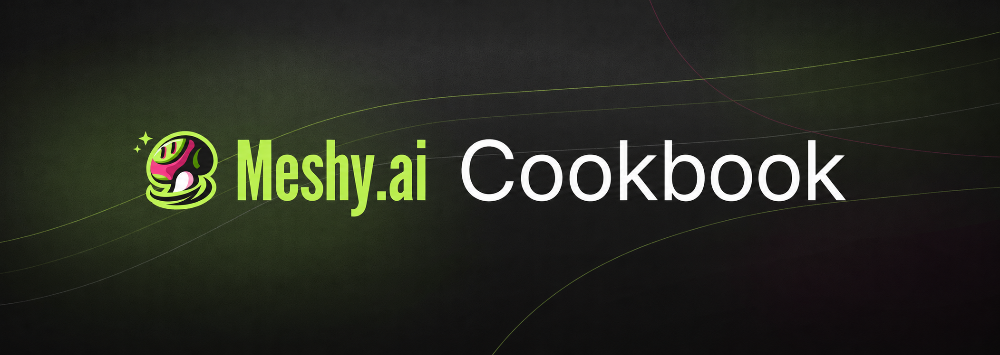

> Browse [Meshy Cookbook](https://www.meshy.ai/developers/cookbook)

Example code and guides for creating 3D assets with the [Meshy API](https://docs.meshy.ai/en/api). To run these examples, you'll need a Meshy account with API access and an API key. [Create your API key](https://www.meshy.ai/developers), then set the `MESHY_API_KEY` environment variable. Alternatively, copy a recipe's `.env.example` to `.env` and add your key there.

Every recipe includes Python and TypeScript implementations. Follow the recipe's README for installation and run commands. Live runs spend Meshy credits; each recipe lists its approximate cost. See [current API pricing](https://docs.meshy.ai/en/api/pricing) for details.

## Agent skills

[`skills/`](skills/) holds four self-contained skills that write Meshy prompts: Text to 3D, Text to Image for Image to 3D, texture and retexture, and Meshy Edit. Each one is built from live A/B tests.

Copy any `skills/<name>` directory into your project's `.claude/skills/` (Claude Code), `.cursor/skills/` (Cursor) or `.agents/skills/` (Codex). See the [skills README](skills/README.md) for examples and installation instructions.

To contribute an example or improve an existing one, see [CONTRIBUTING.md](CONTRIBUTING.md).

## License

MIT. See [LICENSE](LICENSE).
