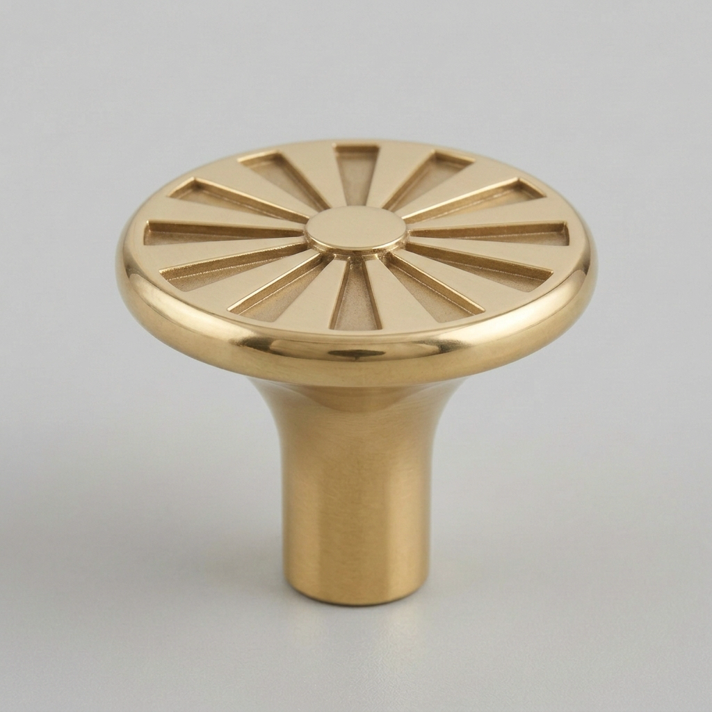
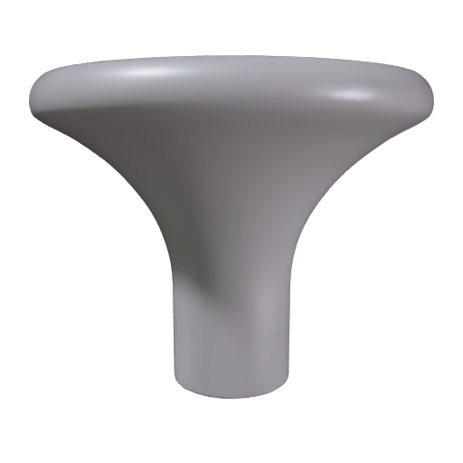
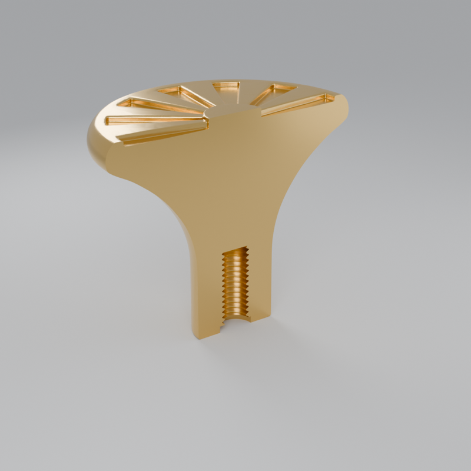
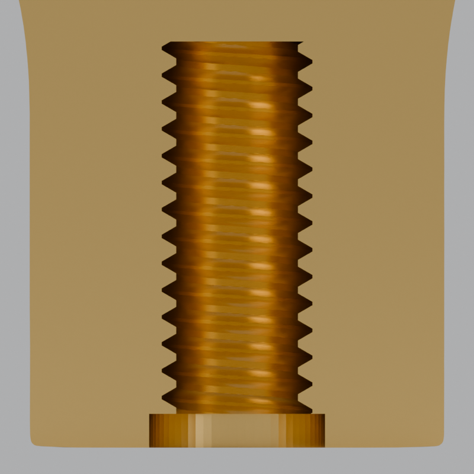

# Make a 3D-printable cabinet knob that fits a real screw

Build the included sunburst knob from one image, size it to exactly 38 mm across, and cut a thread into its stem for a standard 8-32 or M4 cabinet-knob screw. Your coding agent runs the recipe, and this guide explains each step and what to look for.

| The included image | The mesh | The finished knob, cut in half |
|---|---|---|
|  |  |  |

The finished knob is rendered from the actual print file and cut in half to show the thread. [Preview provenance](assets/SOURCES.md).

## What you'll make

The sunburst knob comes back as a file you can print, with a threaded hole in its stem. A standard cabinet-knob screw turns into that hole.

Meshy builds the shape from the picture, but the file it returns has no real size. And a picture can't specify a screw thread to a tenth of a millimetre.

Meshy builds the mesh (the shape, a surface made of many small triangles), and then the recipe's own code runs on your computer. It scales the knob so the cap is exactly 38.00 mm across and cuts the thread into the stem. Last, Meshy's free printability check confirms the file is ready.

The recipe also skips textures, the images that give a model its color, since a printer only uses the shape. You choose the screw: 8-32, the standard in the US and Canada, or M4, the standard in most other countries.

The result is an STL, a file that holds one 3D shape as a list of triangles, in millimetres. Any slicer opens it. A slicer is the program that turns a model into the layer-by-layer instructions a printer follows, and Bambu Studio, PrusaSlicer and OrcaSlicer are free.

To get there, you'll:

1. Give your coding agent the recipe and store your Meshy API key. No credits are spent.
2. Check that the image shows one knob with bold decoration and a stem that flares into the cap.
3. Choose the screw: 8-32 or M4.
4. Start the run and approve the credit cost.
5. Wait about 30 seconds while Meshy builds the mesh.
6. See the recipe size the knob and cut the thread, on your computer, in about a second.
7. See Meshy check the knob for printing, at no cost.
8. Open the knob in your slicer and print a test.

- **Start with:** One PNG or JPEG image of a knob, and the screw size. The sunburst knob shown above is included.
- **Receive:** The print file `knob-8-32.stl` or `knob-M4.stl`, Meshy's original mesh `model.stl`, the printability reports, and a preview image of the mesh.
- **Allow:** about a minute for the whole run, plus time for first-time setup.
- **Budget:** about 20 Meshy credits for the default example, all for the mesh. The thread and the printability check are free.

These are recorded sample costs and timings, not guarantees. Your generated result will vary. [Check current API pricing](https://docs.meshy.ai/en/api/pricing) before you run it.

## Before you start

You need three things. None of them involves writing code.

1. **A Meshy account with API access.** Create an API key in the [Meshy Developer Platform](https://www.meshy.ai/developers/) and [check your credit balance](https://www.meshy.ai/settings/subscription). The default run spends about 20 credits.
2. **A coding agent.** That is an AI assistant such as Claude Code, Codex or Cursor that can open a folder on your computer and run commands for you. It handles installation, runs the recipe, and reports back in plain language.
3. **The example files.** [Download the cookbook files](https://github.com/meshy-dev/meshy-cookbook/archive/refs/heads/main.zip), unzip them, and open the extracted folder in your agent. Or skip the download and ask your agent to clone the [cookbook repository](https://github.com/meshy-dev/meshy-cookbook) for you. Either way, open the folder containing `AGENTS.md`, `examples`, and `shared`, so the agent can see everything it needs.

Optional: install [Bambu Studio](https://bambulab.com/en/download/studio) or [PrusaSlicer](https://www.prusa3d.com/page/prusaslicer_424/) to see the knob on a build plate (the flat surface a printer prints on) and print it. Both are free. Without a slicer, you can still inspect the mesh in your Meshy account, as Step 8 explains.

To finish the knob, you'll also need a filament 3D printer. That's the common kind, which melts a spool of plastic thread (filament) and lays it down in layers. You'll need the screw you choose in Step 3, too.

Keep your API key on your computer. The agent will help you create a local settings file named `.env`. Paste your key into that file yourself, never into chat.

Already comfortable running code? Jump to [Run it](#run-it) for the Python and TypeScript commands, and to [How it works](#how-it-works) for the API calls and the thread cut behind each step.

## Step 1: Give your agent the recipe

With the cookbook folder open in your agent, paste this prompt. It sets everything up without spending any credits: the agent fetches the cookbook if it is not there yet, installs what the recipe needs, and helps you store your key in the local settings file.

```text
If the Meshy cookbook folder is not already open, clone https://github.com/meshy-dev/meshy-cookbook and work inside it. Read AGENTS.md and examples/12-image-to-threaded-knob/README.md. Set up everything this recipe needs, using Python unless my project already uses TypeScript. Help me store MESHY_API_KEY in a local .env file without asking me to paste the key into chat. Do not start any generation yet. When setup is done, explain in plain language what the run will do, stage by stage, and how many credits it will cost.
```

Follow the agent's instructions and paste your key into the settings file yourself. This step is done when the agent confirms the key is in place and quotes a cost of about 20 credits.

## Step 2: Check the image

Meshy builds the whole mesh from a single picture. That picture decides the shape of the knob, even the underside of the cap it barely shows.

The colors don't matter here. A printer prints the shape in whatever filament is loaded.

| The included sunburst knob: one knob, seen from slightly above, with bold grooves on the cap and a plain stem that flares into it |
|---|
|  |

A good input shows:

- one knob, fully in frame, on a plain background
- a three-quarter view from slightly above, so the top of the cap and the stem both show
- bold, shallow decoration on the cap, about 1 mm deep, where every groove and raised shape is at least 1/25 of the cap's width (1 to 1.5 mm on a 38 mm knob)
- a plain, solid stem about a third as wide as the cap, curving smoothly into its underside

A printer nozzle lays lines about 0.4 mm wide, which is why hairline detail disappears. A stem that curves into the cap holds the cap up while it prints, where a wide, flat ledge would need extra material printed under it. And a slot or hole in the stem leaves no room for the screw.

For this walkthrough, keep the included image. [Try your own idea](#try-your-own-idea) covers your own design once you've seen a full run.

## Step 3: Choose the screw

A cabinet knob is held on by a machine screw. It comes through the door from behind and turns into a threaded hole in the knob's stem.

A thread is the spiral ridge on a screw. The hole needs a matching spiral, with the same width and the same pitch. Pitch is the distance the screw moves forward in one full turn. The recipe cuts one of two standard sizes:

| You choose | The screw | Where it is standard | Pitch |
|---|---|---|---|
| `8-32` (the default) | a #8 screw, 4.17 mm across, with 32 threads per inch | the US and Canada | 0.794 mm |
| `M4` | a metric screw, 4 mm across | Europe, the UK and most other countries | 0.7 mm |

The two look almost the same, but they don't fit each other. For example, an M4 screw driven into an 8-32 hole jams after a turn or two, because the pitch differs. Use the size of the screw that came with your cabinet or knob hardware. The package says 8-32 or M4.

The hole is 0.15 mm wider on every side than the screw, so the screw turns in printed plastic without binding. That gap is called the clearance.

One limit to know: this clearance comes from a knob printed in PLA, the most common printing plastic, on a Bambu Lab P1S printer, and that knob took a real 8-32 screw. The M4 hole uses the same clearance but hasn't been tested in a print. Print one knob and try the screw before you print a set.

## Step 4: Start the run and approve the cost

Paste this prompt. The agent quotes the cost and waits for your approval before anything is generated.

```text
Run cookbook 12, the threaded knob recipe, with the included sunburst knob and the 8-32 screw. Tell me the expected credit cost and wait for my approval before generating. While it runs, tell me when each stage finishes and what the printability checks reported. When everything is done, show me where the files were saved.
```

For the M4 screw, paste this one instead:

```text
Run cookbook 12, the threaded knob recipe, with the included sunburst knob and the M4 screw. Tell me the expected credit cost and wait for my approval before generating. While it runs, tell me when each stage finishes and what the printability checks reported. When everything is done, show me where the files were saved.
```

Expect a quote of about 20 credits, all for the mesh. The thread is cut on your computer, and the printability check is free.

Once you approve, the recipe runs three stages back to back and the agent reports each one. The whole run takes a little over a minute, so keep the terminal open and read ahead to see what is happening.

## Step 5: Meshy builds the mesh

This stage takes about 30 seconds. Meshy reads the image and builds a complete mesh, including the underside of the cap and the back of the stem that the picture doesn't show.

The recipe asks for the mesh only, as an STL. No textures are generated. The mesh comes back gray, and the stage costs 20 credits. Expect about 120,000 triangles.

| The untextured knob mesh, exactly as it comes back from Meshy |
|---|
|  |

The recipe saves this picture as `model-thumbnail.png`. It's a side view, which makes it a good place to check the stem. The stem should stand straight, curve smoothly into the cap, and have nothing hanging below the cap's edge. You'll see the top of the cap in Step 8.

You might expect the file to come in millimetres. It doesn't. An STL stores plain numbers without a unit, and this one measures about 1,900 units across. A slicer reads those numbers as millimetres and would show a knob almost two metres wide.

## Step 6: The recipe sizes the knob and cuts the thread

This step runs on your computer, takes about a second and costs nothing. The work is done by Manifold, a free geometry library that cuts and joins 3D shapes. The agent installed it with the rest of the recipe in Step 1.

In order, the recipe:

1. **Closes any gaps.** Meshy occasionally leaves a few broken triangles, where an edge is shared by one triangle or by three instead of exactly two. (A mesh without them is called manifold, which is where the library gets its name.) The recipe removes them and fills each gap, so the mesh is watertight: a closed surface with no gaps. A cut needs that, and so does a slicer, to tell inside from outside. The agent reports how many triangles it replaced. Usually there are none.
2. **Sets the size.** Meshy returns the knob upright, stem down, as in the picture. The recipe scales the whole knob evenly so the cap is exactly 38.00 mm across. It sets the flat end of the stem at height zero, where it will rest on the build plate, and centres the knob on the vertical line the hole will follow. The height follows from the design and varies a little between generations. Expect about 31 to 33 mm for the sunburst knob.
3. **Cuts the hole.** It cuts a screw-shaped hole into the stem: the thread you chose, 0.15 mm wider all round and 12 mm deep. At the opening it adds a short, wider step called a counterbore, 5.2 mm across and 1 mm deep, that guides the screw in.

| The finished knob cut through its stem: the thread runs 12 mm up from the base, with the wider counterbore at the opening |
|---|
|  |

The result is saved as `knob-8-32.stl` or `knob-M4.stl`, in millimetres. Expect a file of about 10 to 11 MB with about 210,000 triangles. Cutting the thread adds about 90,000 triangles.

## Step 7: Meshy checks the knob for printing

This step takes about 30 seconds and costs nothing. The recipe sends the knob to Meshy's printability check twice, once without the hole and once with it.

Meshy measures each file at its real size, for a filament printer. It sums up what it finds in one status: healthy, warning or error. A warning means small problems, like a few non-manifold edges, that a slicer usually repairs when it opens the file.

| Meshy reports | What it means | What you want to see |
|---|---|---|
| Watertight | The surface is closed, with no gaps | Yes |
| Holes | Openings in the surface | 0 |
| Non-manifold edges | Every edge of a mesh should be shared by exactly two triangles. An edge shared by one, or by three, is a spot a slicer cannot interpret | 0 |
| Thin walls | The share of the surface where the plastic is thinner than 1 mm, the least a filament printer prints reliably | 0% without the hole, and about 4 to 5% with it, all from the thread |

Why check twice? The ridges of a screw thread are only about 0.2 mm wide at their tips. The check counts the thread as thin wall, about 4 to 5% of the surface of a 38 mm knob.

The check without the hole tells you whether the knob itself has thin spots. The check with the hole confirms that the cut left a closed, printable file.

Expect both checks to report healthy. The finished file can still read as an error from the thread alone, though. The status turns to error once thin walls reach 5% of the surface, and a knob with less surface gives the same thread a larger share.

That error isn't a reason to change the knob. Those thin walls are the narrow tips of the thread's ridges, and they print and hold a screw. A knob is ready to print when the check without the hole is healthy and the only issue in the finished file is thin walls.

The recipe saves both reports in `printability-8-32.json` or `printability-M4.json`.

## Step 8: Open the knob in your slicer and print a test

When the agent reports that everything is done, the output folder inside the recipe's `python` or `typescript` folder holds five files:

| File | What it is |
|---|---|
| `knob-8-32.stl` or `knob-M4.stl` | The print file: the knob in millimetres with the threaded hole. Open this in your slicer. |
| `model.stl` | Meshy's mesh as it came back, without a real size or a hole. |
| `model-thumbnail.png` | The preview of the mesh from Step 5. |
| `printability-8-32.json` or `printability-M4.json` | The two reports from Step 7. |
| `run.json` | The saved run, so the recipe can cut another thread from the same mesh. |

You don't need to install anything to take a first look. Open the [API console logs](https://www.meshy.ai/api-console/logs) in your Meshy account: every generation made with your key is listed there, and you can rotate the mesh in the browser and see the sunburst on top of the cap. The console shows Meshy's mesh, before the recipe sized it and cut the hole.

To see the finished knob, open it in your slicer. In Bambu Studio, choose **File → Import → Import 3MF/STL/STEP/SVG/OBJ/AMF** and pick the knob file. PrusaSlicer and OrcaSlicer open the same file through their File → Import menu. Or ask your agent:

```text
Help me open the knob STL in output/ in a slicer. If Bambu Studio or PrusaSlicer is installed, open the file there so I can see the knob on the build plate. Otherwise help me install one of them, or open the file in Blender, the free 3D program, so I can look at the threaded hole from below.
```

Check four things before you print:

- **The orientation.** The knob arrives standing on the flat end of its stem, with the hole facing the build plate. Keep it that way. The curve of the stem holds the cap up, so the knob prints without supports. Those are the extra material a slicer adds under overhanging parts, which you break off afterwards.
- **The size.** The slicer should show the knob 38 mm across. Don't scale it. Scaling changes the thread too, and the screw won't fit.
- **Supports.** Leave them off. If you turn them on for another design, right-click the knob in Bambu Studio, choose **Add support blocker**, and place the shape over the hole. That keeps support out of the thread.
- **The layer height.** Choose 0.12 mm layers. Each turn of the thread then gets about six layers. In Bambu Studio, that's the 0.12mm Fine process preset. Thicker layers blur the thread.

Then print one knob, let it cool, and turn the screw in by hand. If it binds, ask your agent to raise the clearance in the recipe from 0.15 mm to 0.2 mm and cut the thread again. Resuming the saved run reuses the mesh, and a new thread costs nothing.

The hole is 12 mm deep. Check that the screw sticks out of the door by less than that.

What comes next depends on what you want:

- **The other screw size:** ask your agent to resume the saved run with the other screw. It writes a second knob file next to the first and spends no credits.
- **Your own knob design:** see [Try your own idea](#try-your-own-idea). The [concept image recipe](../03-text-to-hero-prop/) shows how to make a picture like the sunburst knob from a description.
- **Other prints:** the [printable parts recipe](../10-image-to-printable-parts/) cuts a figure into parts that each stand on a flat cut face. The [multi-color print recipe](../11-image-to-multi-color-print/) turns a textured model into a file for a printer that holds several filaments.

## Try your own idea

Choose a PNG or JPEG that passes the checks in [Step 2](#step-2-check-the-image): one knob, seen from slightly above, with bold, shallow decoration and a plain stem that curves into the cap. Attach it to your agent or tell it where the file is, then paste this prompt.

```text
Use my image for cookbook 12. Ask me whether my screw is 8-32 or M4. Archive any previous output first. Check the image and tell me about anything that could give a poor mesh or a knob that prints badly before spending credits. Explain the expected credit cost and wait for my approval before starting a new generation.
```

The prompt archives old output because the recipe keeps its saved run in the output folder and won't start a new paid run on top of it. Save a copy of your first result before generating another version. A new image means a new paid generation. A new screw or clearance on the saved run doesn't.

## If something goes wrong

- **The key is missing or rejected:** ask your agent to check that the local `.env` file is in the recipe's `python` or `typescript` folder, whichever it set up, and contains `MESHY_API_KEY`. Do not paste the key into chat.
- **The run cannot start:** check API access and available credits in your Meshy account, and ask the agent to explain the error before retrying.
- **Progress stops or a download fails:** ask your agent to resume the saved run. The recipe records the ID of Meshy's mesh request as soon as Meshy accepts it, so the mesh isn't paid for twice. The thread cut and the free checks simply run again. If the agent can't tell whether a request went through, check the [API console logs](https://www.meshy.ai/api-console/logs) before continuing.
- **The recipe reports that `model.stl` is not watertight:** the mesh still has gaps after the recipe tried to close them. Check the image against [Step 2](#step-2-check-the-image) with your agent, archive the output folder, and generate the mesh again.
- **The check reports thin walls without the hole:** the design itself has parts thinner than 1 mm at 38 mm across, usually fine decoration or a thin rim. Choose a bolder image, as [Step 2](#step-2-check-the-image) describes.
- **The screw doesn't fit:** check that it's the size you chose, that the slicer didn't scale the knob, and that no support printed inside the hole. If the screw is right but tight, raise the clearance as Step 8 describes.
- **The result looks different from the example:** each generation can vary. Check the image against [Step 2](#step-2-check-the-image) with your agent before paying for another run.

## Technical details

**Endpoints:** `POST /openapi/v1/image-to-3d` → `GET /openapi/v1/image-to-3d/:id`, then `POST /openapi/v1/print/analyze` → `GET /openapi/v1/print/analyze/:id`, twice\
**Languages:** Python 3.10+ · TypeScript (Node 22+)\
**Source:** [Python](python/main.py) · [TypeScript](typescript/main.ts)\
**Last verified run measurements:** October 12, 2026 · [Sample result](sample-result.json)

Image to 3D builds the mesh, and the recipe's own code does what the API does not: it gives the mesh a real size and cuts a thread to a tenth of a millimetre. The geometry runs on [Manifold](https://github.com/elalish/manifold), a solid-geometry library with the same API in Python (`manifold3d`) and TypeScript (`manifold-3d`), so both entrypoints produce the same knob. The Analyze Printability endpoint then checks the file you will print, uploaded at its real size as a data URI of a GLB, the binary form of glTF, the standard 3D format for the web, and consumes no credits. Live runs need a Meshy plan with API access (Pro, Premium, Ultra, Studio, or Enterprise) and about 20 credits.

## Run it

Complete [Before you start](#before-you-start) to configure API access and your key. Review the estimated budget above before running.

Clone once, then choose one language and run its commands from the repository root:

    git clone https://github.com/meshy-dev/meshy-cookbook.git
    cd meshy-cookbook

**Python**

    cd examples/12-image-to-threaded-knob/python
    python3 -m venv .venv && source .venv/bin/activate
    cp .env.example .env          # paste your key
    pip install -r requirements.txt
    python main.py

**TypeScript**

    cd examples/12-image-to-threaded-knob/typescript
    cp .env.example .env          # paste your key
    npm install
    npm start

You get `output/knob-8-32.stl` in millimetres, Meshy's raw mesh at `output/model.stl`, both printability reports at `output/printability-8-32.json`, and a 512 px preview at `output/model-thumbnail.png`. Open the knob STL in your slicer.

The first argument is the screw, `8-32` (the default) or `M4`, in upper or lower case. To use your own image, pass it after the screw:

    python main.py M4
    python main.py 8-32 my-knob.png
    npm start -- M4
    npm start -- 8-32 my-knob.png

### Resume an interrupted run

The script saves the image path, the screw and the model task ID in `output/run.json`. If a poll, download or check is interrupted, continue the same run from the same language directory:

    python main.py --resume
    npm start -- --resume

Resume reuses the saved model task: it downloads the mesh again, cuts the thread and runs both checks, all of which are free. Only a run that has not created its model task yet spends credits. Resume before the model task expires: Meshy keeps a finished task for three days on plans other than Enterprise.

The thread is cut locally, so a resume may change the screw. This writes `knob-M4.stl` and `printability-M4.json` next to the 8-32 files and spends no credits:

    python main.py --resume M4
    npm start -- --resume M4

The same goes for the constants at the top of `main.py` and `main.ts`: change `CAP_DIAMETER_MM`, `CLEARANCE_MM` or `HOLE_DEPTH_MM` and run with `--resume` to cut the knob again from the same mesh.

A normal run refuses to start when `output/run.json` already exists. To build another image, archive the current `output/` directory first. Passing a different image with `--resume` is rejected.

If execution stops while the model request is in flight, the checkpoint, `output/run.json`, may contain a `creating` marker without a task ID. The script stops rather than risk a duplicate charge. Check the [API console logs](https://www.meshy.ai/api-console/logs) for the submitted request; if it exists, put its ID in `model_task_id` and set `creating` to `null` before resuming. If no task was created, clear the marker only after confirming that. The checkpoint contains no API key or signed download URLs.

## How it works

The excerpts below show the Python runner. The full [Python](python/main.py) and [TypeScript](typescript/main.ts) sources also checkpoint the model task, read and write binary STL, and build the GLB for the check.

1. **Build the mesh.** `client.create` POSTs the image to `/openapi/v1/image-to-3d` with `should_texture` off and STL as the only format.

```python
model_id = client.create(
    "image-to-3d",
    {
        "image_url": image_url,
        "should_texture": False,
        "target_formats": ["stl"],
    },
)
```

   A printer uses only the shape, so the mesh-only request costs 20 credits instead of 30.

2. **Wait for it and download it.** `client.wait` GETs `/openapi/v1/image-to-3d/:id` until the mesh is ready.

```python
model = client.wait("image-to-3d", model_id, label="model")
client.download(model["model_urls"]["stl"], output / "model.stl")
client.download(model["thumbnail_url"], output / "model-thumbnail.png")
```

3. **Make it a closed solid and set its size.** `close_gaps` removes the triangles on any edge not shared by exactly two triangles and fills each gap with a fan of new triangles that meet at the gap's centre; Manifold then refuses anything that is still not a closed solid. The STL from Image to 3D has no unit (its longest side is about 1,903), so the cap's width sets the scale.

```python
vertices, triangles, replaced = close_gaps(*read_stl(output / "model.stl"))
solid = Manifold(Mesh(vert_properties=vertices, tri_verts=triangles))
solid = max(solid.decompose(), key=lambda piece: piece.volume())  # drop any loose fragments
x0, y0, z0, x1, y1, z1 = solid.bounding_box()
scale = CAP_DIAMETER_MM / max(x1 - x0, y1 - y0)  # the file has no units, so the cap sets the size
knob = solid.translate((-(x0 + x1) / 2, -(y0 + y1) / 2, -z0)).scale((scale, scale, scale))
```

4. **Cut the thread.** A standard screw thread is a V-shaped ridge whose two sides meet at 60 degrees, with flat tips, wound around the screw once per pitch. `thread_cutter` turns one pitch of that profile into a flat outline: going once around the axis, the outline's distance from the centre follows the ridge's shape from its root, the bottom of the groove, to its tip and back. Extruding that outline 12 mm while it twists one full turn per pitch, sweeps out a right-handed helix in 32 straight steps per turn (a smoothness setting, unrelated to the 32 in 8-32), widened by the clearance. A cylinder adds the counterbore, and Manifold subtracts both from the knob. `state["screw"]` is the screw from the command line, `8-32` or `M4`.

```python
thread = Manifold.extrude(CrossSection([points]), length, round(turns * 32), 360 * turns)  # one turn per pitch
finished = knob - thread_cutter(state["screw"])
```

5. **Check printability, with and without the hole.** `client.create` POSTs each version to `/openapi/v1/print/analyze` as a GLB data URI, with the printer type and the real height so the check measures wall thickness at print size. `part` is first the knob without the hole, then the finished knob.

```python
check_id = client.create(
    "print/analyze",
    {
        "model_url": glb_data_uri(part),
        "printer_type": "fdm",
        "intended_print_height_mm": height,
    },
)
report = client.wait("print/analyze", check_id, label="check")["printability"]
```

   The endpoint accepts STL by `https` URL, but rejects an STL data URI with `400 Only data:model/gltf-binary or data:model/gltf+json URLs are accepted on the model_url branch` (checked October 12, 2026), so `glb_data_uri` writes a minimal GLB: positions and triangle indices only, with height along the Y axis as glTF expects. The STL has height along Z, and a GLB written that way is measured lying on its side. The check rounds the print size to whole millimetres, so the size it reports can differ from the file's by a fraction of a millimetre.

## What you get

These are measurements of the two recorded sample runs, one per language, on October 12, 2026. The Python run's files are pictured above.

| File | Contents |
|---|---|
| `knob-8-32.stl` | One closed solid in millimetres, 38.00 × 38.00 mm across the cap and 31.12–32.73 mm tall, standing on Z = 0; 208,746–211,810 triangles, 10.4–10.6 MB. Measured on horizontal slices, the hole's radius runs from 1.795 mm at the tips of the plastic ridges to 2.232 mm between them, against a modelled 1.804–2.233, with a 0.794 mm pitch, right-handed, 12 mm deep, under a 5.2 × 1.0 mm counterbore, with at least 4.0 mm of plastic around it |
| `knob-M4.stl` | The same knob with the M4 thread, cut on resume from the same mesh: 220,074–223,138 triangles, 11.0–11.2 MB, radius 1.763–2.148 mm, measured the same way, against 1.771–2.150, 0.700 mm pitch |
| `model.stl` | Meshy's mesh as delivered: one closed solid, Z-up, about 1,903 units on its longest side; 122,642–125,700 triangles, 6.1–6.3 MB. Neither run needed its gaps closed |
| `printability-8-32.json`, `printability-M4.json` | Both checks `healthy`, watertight, 0 holes, 0 non-manifold edges, 0 degenerate faces (triangles with almost no area); thin walls 0% without the hole and 4.1–4.3% with either thread |
| `model-thumbnail.png` | 512 × 512 side view of the mesh |

The model stage generated in 29–34 seconds, the thread cut took about a second, and each check took 12–13 seconds of processing; each language's run finished in 68–71 seconds from start to files on disk, and a resume with the other screw in 33–35 seconds. Before these runs, the same code was tested offline on 30 other knob meshes that Image to 3D built with Meshy 7.1, the API's default model in October 2026: 11 had one small cluster of broken edges (1–8 edges with only one triangle, 2–16 edges shared by more than two), which `close_gaps` repaired in every case by replacing 5 to 66 triangles. On a 38 mm knob an 8-32 thread alone reads as about 4–5.6% thin walls, depending on the design, and the check reports `error` at about 5% (4.9% was healthy, 5.0% an error), so a finished knob can read as an error while its copy without the hole is healthy.

## Parameters worth changing

| Parameter | We use | Why |
|---|---|---|
| [`should_texture`](https://docs.meshy.ai/en/api/image-to-3d#create-an-image-to-3d-task) (image-to-3d) | `false` | A printer prints the shape in whatever filament is loaded, so the mesh-only request saves 10 credits |
| [`target_formats`](https://docs.meshy.ai/en/api/image-to-3d#create-an-image-to-3d-task) | `["stl"]` | The recipe reads the STL and writes its own. It could read a GLB instead; an STL is Z-up, a GLB Y-up |
| [`geometry_resolution`](https://docs.meshy.ai/en/api/image-to-3d#create-an-image-to-3d-task) | omitted (`standard`) | `"2k"` builds a denser mesh for fine decoration, for 5 more credits |
| [`printer_type`](https://docs.meshy.ai/en/api/analyze-printability#create-an-analyze-printability-task) | `"fdm"` | Sets the minimum wall: 1.0 mm for `fdm` (filament), 0.8 mm for `sla` (resin), 2.0 mm for `full_color` |
| [`intended_print_height_mm`](https://docs.meshy.ai/en/api/analyze-printability#create-an-analyze-printability-task) | the knob's height | GLB input only, 1 to 1000. `intended_print_longest_side_mm` works with every format; send one of the two |
| [`SCREWS`](python/main.py) | `8-32`: 4.166 mm, 25.4/32 mm pitch; `M4`: 4.0 mm, 0.7 mm pitch | Add any 60-degree screw by its outside diameter and pitch, for example `"M3": (3.0, 0.5)` |
| [`CLEARANCE_MM`](python/main.py) | `0.15` | Added to every radius of the hole. 0.15 mm took a real 8-32 screw in a PLA print from a Bambu Lab P1S; raise it if the screw binds. Resin prints usually need less |
| [`CAP_DIAMETER_MM`](python/main.py) | `38.0` | The width of the cap; the knob is scaled evenly to it |
| [`HOLE_DEPTH_MM`, `COUNTERBORE_MM`](python/main.py) | `12.0`; 5.2 × 1.0 mm | Depth of the thread, and the diameter and depth of the step at the opening |

`ai_model` is omitted on the model stage, so it follows the API's current default; the printability endpoint has no model selection. The [Meshy CLI](https://github.com/meshy-dev/meshy-cli), a command-line tool, and the [Meshy MCP server](https://github.com/meshy-dev/meshy-mcp-server), which gives coding agents Meshy tools, can make the same Image to 3D request, but on October 12, 2026 neither could send this recipe's printability check: the CLI uploads a local STL as an STL data URI, which the endpoint rejects, and the MCP server's check accepts neither a local file nor a printer type and print size.
