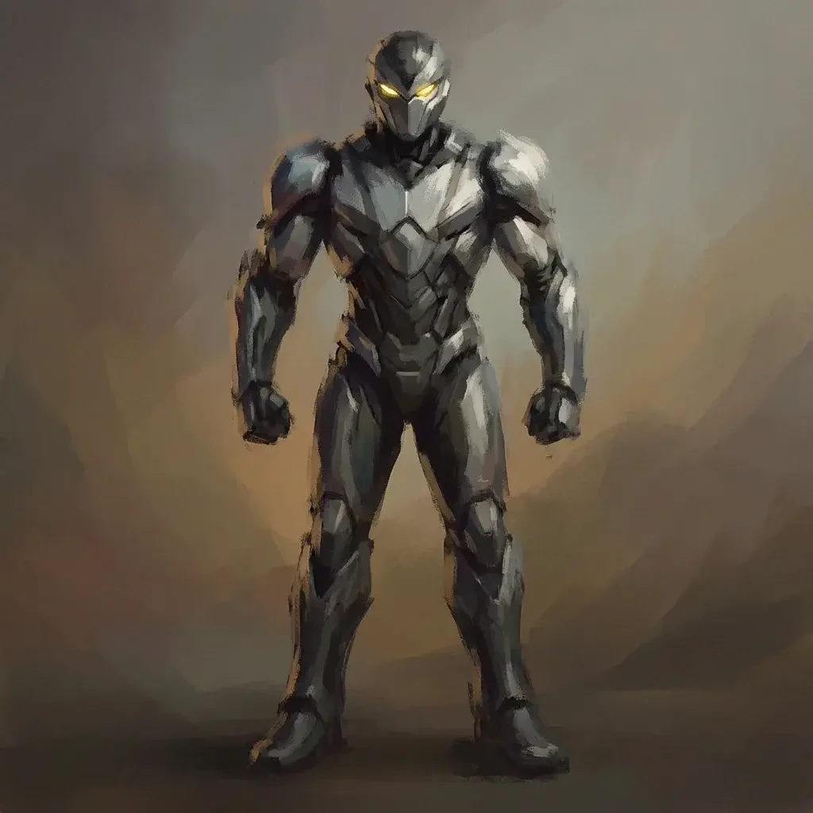
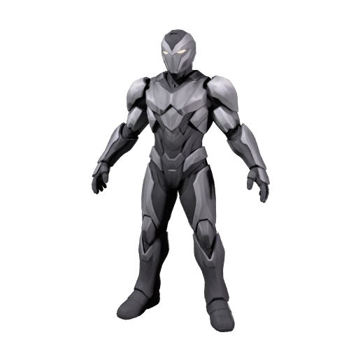
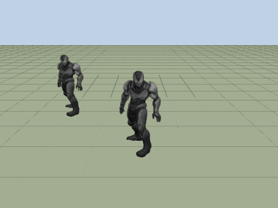

# Play an animated 3D character in a three.js game

Turn one character image into a rigged 3D character with an idle, a run and an attack clip, shrink the file for the web, and play it in a three.js page where the keyboard steers it. Your coding agent runs the recipe, and this guide explains what happens at each step and what to look for.

| Concept art | Generated model | In the three.js page |
|---|---|---|
|  |  |  |

The page plays a real result, rendered by three.js: **3.8 MB shrunk to 0.6 MB**, with the idle, run and attack clips in one file. [Preview provenance](assets/SOURCES.md).

## What you'll make

The armored character comes back as one small file that a browser game can load: rigged, animated with an idle, a run and an attack, and compressed from about 3.8 MB to about 0.6 MB. A web page plays it with three.js, a JavaScript library that draws 3D scenes in the browser. Hold W, A, S, D or an arrow key and the character runs where you steer; press Space and it attacks.

To move, a character needs a rig: a skeleton of joints inside the mesh, the shape made of triangles, each joint moving the part of the mesh around it, plus skin weights, which tell every corner point of the mesh which joints move it and by how much. An animation clip is a short recorded motion of every joint. The file is a GLB, which packages the mesh, its texture, the skeleton and the clips together, and three.js loads it directly.

The page builds into plain static files that any web host can serve. Meshy runs only while you make the character. The finished page loads the file and never calls the Meshy API, so your API key never reaches the browser.

To get there, you'll:

1. Give your coding agent the recipe and store your Meshy API key. No credits are spent.
2. Choose clips the game can steer.
3. Start the run and approve the credit cost.
4. Wait about two and a half minutes while Meshy builds, rigs and animates the character.
5. Shrink the file for the web.
6. Play it in the browser and build the static files.

- **Start with:** One PNG or JPEG of a standing humanoid character, plus the ids of an idle, a run and an attack from the animation library. The armored character shown above is included, and the recipe picks Idle, Run Fast 10 (in place) and Attack.
- **Receive:** `animated-character.glb` with the three clips, `character.glb`, the same character shrunk for the web, a three.js page that plays it, and a preview image.
- **Allow:** about two and a half minutes for generation, plus time for first-time setup.
- **Budget:** about 44 Meshy credits for the default example: 30 to build the model, 5 to rig it and 9 for the three clips.

These are recorded sample costs and timings, not guarantees. Your generated result will vary. [Check current API pricing](https://docs.meshy.ai/en/api/pricing) before you run it.

## Before you start

You need three things. None of them involves writing code.

1. **A Meshy account with API access.** Create an API key in the [Meshy Developer Platform](https://www.meshy.ai/developers/) and [check your credit balance](https://www.meshy.ai/settings/subscription). The default run spends about 44 credits.
2. **A coding agent.** That is an AI assistant such as Claude Code, Codex or Cursor that can open a folder on your computer and run commands for you. It handles installation, runs the recipe, and reports back in plain language.
3. **The example files.** [Download the cookbook files](https://github.com/meshy-dev/meshy-cookbook/archive/refs/heads/main.zip), unzip them, and open the extracted folder in your agent. Or skip the download and ask your agent to clone the [cookbook repository](https://github.com/meshy-dev/meshy-cookbook) for you. Either way, open the folder containing `AGENTS.md`, `examples`, and `shared`, so the agent can see everything it needs.

The page runs in any current desktop browser. It is built with Node.js 22.12 or newer, even when the rest of the recipe runs in Python, and your agent installs or updates it if needed.

Keep your API key on your computer. The agent will help you create a local settings file named `.env`. Paste your key into that file yourself, never into chat.

Already comfortable running code? Jump to [Run it](#run-it) for the Python, TypeScript and page commands, and to [How it works](#how-it-works) for the API calls and the page code behind each step.

## Step 1: Give your agent the recipe

With the cookbook folder open in your agent, paste this prompt. It sets everything up without spending any credits: the agent fetches the cookbook if it is not there yet, installs what the recipe needs, and helps you store your key in the local settings file.

```text
If the Meshy cookbook folder is not already open, clone https://github.com/meshy-dev/meshy-cookbook and work inside it. Read AGENTS.md and examples/13-image-to-threejs-character/README.md. Set up everything this recipe needs, including the three.js page in its web folder, using Python unless my project already uses TypeScript. Help me store MESHY_API_KEY in a local .env file without asking me to paste the key into chat. Do not start any generation yet. When setup is done, explain in plain language what the run will do, stage by stage, and how many credits it will cost.
```

Follow the agent's instructions and paste your key into the settings file yourself. This step is done when the agent confirms the key is in place and quotes a cost of about 44 credits.

## Step 2: Choose clips the game can steer

Meshy's animation library is a catalog of motions recorded for a humanoid skeleton. Each one has a number, its action id, and the recipe names the actions it wants by id. In a game, the code decides where the character goes, and the clip only moves the arms and legs. Many motions in the library come in two versions: one that carries the body forward as it plays, and an in-place one that keeps the body over the same spot, with `inplace` at the end of its library key.

A game needs the in-place run. The page moves the character at a steady speed and the clip makes the legs keep pace. A run that carries the body forward adds its own movement on top, and the character jumps back to its starting spot every time the clip repeats.

The recipe uses three actions, in this order:

| Action | Library id | Clip in the file | What the page does with it |
|---|---|---|---|
| Idle | `0` | `Idle`, 4.0 seconds | Plays while no key is held |
| Run Fast 10, in place | `657` | `run_fast_10_inplace`, 0.8 seconds | Repeats while a movement key is held, as the page moves the character |
| Attack | `4` | `Attack`, 2.8 seconds | Plays once on Space, then the page goes back to the idle |

The order matters: the page takes the first clip as the idle, the second as the run and the third as the attack.

Browse the [Animation Library](https://docs.meshy.ai/en/api/animation-library) to see a looping preview of every action. An in-place action shows the same preview as its moving version, so check the key, not the picture. Or ask your agent to list the in-place actions. Listing the library is free; only applying an action costs credits.

```text
Without spending any credits, show me the in-place actions in Meshy's animation library for cookbook 13. Call GET https://api.meshy.ai/openapi/v1/animations/library with the key from my local .env file and search=inplace, and show me the action ids, names and keys of the runs and walks it returns as a short table. Then confirm the three actions the recipe uses by default: Idle (0), Run Fast 10 in place (657) and Attack (4).
```

Every action costs 3 credits, whatever the length of its clip. For this walkthrough, keep the default three. [Try your own idea](#try-your-own-idea) covers choosing other actions once you have seen a full run.

## Step 3: Start the run and approve the cost

Paste this prompt. The agent quotes the cost and waits for your approval before anything is generated.

```text
Run cookbook 13, the three.js character recipe, with the included armored character and the default actions. Tell me the expected credit cost and wait for my approval before generating. While it runs, tell me when each stage finishes. When everything is done, show me where the files were saved.
```

Expect a quote of about 30 credits to build the model, 5 to rig it and 9 for the three clips. Once you approve, the recipe runs three stages back to back and the agent reports progress. The whole run takes about two and a half minutes, so keep the terminal open and read ahead to see what is happening.

## Step 4: Meshy builds, rigs and animates the character

This stage takes about two and a half minutes and repeats the three stages of the [animated character recipe](../09-image-to-animated-character/), with two settings changed for the web.

- **Build the model.** About two minutes. Meshy reads the image and builds a complete mesh from it, including the back and sides the picture does not show. The recipe asks for an A-pose, with the arms angled down and away from the body, so the rigger can find shoulders, elbows and hands. It simplifies the mesh to about 15,000 triangles, the flat polygons a mesh is made of, half of what cookbook 09 uses, because a browser draws every triangle of every model on every frame. It generates only the base color texture, the image that gives the mesh its colors. The animated file keeps only that texture, so the PBR maps cookbook 09 asks for, which tell a viewer how the surface reflects light, would be dropped anyway.
- **Rig it.** About ten seconds. Meshy places a skeleton of 24 joints inside the mesh, computes the skin weights, and scales the character to 1.8 meters tall.
- **Add the clips.** About ten seconds. Meshy fits each of the three motions onto your character's skeleton, which is called retargeting, and saves them as three named clips in one GLB, in the order you chose.

| The model before rigging, in its A-pose |
|---|
|  |

As soon as the model is built, the recipe saves this preview as `character-thumbnail.png` in the output folder, and you can open it while the next stages run. Check that the proportions match the drawing and that the arms and legs are distinct from the body: the rigger needs a clear body to place the joints.

## Step 5: Shrink the file for the web

The downloaded `animated-character.glb` is about 3.8 MB. Most of that is the base color texture, a 2,048 × 2,048 pixel JPEG of about 2.4 MB. A browser game downloads every model before the player can start, so this step makes the file about six times smaller without changing the mesh, the skeleton or the clips. It runs on your computer and costs no credits.

```text
In examples/13-image-to-threejs-character/web, run npm run optimize on the animated character the recipe downloaded. Tell me the file size before and after, and where the new file was saved.
```

The script, `web/optimize.mjs`, does three things:

1. **Shrinks the texture.** It saves the texture as WebP, an image format every current browser opens, at 1,024 × 1,024 pixels. That is a quarter of the pixels, and about 80 KB instead of 2.4 MB.
2. **Compresses the mesh and the clips.** It uses meshopt, a compression format for 3D data that three.js decodes as the file loads. It stores the positions, normals and texture coordinates with fewer bits, then packs all the data, keyframes included, so it compresses well.
3. **Drops what the file doesn't need.** Keyframes that the frames around them already describe, and anything nothing in the scene uses.

| | The download | For the web |
|---|---|---|
| File | `animated-character.glb` | `character.glb` |
| Size | about 3.8 MB | about 0.6 MB |
| Base color texture | 2,048 px JPEG, about 2.4 MB | 1,024 px WebP, about 80 KB |
| Triangles, joints, clips | about 15,500, 24, three | the same |

The new file goes to `web/public/models/character.glb`, where the page loads it. Keep `animated-character.glb` as well: it is the copy to bring into Blender or a game engine.

## Step 6: Play it in the browser and build the static files

When the agent reports that everything is done, the recipe has written three files:

| File | What it is |
|---|---|
| `output/animated-character.glb` | The character with its skeleton and the three clips, as Meshy made it. The output folder is inside the recipe's `python` or `typescript` folder. |
| `output/character-thumbnail.png` | The preview from Step 4, before rigging. |
| `web/public/models/character.glb` | The same character shrunk for the web. The page loads this one. |

You don't need to install anything to take a first look. Open the [API console logs](https://www.meshy.ai/api-console/logs) in your Meshy account: every generation made with your key is listed there, and you can play the animation in the browser. To play the character in the three.js page, ask your agent:

```text
Start the three.js page for cookbook 13: run npm run dev in examples/13-image-to-threejs-character/web and give me the local address to open in my browser.
```

Open the address and click the page. Hold W, A, S, D or an arrow key: the character turns toward that direction and runs. Let go and it stands idle. Press Space and it attacks once, then returns to the idle. A second copy stands behind the start position and keeps idling on its own.

Watch the feet while the character runs: they should stay planted on the grid instead of sliding. Watch the change from run to idle: the page blends the clips over 0.2 seconds, so the body should not snap from one pose to the other.

The page does four things a browser game needs to play a Meshy character:

- **It decodes meshopt.** The loader gets the meshopt decoder. Without it, `character.glb` doesn't load.
- **It moves the character in code.** The run clip is in place, and the page moves the character 2.2 meters per second, the speed at which the clip's feet push back on the ground, so they don't slide.
- **It copies the character with `SkeletonUtils.clone`.** The second copy needs its own skeleton. A plain copy keeps using the first character's skeleton and can't play clips of its own. Use the same call to place enemies or other players.
- **It picks clips by position.** The first clip is the idle, the second the run, the third the attack, whatever their names.

To get files you can upload to a static web host or a game jam, paste this prompt:

```text
Build the three.js page for cookbook 13 as static files: run npm run build in examples/13-image-to-threejs-character/web, then serve the dist folder with npm run preview and give me the address. List the files in dist with their sizes.
```

The `web/dist` folder holds `index.html`, one JavaScript file with three.js and the page code, and `models/character.glb`, about 1.2 MB in total. Open the preview address in a private browser window to test it the way a new visitor sees it. No file in `dist` contains your API key.

## Try your own idea

Choose actions that pass the checks in [Step 2](#step-2-choose-clips-the-game-can-steer): three ids from the [Animation Library](https://docs.meshy.ai/en/api/animation-library), an idle, a run whose key ends in `inplace` and an attack, none repeated. Then paste this prompt with the ids you picked; the example below swaps in a second idle, another in-place run and an axe swing.

```text
Run cookbook 13 again with actions 243, 658 and 238, which are Idle 3, Run Fast 2 in place and Axe Spin Attack, on the included armored character. Archive any previous output first. Explain the expected credit cost and wait for my approval before starting a new generation. When it is done, shrink the file for the web and start the page.
```

A different run clip moves its feet at a different speed. If the feet slide, ask your agent to change `RUN_SPEED` in `web/main.js` until they stay planted.

To use your own character instead, choose a PNG or JPEG that shows one humanoid, standing upright and facing the camera, with arms and legs clear of the body, as the [rigged character recipe](../05-image-to-rigged-character/) describes. Attach it to your agent or tell it where the file is, then paste this prompt.

```text
Use my image for cookbook 13 with the default actions. Archive any previous output first. Check that the image shows one standing humanoid character facing forward, and tell me about anything that could cause rigging problems before spending credits. Explain the expected credit cost and wait for my approval before generating.
```

Save a copy of your first result before generating another version. Every new run builds and rigs the character again before animating it, so a new set of actions costs the full amount, not just the clips.

## If something goes wrong

- **The key is missing or rejected:** ask your agent to check that the local `.env` file is in the language folder and contains `MESHY_API_KEY`. Do not paste the key into chat.
- **The run cannot start:** check API access and available credits in your Meshy account, and ask the agent to explain the error before retrying.
- **Progress stops or a download fails:** ask your agent to resume the saved run. The recipe records each stage as it finishes, so a model that was already built or rigged is not paid for twice. If the agent reports that it cannot tell whether a request went through, have it check Meshy's task history before continuing.
- **Rigging fails:** the rigging stage needs a textured, standing humanoid. Ask your agent to read the error message with you and check the image against the [rigged character recipe](../05-image-to-rigged-character/) before paying for another model.
- **The animation stage fails:** an id that is not in the library is rejected before any credits are spent. Check each id in the [Animation Library](https://docs.meshy.ai/en/api/animation-library), then ask your agent to correct `actions` in `output/run.json` and resume the run. The saved model and rig are reused, so only the clips are paid for.
- **The page stays empty:** the page loads `web/public/models/character.glb`. Ask your agent to check that `npm run optimize` saved it, and to read the error in the browser's developer console.
- **The character jumps back while it runs:** the run clip carries the body forward. Choose a run whose key ends in `inplace`, as [Step 2](#step-2-choose-clips-the-game-can-steer) explains.

## Technical details

**Endpoints:** `POST /openapi/v1/image-to-3d` → `GET /openapi/v1/image-to-3d/:id`, then `POST /openapi/v1/rigging` → `GET /openapi/v1/rigging/:id`, then `POST /openapi/v1/animations` → `GET /openapi/v1/animations/:id`\
**Languages:** Python 3.10+ · TypeScript (Node 22+) · the page: JavaScript with three.js 0.186 and Vite 8 (Node 22.12+)\
**Source:** [Python](python/main.py) · [TypeScript](typescript/main.ts) · [Page](web/main.js) · [Shrink script](web/optimize.mjs)\
**Last verified run measurements:** October 19, 2026 · [Sample result](sample-result.json)

The API side is the three stages of the [animated character recipe](../09-image-to-animated-character/) with 15,000 faces, no PBR maps and an in-place run, chained with `input_task_id` and `rig_task_id`. What this recipe adds runs locally and costs nothing: `web/optimize.mjs` compresses the GLB with glTF Transform, and `web/main.js` plays it with three.js. Meshy is called only while the asset is made. The page loads a static file and holds no API key. The signed URLs in a task's results expire, so a game downloads the file at build time and never links to them.

## Run it

Complete [Before you start](#before-you-start) to configure API access and your key. Review the estimated budget above before running.

Clone once, then choose one language and run its commands from the repository root:

    git clone https://github.com/meshy-dev/meshy-cookbook.git
    cd meshy-cookbook

**Python**

    cd examples/13-image-to-threejs-character/python
    python3 -m venv .venv && source .venv/bin/activate
    cp .env.example .env          # paste your key
    pip install -r requirements.txt
    python main.py

**TypeScript**

    cd examples/13-image-to-threejs-character/typescript
    cp .env.example .env          # paste your key
    npm install
    npm start

You get `output/animated-character.glb` with the three clips and a 512 px preview of the unrigged model at `output/character-thumbnail.png`.

**The page** (after either language)

    cd examples/13-image-to-threejs-character/web
    npm install
    npm run optimize      # newest output/animated-character.glb → public/models/character.glb
    npm run dev           # play it at the address Vite prints
    npm run build         # static files in dist/
    npm run preview       # serve dist/ the way a static host does

`npm run optimize` picks the newest `animated-character.glb` from the `python` and `typescript` output folders; `npm run optimize -- path/to/file.glb` shrinks a file you name instead.

To choose other actions, pass three library ids: the idle, the run, then the attack. To animate a different character, add its image after the ids:

    python main.py 243 658 238
    npm start -- 243 658 238
    python main.py 243 658 238 my-character.png
    npm start -- 243 658 238 my-character.png

Exactly three ids, none repeated, 3 credits each. An image on its own keeps the default actions.

### Resume an interrupted run

The script saves the image path, the action ids and the task IDs in `output/run.json`. If a poll, download or a later stage is interrupted, continue the same run from the same language directory:

    python main.py --resume
    npm start -- --resume

Resume reuses saved tasks and creates only stages that have not started. Starting the rigging stage still costs its 5 credits and the animation stage its 3 credits per action. If the animation task is already saved, resume retrieves it directly and reports animation credits only. Resume before the results expire; the recorded retention period is three days outside Enterprise.

A normal run refuses to start when `output/run.json` already exists. To animate another character, archive the current `output/` directory first. Passing a different image or different action ids with `--resume` is rejected.

To apply a different set of actions to a character you already rigged, edit `output/run.json`: replace `actions` with three new ids and set `animation_task_id` to `null`, then run with `--resume` and no arguments. Only the animation stage is created, for 3 credits per action, as long as the rig task is under three days old.

If execution stops while a create request is in flight, the checkpoint may contain a `creating` marker without its task ID. The script stops rather than risk duplicate charges. Check the Meshy task history for the submitted request; if it exists, put its ID in `model_task_id`, `rig_task_id` or `animation_task_id` as appropriate and set `creating` to `null` before resuming. If no task was created, clear the marker only after confirming that. When Meshy refuses a request outright, for example with a 402 for missing credits or a 400 for an invalid parameter, no task exists, so the script clears the marker itself before it stops. Fix the cause, correcting the input saved in `output/run.json` if that is what Meshy refused, and `--resume` retries that stage. The checkpoint contains no API key or signed download URLs.

## How it works

The excerpts below show the API calls from the Python runner, then the two local steps. The full [Python](python/main.py) and [TypeScript](typescript/main.ts) sources also checkpoint each stage and skip creation when resuming a saved task.

1. **Build a model the rigger can use.** `client.create` POSTs the image to `/openapi/v1/image-to-3d` in an A-pose, remeshed to about 15,000 triangles, with a base color texture and no PBR maps.

```python
model_id = client.create(
    "image-to-3d",
    {
        "image_url": image_url,
        "pose_mode": "a-pose",
        "should_remesh": True,
        "target_polycount": 15000,
        "should_texture": True,
        "enable_pbr": False,
        "target_formats": ["glb"],
    },
)
```

2. **Wait for the model and save its preview.** `client.wait` GETs `/openapi/v1/image-to-3d/:id` until the model is ready.

```python
model = client.wait("image-to-3d", model_id, label="model")
client.download(model["thumbnail_url"], output / "character-thumbnail.png")
```

3. **Rig the model.** `client.create` POSTs to `/openapi/v1/rigging` with `input_task_id` pointing at the model task.

```python
rig_id = client.create(
    "rigging",
    {
        "input_task_id": model_id,
        "height_meters": 1.8,
    },
)
```

4. **Apply the actions.** Once the rig task has succeeded, `client.create` POSTs to `/openapi/v1/animations` with `rig_task_id` and the three action ids.

```python
rig = client.wait("rigging", rig_id, label="rig")
```

```python
animation_id = client.create(
    "animations",
    {
        "rig_task_id": rig_id,
        "action_ids": state["actions"],
    },
)
```

   `state["actions"]` is `[0, 657, 4]` unless ids were passed on the command line. Three ids cost 9 credits.

5. **Download the animated character.** With `action_ids`, `animation_glb_url` points at one GLB that holds every clip in the order given.

```python
animation = client.wait("animations", animation_id, label="animation")
result = animation["result"]
client.download(result["animation_glb_url"], output / "animated-character.glb")
```

6. **Shrink it.** `web/optimize.mjs` reads the GLB with glTF Transform and writes `web/public/models/character.glb`.

```js
await document.transform(
  dedup(), // merge identical accessors, textures and materials
  prune(), // drop anything nothing in the scene uses
  resample(), // drop animation keyframes that the frames around them already describe
  textureCompress({ encoder: sharp, targetFormat: "webp", resize: [1024, 1024] }),
  meshopt({ encoder: MeshoptEncoder, level: "medium" }),
);
```

7. **Play it.** `web/main.js` loads the file with the meshopt decoder, makes the second copy with `SkeletonUtils.clone`, and creates one `AnimationMixer` per copy. `play()` cross-fades from the current clip to the next.

```js
const loader = new GLTFLoader().setMeshoptDecoder(MeshoptDecoder);
const gltf = await loader.loadAsync(MODEL);
// The clips keep the order of the action ids: idle, run, attack.
const [idleClip, runClip, attackClip] = gltf.animations;
```

```js
function play(next) {
  if (next === current) return;
  next.reset().play();
  current.crossFadeTo(next, FADE, false);
  current = next;
}
```

## What you get

These are measurements of the two recorded sample runs, one per language. The Python run's files are pictured above.

| File | Contents |
|---|---|
| `animated-character.glb` | 15,456–15,591 triangles, 20,905–24,757 vertices, 24 joints, one 2,048 px JPEG base color texture of 2.2–2.5 MB, three clips, 3.8 MB |
| `character.glb` | The same mesh, skeleton and clips with a 1,024 px WebP texture of 70–83 KB, meshopt-compressed, 0.59–0.68 MB |
| `character-thumbnail.png` | 512 px preview of the model before rigging |
| `web/dist/` | `index.html`, 654 KB of JavaScript (164 KB gzipped) and the model: 1.24 MB with the Python run's `character.glb` |

The three clips are named `Idle` (4.0 seconds), `run_fast_10_inplace` (0.8 seconds) and `Attack` (2.8 seconds), in the order of `action_ids`: the names are the library `key` values. In `run_fast_10_inplace` the hips stay within 2.5 cm forward and back and end where they start, so the clip plays in place. The feet move backward at about 2.1 m/s while they touch the ground, which sets `RUN_SPEED` in `web/main.js` to 2.2. The model stage took 105–112 seconds, rigging 10–11 seconds and the animation stage 8 seconds, 137–141 seconds end to end. Compressing took under 2 seconds.

The GLB's root node, `Armature`, is scaled 0.01, with the bones in centimeters and the mesh in meters. three.js 0.186 and Blender 5.2 both show the character 1.8 meters tall, and `Box3.setFromObject` measures it correctly, so the page needs no scale fix. Blender 5.2 also opens the meshopt-compressed `character.glb`.

## Parameters worth changing

| Parameter | We use | Why |
|---|---|---|
| [`action_ids`](https://docs.meshy.ai/en/api/animation#create-an-animation-task) (animations) | `[0, 657, 4]` | Three unique ids from the library, 3 credits each, in the order idle, run, attack. Pick a run whose key ends in `inplace` |
| [`target_polycount`](https://docs.meshy.ai/en/api/image-to-3d#create-an-image-to-3d-task) (image-to-3d) | `15000` | Triangles in the character. Lower draws faster in the browser; the rigger refuses meshes over 300,000 |
| [`enable_pbr`](https://docs.meshy.ai/en/api/image-to-3d#create-an-image-to-3d-task) (image-to-3d) | `false` | The animated file keeps only the base color texture, so PBR maps would be dropped |
| [`height_meters`](https://docs.meshy.ai/en/api/rigging#create-a-rigging-task) (rigging) | `1.8` | Character height in meters. The API default is 1.7 |
| [`resize`](https://gltf-transform.dev/modules/functions/functions/textureCompress) in `textureCompress` (`web/optimize.mjs`) | `[1024, 1024]` | `[2048, 2048]` keeps the full texture; `[512, 512]` suits a character that stays small on screen |
| [`level`](https://gltf-transform.dev/modules/functions/functions/meshopt) in `meshopt` (`web/optimize.mjs`) | `"medium"` | `"high"` also stores normals and rotations in fewer bits for a smaller file |
| [`RUN_SPEED`](web/main.js) (`web/main.js`) | `2.2` | Meters per second. To run faster without sliding feet, raise it and the run clip's speed together with `run.setEffectiveTimeScale()` |

`ai_model` is omitted, so the model stage uses the API's current default. The rigging and animation endpoints have no model selection.
