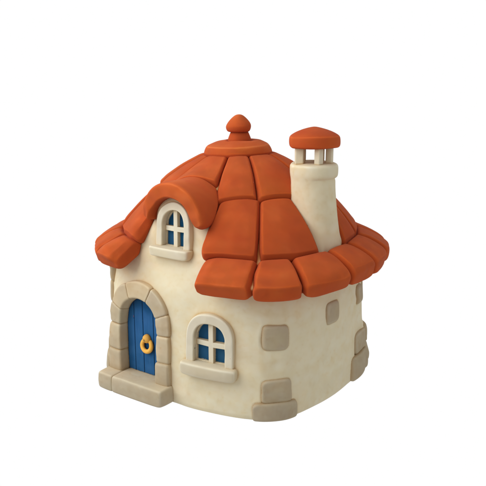
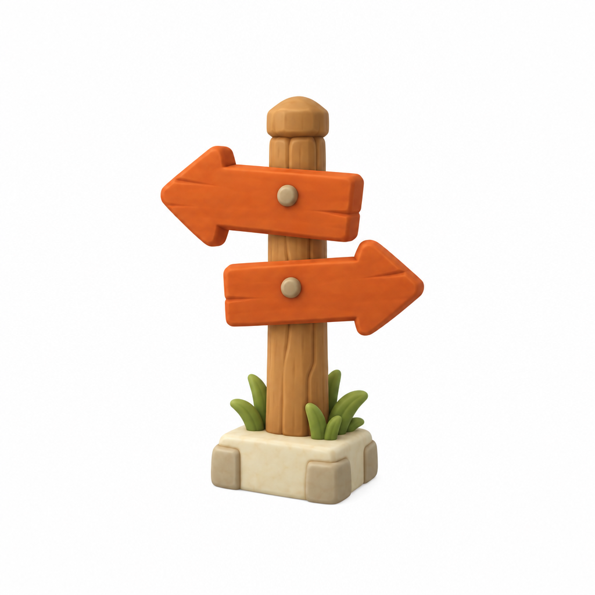
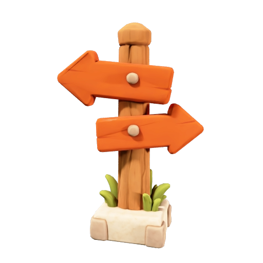
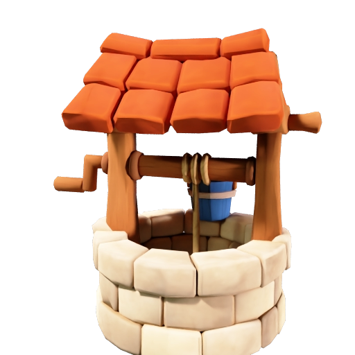
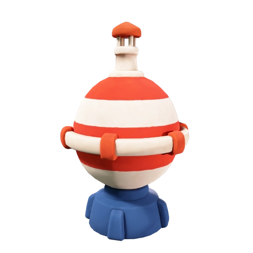
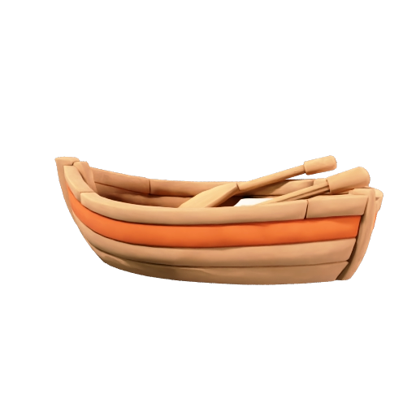
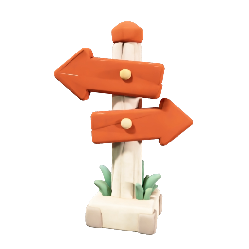
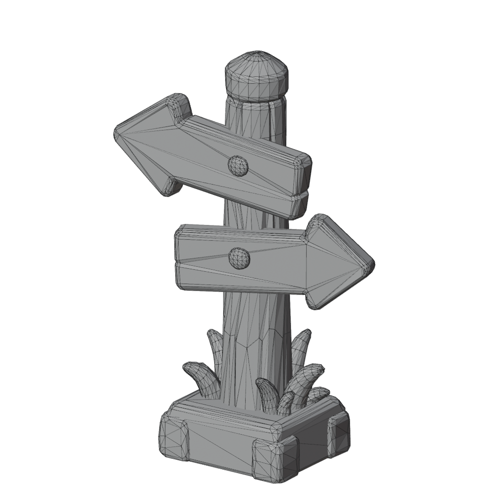

# Make low-poly props that match your concept art

Turn one piece of concept art into a set of low-poly game props that match it: describe a prop in one line, and Meshy draws it in the art's style, builds the model and textures it with Meshy N1. Your coding agent runs the recipe, and this guide explains each step and what to look for.

| Concept art | Generated prop concept | Finished prop |
|---|---|---|
|  |  |  |

[Preview provenance](assets/SOURCES.md).

## What you'll make

One piece of concept art gives you as many matching props as your game needs. Concept art is a picture that sets the look of a game, and here it is the style reference, the image whose style each new prop copies. You describe a prop in one line, and it comes back as a low-poly 3D model with the art's chunky shapes, its orange and cream, and its soft clay look. Run the recipe again with the same art and a new description, and the next prop matches the first.

| Signpost | Stone well | Sea buoy | Rowboat |
|---|---|---|---|
|  |  |  |  |

All four props came from the cottage above, one run and about 27 credits each, with nothing changed but the one-line description. This walkthrough follows the signpost.

The model is a mesh, the shape, a surface made of about 5,000 triangles. That makes it low-poly: a mesh made of few faces, so the shape is simple and the file is small enough for a browser game. Its colors come from a texture, an image wrapped onto the mesh. A GLB is a file that packages the mesh and its texture together, and that is what you get.

The texture comes from Meshy N1, a texture model built for stylized, low-poly game assets. It makes one base color texture, the image that gives the mesh its colors, and no PBR maps, the extra images that tell a viewer how each part of the surface reflects light. A game drawn unlit or with toon shading reads only the base color, so for that kind of game nothing is missing, and the file stays small.

To get there, you'll:

1. Give your coding agent the recipe and store your Meshy API key. No credits are spent.
2. Check the concept art.
3. See how the prop description is built.
4. Start the run and approve the credit cost.
5. Wait about 30 seconds while Meshy generates the prop concept.
6. Wait about ten seconds while Meshy builds the gray mesh.
7. Wait under two minutes while Meshy N1 generates the texture.
8. Compare the prop with its concept and decide what to do next.

- **Start with:** One PNG, JPEG or WebP image of your concept art and a one-line description of the prop. The cottage shown above and the signpost description in Step 3 are included.
- **Receive:** A prop concept image, a textured low-poly model (`prop.glb`), and a preview image.
- **Allow:** about one to three minutes for generation, plus time for first-time setup.
- **Budget:** about 27 Meshy credits for the default example: 12 for the prop concept, 5 for the mesh and 10 for the texture.

These are recorded sample costs and timings, not guarantees. Your generated result will vary. [Check current API pricing](https://docs.meshy.ai/en/api/pricing) before you run it.

## Before you start

You need three things. None of them involves writing code.

1. **A Meshy account with API access.** Create an API key in the [Meshy Developer Platform](https://www.meshy.ai/developers/) and [check your credit balance](https://www.meshy.ai/settings/subscription). The default run spends about 27 credits.
2. **A coding agent.** That is an AI assistant such as Claude Code, Codex or Cursor that can open a folder on your computer and run commands for you. It handles installation, runs the recipe, and reports back in plain language.
3. **The example files.** [Download the cookbook files](https://github.com/meshy-dev/meshy-cookbook/archive/refs/heads/main.zip), unzip them, and open the extracted folder in your agent. Or skip the download and ask your agent to clone the [cookbook repository](https://github.com/meshy-dev/meshy-cookbook) for you. Either way, open the folder containing `AGENTS.md`, `examples`, and `shared`, so the agent can see everything it needs.

Optional: install [Blender](https://www.blender.org/download/), which is free, to see the prop lit and unlit on your own computer. Without it, you can still inspect every result in your Meshy account, as Step 8 explains.

Keep your API key on your computer. The agent will help you create a local settings file named `.env`. Paste your key into that file yourself, never into chat.

Already comfortable running code? Jump to [Run it](#run-it) for the Python and TypeScript commands, and to [How it works](#how-it-works) for the API calls behind each stage.

## Step 1: Give your agent the recipe

With the cookbook folder open in your agent, paste this prompt. It sets everything up without spending any credits: the agent fetches the cookbook if it is not there yet, installs what the recipe needs, and helps you store your key in the local settings file.

```text open-in-agent
If the Meshy cookbook folder is not already open, clone https://github.com/meshy-dev/meshy-cookbook and work inside it. Read AGENTS.md and examples/14-image-to-style-matched-prop/README.md. Set up everything this recipe needs, using Python unless my project already uses TypeScript. Help me store MESHY_API_KEY in the recipe's local settings file without asking me to paste the key into chat. Do not start any generation yet. When setup is done, explain in plain language what the run will do, stage by stage, and how many credits it will cost.
```

Follow the agent's instructions and paste your key into the settings file yourself. This step is done when the agent confirms the key is in place and quotes a cost of about 27 credits.

## Step 2: Check the concept art

Meshy takes the art style from this image: the shapes, the palette and the brushwork. It does not copy the subject, so the cottage itself never appears in the result. Only its look carries over to the signpost.

| The cottage: one subject on a plain white background, in bold blocks of color |
|---|
|  |

A good reference shows:

- one subject, whole and centered
- bold colors and clear patterns in big shapes
- a plain background with nothing else in the picture

A photo or a busy scene will not work, because it has no single drawn style for Meshy to take. For this walkthrough, keep the included cottage. [Try your own idea](#try-your-own-idea) covers your own art once you have seen a full run.

## Step 3: See how the prop description is built

The description is one line that says what the prop is. In Step 5, Meshy's image model reads it together with the cottage and draws a picture of the prop in the cottage's style. The mesh and the texture are both made from that picture. Meshy N1 never reads the description; it takes its colors from the picture alone. This walkthrough includes this description:

> A wooden signpost with two chunky orange arrow signs pointing left and right, a thick light brown wooden post with a rounded top, a few tufts of green grass around its foot, and a square cream stone base

It names the object, then describes its parts from top to bottom, each with a shape and a color:

| The description says | What it does |
|---|---|
| A wooden signpost | Names one object, so the picture shows one prop. |
| with two chunky orange arrow signs pointing left and right | The biggest part, with its shape and its color. "Chunky" keeps the signs thick enough to hold their shape in a 5,000-triangle mesh. |
| a thick light brown wooden post with a rounded top | The next part down. "Thick" does the same for the post. Each part gets one plain color, which is what Meshy N1 carries over most cleanly. |
| a few tufts of green grass around its foot, and a square cream stone base | The bottom, so the prop has a base to stand on. |

The description says nothing about style, view or background, because the recipe adds those every time: the whole object, seen from the front and a little to the side, in the same art style, palette and brushwork as the cottage, on a plain white background, with no text.

Leave these out of a description:

- **Thin strands, such as rope or fringe.** A 5,000-triangle mesh has too few triangles to hold them.
- **Glass or glowing parts.** The texture only sets colors, so glass can't look see-through and a lamp can't glow.
- **Words or letters.** They come out garbled, so keep signs blank.

For this walkthrough, keep the included description. [Try your own idea](#try-your-own-idea) reuses the same pattern for your own prop.

## Step 4: Start the run and approve the cost

Paste this prompt. The agent quotes the cost and waits for your approval before anything is generated.

```text
Run cookbook 14, the style-matched prop recipe, with the included cottage concept art and signpost description. Tell me the expected credit cost and wait for my approval before generating. While it runs, tell me when each stage finishes, and show me the prop concept as soon as it is saved. When everything is done, show me where the files were saved.
```

Expect a quote of about 27 credits: 12 for the prop concept, 5 for the mesh and 10 for the texture. Once you approve, the recipe runs three stages back to back and the agent reports progress. The whole run takes one to three minutes, so keep the terminal open and read ahead to see what is happening.

## Step 5: Meshy generates the prop concept

This stage takes about 30 seconds. Meshy's image model, GPT Image 2.5 Sunburst, generates a new picture of the prop from your description, with the cottage as its style reference. The recipe saves it as `prop-concept.png` in the output folder as soon as it is ready.

| The prop concept, generated in the cottage's style and saved before the mesh is built |
|---|
|  |

Open it as soon as the agent says it is there. Both later stages work from this picture: the next stage builds the mesh from it, and Meshy N1 takes the texture's colors from it. Check that the style matches the cottage and that the whole prop is in the picture, with nothing cut off at the edges.

This new picture is what lets one piece of art become many props. Meshy builds a mesh from a picture of the object itself, so the cottage picture on its own could only ever become a cottage.

The texture needs the new picture too. Meshy N1 gives each part of the mesh the color it sees on that part in the picture, so it works from a picture of the same prop the mesh was built from. Here is the same signpost mesh textured twice:

| Textured from the signpost concept | Textured from the cottage picture |
|---|---|
|  |  |

From the cottage picture, N1 still uses the cottage's orange and cream, so the arrows stay orange. But the cottage has no wooden post or grass for N1 to take colors from: the post comes out cream like the cottage's walls, its cap orange like a roof tile, and the grass pale blue-green. Any picture passes on its palette; only a picture of the prop itself gives each part the color your description asked for.

One limit to know: the recipe does not pause here for your approval. If you would rather check the concept before paying for the other two stages, ask your agent to adapt the recipe to stop after this step.

## Step 6: Meshy builds the gray mesh

This stage takes about ten seconds. Meshy reads the prop concept, which never leaves Meshy between the stages, and builds the mesh with Smart Topology: it builds the mesh directly at a face count you choose, instead of building a dense mesh and simplifying it afterwards.

- **5,000 faces.** Faces are the flat triangles a mesh is made of, and the face count is a target, so expect a count a little above or below it. That is enough for the chunky shapes of a stylized prop, and small enough that a browser game can load a whole set of props. A detailed model from Meshy's other image-to-3D recipes has about a million.
- **No texture yet.** The recipe turns texturing off for this stage. Smart Topology could texture the mesh itself, but through the API that uses a different texture model, Meshy 7, for 10 more credits. Leaving it off hands the job to Meshy N1 in the next stage for the same 10 credits.

| The gray mesh with every triangle edge drawn, rendered from the actual file |
|---|
|  |

The recipe does not download this gray mesh, but you can rotate it in the API console logs described in Step 8. It has no UV layout yet. A UV layout is the map that says which spot on a texture image lands on which triangle of the mesh, and the next stage creates one.

## Step 7: Meshy N1 generates the texture

This stage takes from about 20 seconds to about two minutes, depending on how busy Meshy is. Meshy N1 takes the gray mesh and the prop concept from Step 5, then:

1. **Unwraps the mesh.** It creates the UV layout by cutting the surface into flat pieces and arranging them on one square image. The edges where two pieces meet on the mesh are called UV seams.
2. **Generates the base color texture from the concept.** N1 treats the concept as the front view of the prop. The colors it sees there land on the matching parts of the mesh, and it fills in the sides and the back to match. The mesh was built from the same picture, so the orange lands on the arrows and the cream on the stone base.
3. **Stops at the base color.** It makes one base color texture of 2,048 × 2,048 pixels and no PBR maps.

| The finished signpost, as its preview image |
|---|
|  |

The soft highlights and shadows you see are part of the base color texture, carried over from the concept. In an unlit or toon-shaded game, the prop looks just like this. Under a game's lights, the lighting adds to the shading already in the texture, so the colors look paler, and nothing on the prop shines like metal.

One limit to know: the textured model comes back 2 meters tall, about twice the size of the gray mesh, so set its scale in your game before placing it.

## Step 8: Compare it with the concept

When the agent reports that everything is done, the output folder inside the recipe's `python` or `typescript` folder holds four files:

| File | What it is |
|---|---|
| `prop.glb` | The 5,000-face mesh with its base color texture packed inside. Start here. |
| `prop-concept.png` | The prop concept from Step 5. |
| `prop-thumbnail.png` | A still preview of the textured prop. |
| `run.json` | The task IDs of the three stages, so an interrupted run can continue without paying twice. |

You don't need to install anything to take a first look. Open the [API console logs](https://www.meshy.ai/api-console/logs) in your Meshy account: every generation made with your key is listed there, and you can rotate and inspect both the gray mesh and the textured prop in the browser. To open the downloaded file instead, open Blender and choose **File → Import → glTF 2.0**, then pick `prop.glb`. Press Z and choose **Material Preview** to see it lit. For the unlit look of a flat-shaded game, press Z and choose **Solid**, then open the Viewport Shading menu with the small arrow at the top right of the viewport, and set **Lighting** to **Flat** and **Color** to **Texture**. Or ask your agent:

```text
Help me look at output/prop.glb from all sides, next to output/prop-concept.png. If Blender is installed, open the model there and show it to me both lit and unlit. Otherwise suggest a free viewer that opens GLB files and help me open the file in it.
```

Put the concept next to the model and check three things:

- **Where colors cross an edge.** Follow the arrows' outlines and the place where the post meets the base. The colors should continue across each edge without a visible line along a UV seam.
- **The back.** N1 works from the front view, so the back of the arrows comes back plain orange and the back of the post plain wood. That is expected. Check that nothing from the front shows up in the wrong place on the back.
- **Lit against unlit.** Compare the two Blender views. If your game lights its props, decide whether the paler lit look is acceptable.

What comes next depends on your game:

- **Put it in a browser game.** The [three.js character recipe](../13-image-to-threejs-character/) plays a character in a three.js page and has a step that shrinks a GLB for the web. It takes this prop from about 3 MB to about 0.2 MB. Ask your agent: "Shrink output/prop.glb with the optimize step of cookbook 13, save the result as prop.glb next to the character in that recipe's web/public/models folder without replacing character.glb, and show me the file size before and after."
- **Make the rest of the set.** [Try your own idea](#try-your-own-idea) runs the recipe again with the same concept art and a new description. Each prop is a new run of about 27 credits.
- **Metal that shines.** The [restyle recipe](../06-text-to-restyled-prop/) textures a low-poly mesh with Meshy 7 instead, which adds PBR maps.

## Try your own idea

To grow the set, keep the included cottage and change only the description. Write it following the pattern in [Step 3](#step-3-see-how-the-prop-description-is-built): the object, then each part with its shape and its color. This prompt makes the well shown in [What you'll make](#what-youll-make).

```text
Use cookbook 14 with the included cottage concept art and this description: A round stone well with cream stone blocks, a small orange tiled roof on two thick light brown wooden posts, a chunky wooden crank between the posts, and a blue wooden bucket sitting on the rim. Archive any previous output before starting. Explain the expected credit cost and wait for my approval before generating.
```

To match different art, choose a PNG, JPEG or WebP that passes the checks in [Step 2](#step-2-check-the-concept-art): one subject, bold colors, a plain background. For example, to make a prop that matches the armored character of the [three.js character recipe](../13-image-to-threejs-character/), so the two share one scene, use that recipe's concept art with a supply crate. Paste this prompt.

```text
Use cookbook 14 with the concept art in examples/13-image-to-threejs-character/input/concept-art.png and this description: A sci-fi supply crate with dark gunmetal armor panels and black rubber corner guards, a bold yellow chevron emblem painted on the front that wraps around both front corners onto the sides, and yellow hazard stripes painted across the lid and down over its edges. Archive any previous output before starting. Check the image and the description against Steps 2 and 3 of the recipe and tell me about anything that could give a poor result before spending credits. Explain the expected credit cost and wait for my approval before generating.
```

To use your own art, attach it to your agent or tell it where the file is, and change the path and the description in the prompt. Save a copy of your first result before generating another version. Every new prop runs all three stages again, about 27 credits.

## If something goes wrong

- **The key is missing or rejected:** ask your agent to check that the local `.env` file is in the language folder and contains `MESHY_API_KEY`. Do not paste the key into chat.
- **The run cannot start:** check API access and available credits in your Meshy account, and ask the agent to explain the error before retrying.
- **Progress stops or a download fails:** ask your agent to resume the saved run. The recipe records each stage as it finishes, so a prop concept or a mesh that already exists is not paid for twice. If the agent reports that it cannot tell whether a request went through, have it check Meshy's task history before continuing.
- **The texture does not match the concept:** check that the texture stage used `output/prop-concept.png` from the same run, the picture the mesh was built from. N1 takes its colors from that image, and a different picture sets only a general style. If the concept itself looks wrong, change the description and run again.
- **Gold or metal looks flat under lights:** Meshy N1 makes a base color texture only, with no map that marks metal. For metal that shines, use Meshy 7 with PBR maps, as the [restyle recipe](../06-text-to-restyled-prop/) does.
- **The result looks different from the example:** each generation can vary, and the concept varies most. Check the art and the description against [Step 2](#step-2-check-the-concept-art) and [Step 3](#step-3-see-how-the-prop-description-is-built) with your agent before paying for another run.

## Technical details

**Endpoints:** `POST /openapi/v1/image-to-image` → `GET /openapi/v1/image-to-image/:id`, then `POST /openapi/v1/image-to-3d` → `GET /openapi/v1/image-to-3d/:id`, then `POST /openapi/v1/retexture` → `GET /openapi/v1/retexture/:id`\
**Languages:** Python 3.10+ · TypeScript (Node 22+)\
**Source:** [Python](python/main.py) · [TypeScript](typescript/main.ts)\
**Last verified run measurements:** November 3, 2026 · [Sample result](sample-result.json)

Meshy N1 is `ai_model: "meshy-n1"` on the retexture endpoint: a 2K base color texture from reference images only, with no text prompt, no PBR maps and no 4K or 8K. It reads `image_style_url` as the front view of the model. This recipe gives it the same image the mesh was built from. Image to Image draws the prop in the reference's style, Smart Topology builds an untextured 5,000-face mesh from that task with `input_task_id`, and the retexture call sends the downloaded concept back as a data URI, because retexture takes no image task ID. The [restyle recipe](../06-text-to-restyled-prop/) textures a Smart Topology mesh with Meshy 7 from a text prompt instead.

## Run it

Complete [Before you start](#before-you-start) to configure API access and your key. Review the estimated budget above before running.

Clone once, then choose one language and run its commands from the repository root:

    git clone https://github.com/meshy-dev/meshy-cookbook.git
    cd meshy-cookbook

**Python**

    cd examples/14-image-to-style-matched-prop/python
    python3 -m venv .venv && source .venv/bin/activate
    cp .env.example .env          # paste your key
    pip install -r requirements.txt
    python main.py

**TypeScript**

    cd examples/14-image-to-style-matched-prop/typescript
    cp .env.example .env          # paste your key
    npm install
    npm start

You get `output/prop.glb`, the generated concept at `output/prop-concept.png`, and a 512 px preview at `output/prop-thumbnail.png`. Open the GLB in Blender with File > Import > glTF 2.0.

To make your own prop, pass its description in quotes. To match your own concept art, add the image after the description:

    python main.py "A wooden barrel with two iron bands and a red painted lid"
    npm start -- "A wooden barrel with two iron bands and a red painted lid"
    python main.py "A wooden barrel with two iron bands and a red painted lid" my-concept-art.png
    npm start -- "A wooden barrel with two iron bands and a red painted lid" my-concept-art.png

The reference can be a PNG, JPEG or WebP of up to 20 MB.

### Resume an interrupted run

The script saves the description, the reference image path and the task IDs in `output/run.json`. If a poll, a download or a later stage is interrupted, continue the same run from the same language directory:

    python main.py --resume
    npm start -- --resume

Resume reuses saved tasks and creates only stages that have not started. Starting the mesh stage still costs its 5 credits and the texture stage its 10. The texture stage reads `output/prop-concept.png` from disk, so keep that file; it works after the concept task's download link has expired. If the texture task is already saved, resume retrieves it directly and reports texture credits only. Resume before the results expire; the recorded retention period is three days outside Enterprise.

A normal run refuses to start when `output/run.json` already exists. To make another prop, archive the current `output/` directory first. Passing a different description or reference image with `--resume` is rejected.

If execution stops while a create request is in flight, the checkpoint may contain a `creating` marker without its task ID. The script stops rather than risk duplicate charges. Check the Meshy task history for the submitted request; if it exists, put its ID in `concept_task_id`, `mesh_task_id` or `texture_task_id` as appropriate and set `creating` to `null` before resuming. If no task was created, clear the marker only after confirming that. When Meshy refuses a request outright, for example with a 402 for missing credits or a 400 for an invalid parameter, no task exists, so the script clears the marker itself before it stops. Fix the cause, correcting the input saved in `output/run.json` if that is what Meshy refused, and `--resume` retries that stage. The checkpoint contains no API key or signed download URLs.

## How it works

The excerpts below show the API calls from the Python runner. The full [Python](python/main.py) and [TypeScript](typescript/main.ts) sources also checkpoint each stage and skip creation when resuming a saved task.

1. **Generate the prop concept from the reference.** `client.create` POSTs the description, with fixed framing and style phrases added, and the concept art as a data URI to `/openapi/v1/image-to-image`.

```python
concept_id = client.create(
    "image-to-image",
    {
        "ai_model": "gpt-image-2-5-sunburst",
        "prompt": (
            f"{state['description']}, full object, three-quarter front view, centered with space around it, "
            "painted in the same art style, palette and brushwork as the reference image, "
            "painted highlights and soft shadows, soft even studio lighting, plain white background, "
            "single object, no props, no text"
        ),
        "reference_image_urls": [reference_url],
        "aspect_ratio": "1:1",
    },
)
```

   The prompt never names the reference's subject, so the cottage's style carries over without the cottage itself.

2. **Save the concept, then build the untextured mesh from it.** `client.wait` GETs `/openapi/v1/image-to-image/:id` until the image is ready, `client.download` saves it, and `client.create` POSTs a Smart Topology task to `/openapi/v1/image-to-3d` with `input_task_id` pointing at the image task.

```python
concept = client.wait("image-to-image", concept_id, label="concept")
client.download(concept["image_urls"][0], output / "prop-concept.png")
```

```python
mesh_id = client.create(
    "image-to-3d",
    {
        "input_task_id": concept_id,
        "model_type": "smart-topology",
        "ai_model": "meshy-t2.5",
        "target_polycount": 5000,
        "should_texture": False,
        "target_formats": ["glb"],
    },
)
```

   With `should_texture` off, the mesh stage costs 5 credits and returns `POSITION` data only: no UVs and no material.

3. **Texture it with Meshy N1 from the saved concept.** Once the mesh is ready, `client.create` POSTs to `/openapi/v1/retexture` with `input_task_id` pointing at the mesh task and the downloaded concept as `image_style_url`.

```python
mesh = client.wait("image-to-3d", mesh_id, label="mesh")
concept_url = Meshy.data_uri(output / "prop-concept.png")
```

```python
texture_id = client.create(
    "retexture",
    {
        "input_task_id": mesh_id,
        "ai_model": "meshy-n1",
        "image_style_url": concept_url,
        "enable_pbr": False,
        "target_formats": ["glb"],
    },
)
```

   Retexture has no field for an image task's ID, and the concept's signed link expires, so the local file is what makes a resume work days later.

4. **Download the model and its preview.** `client.wait` GETs `/openapi/v1/retexture/:id` until the texture is done, then `client.download` saves both files.

```python
texture = client.wait("retexture", texture_id, label="texture")
client.download(texture["model_urls"]["glb"], output / "prop.glb")
client.download(texture["thumbnail_url"], output / "prop-thumbnail.png")
```

## What you get

These are measurements of the two recorded sample runs, one per language. The Python run's files are pictured above.

| File | Contents |
|---|---|
| `prop.glb` | 4,905–5,072 triangles for the 5,000 target, the gray mesh's count unchanged; 4,765–4,795 vertices after unwrapping; one material with one embedded 2,048 × 2,048 PNG base color texture, `metallicFactor` 0 and `roughnessFactor` 1; 2.5–2.7 MB; 2.0 m tall |
| `prop-concept.png` | 1,024 × 1,024 PNG, about 0.75 MB |
| `prop-thumbnail.png` | 512 × 512 preview of the textured prop on a transparent background |

The concept stage took 30 seconds, the mesh stage 8–11 seconds and the Meshy N1 texture stage 99–111 seconds, 144–160 seconds from start to files on disk. Three more Python runs the same day, the well, the buoy and the rowboat pictured under What you'll make, finished the texture stage in 17–20 seconds and the whole run in 69–79 seconds, so most of the variation is the N1 stage under load. Those three cost 27 credits each and came back with 4,946–5,051 triangles and 2.9–3.3 MB GLBs. The comparison in Step 5 sent the signpost run's mesh task back to retexture with the cottage picture as `image_style_url` in place of the concept: 10 credits, 17 seconds, the same 4,905 triangles. The gray mesh has `POSITION` data only and stands 0.95 m tall; N1 adds normals and UVs and scales the model to 2.0 m. The optimize step of the [three.js character recipe](../13-image-to-threejs-character/) (a 1,024 px WebP texture and meshopt compression) took each `prop.glb` to 0.20 MB with every triangle kept.

## Ways to extend it

- **A whole prop set.** Loop over a list of descriptions with one reference image, at 27 credits a prop, as the four props under [What you'll make](#what-youll-make) were made.
- **A picture of the prop itself.** When you already have art of the exact object you want, the concept stage has nothing to add: build the mesh from your picture with `image_url` and texture it from the same picture with `image_style_url`. Two stages, 15 credits. Use the concept stage when the art shows something else and you need new objects in its style.
- **Skins.** Restyle a prop's concept with Image to Image, keeping the shape and changing the colors and patterns, then run Meshy N1 again on the same mesh task. Each look costs 22 credits: 12 for the new concept and 10 for the texture.
- **Your own blockout.** Render a gray model you made in Blender, have Image to Image draw it in the reference's style, then texture the model with Meshy N1 from that drawing, sending the file as `model_url` with `enable_original_uv: true` to keep your UV layout. 22 credits.
- **Several views.** `multiview_image_urls` takes one to four views of the object, front first, in place of `image_style_url`.

## Parameters worth changing

| Parameter | We use | Why |
|---|---|---|
| [`ai_model`](https://docs.meshy.ai/en/api/image-to-image#create-an-image-to-image-task) (image-to-image) | `"gpt-image-2-5-sunburst"` | 12 credits with reference images, as for every GPT Image model. `"nano-banana-pro"` costs 9 and `"nano-banana"` 3 |
| [`prompt`](https://docs.meshy.ai/en/api/image-to-image#create-an-image-to-image-task) | the description plus fixed phrases | The fixed phrases ask for one whole object in a three-quarter front view on white, in the reference's art style, palette and brushwork, without naming what the reference shows |
| [`reference_image_urls`](https://docs.meshy.ai/en/api/image-to-image#create-an-image-to-image-task) | the concept art as a data URI | One to five images, as public URLs or data URIs, up to 20 MB each |
| [`aspect_ratio`](https://docs.meshy.ai/en/api/image-to-image#create-an-image-to-image-task) | `"1:1"` | A square concept frames a single prop. `"3:4"` suits a tall one |
| [`model_type`](https://docs.meshy.ai/en/api/image-to-3d#create-an-image-to-3d-task) | `"smart-topology"` | Builds the mesh directly at the face count |
| [`ai_model`](https://docs.meshy.ai/en/api/image-to-3d#create-an-image-to-3d-task) (image-to-3d) | `"meshy-t2.5"` | The Smart Topology model of the recorded runs, and the default when `ai_model` is omitted. `"meshy-t2"` accepts 100 to 15,000 faces |
| [`target_polycount`](https://docs.meshy.ai/en/api/image-to-3d#create-an-image-to-3d-task) | `5000` | The target face count, from 100 to 30,000 on `meshy-t2.5`; the result lands near it |
| [`should_texture`](https://docs.meshy.ai/en/api/image-to-3d#create-an-image-to-3d-task) | `false` | A textured Smart Topology task uses Meshy 7 through the API and costs 15 credits. Untextured costs 5 and leaves the texture to Meshy N1 |
| [`ai_model`](https://docs.meshy.ai/en/api/retexture#create-a-retexture-task) (retexture) | `"meshy-n1"` | Has to be named, because `latest` on retexture is Meshy 7. `"meshy-7"` with `enable_pbr: true` adds PBR maps and accepts a text prompt; it is a different texture model with different strengths |
| [`image_style_url`](https://docs.meshy.ai/en/api/retexture#create-a-retexture-task) | the downloaded concept as a data URI | Meshy N1 reads it as the front view. Use the image the mesh was built from; a different image sets only a general style |
| [`enable_pbr`](https://docs.meshy.ai/en/api/retexture#create-a-retexture-task) | `false` | `true` returns 400 with Meshy N1, as do `texture_resolution` `"4k"` or `"8k"`, `remove_lighting` with any value, and a text prompt without an image. None of them is charged |
| [`target_formats`](https://docs.meshy.ai/en/api/retexture#create-a-retexture-task) | `["glb"]` | Add `"fbx"` for Unity or Unreal |

Every stage names its model, the models of the recorded runs, so the recipe keeps running them when the API defaults change. Meshy N1 also accepts models of up to 7,999,999 triangles, so the same texture stage works on a denser mesh.
