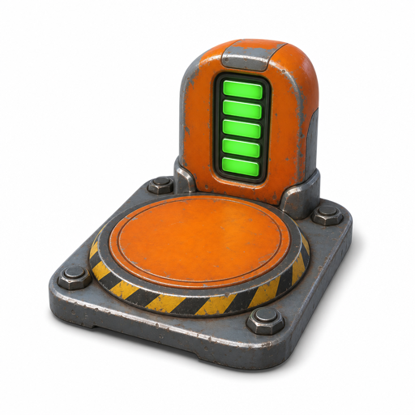
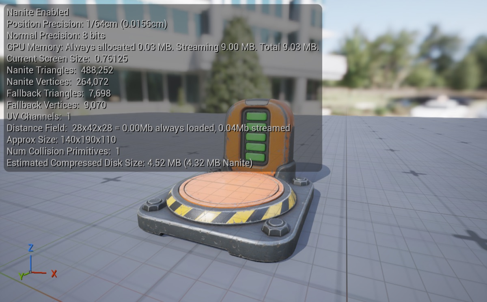

# Make a 3D asset and place it in Unreal with your coding agent

Describe a game asset, and your coding agent turns it into a concept image and then a 3D model with the Meshy CLI, and places it in your Unreal Engine level through Unreal MCP. You write no code: you paste prompts, approve each cost, check the image, drag one file into the editor, and walk up to the asset in Play In Editor.

**Last tested:** November 9, 2026, with Unreal Engine 5.8.2 on macOS, the Meshy CLI 0.8.5 and Claude Code. Windows hasn't been tested yet.

| The concept image Meshy drew from the prompt | The 3D model Meshy built from that image |
|---|---|
|  |  |

[Preview provenance](assets/SOURCES.md).

## What you'll make

The asset is a charging dock for a robot game, the kind of object a level uses as a respawn checkpoint: a round orange pad with hazard stripes, a short orange tower with a five-bar green battery meter, and a scuffed steel base with four big bolts. It comes back as a textured GLB, a file that packages the 3D model and its textures together, and it ends up placed in your level, where your character can walk up to it.

Three tools do the work:

- **Your coding agent**, an AI assistant such as Claude Code, Cursor or Codex that runs commands on your computer. It runs the other two for you and reports back in plain language.
- **The Meshy CLI**, a command-line program that makes images and 3D models with Meshy. The agent learns how to use it from the meshy-3d-agent skills, a set of instructions you install once.
- **Unreal MCP**, a plugin in Unreal Engine 5.8 that lets an agent work in the open editor. MCP, the Model Context Protocol, is the standard way an agent talks to another program's tools.

The model is made in two Meshy tasks. The first draws a concept image from your prompt, and you check it before going on. The second turns that image into a 3D model: it builds the mesh, the shape made of triangles, and paints it with textures, the images that give the mesh its colors and tell the engine how each part reflects light. Both run on Meshy's servers, and the CLI saves the finished GLB into your Unreal project folder.

To get there, you'll:

1. Install the Meshy CLI and the skills, and sign in with your browser. No credits are spent.
2. Turn on Unreal MCP in the editor and connect your agent to it.
3. See how the image prompt is built.
4. Approve the cost, and check the concept image the agent makes.
5. Approve the cost of the 3D model, and wait about a minute and a half while Meshy builds it.
6. Bring the file into Unreal and place it in the level.
7. Walk up to it in Play In Editor.

- **Start with:** A prompt that describes the asset. The charging dock prompt in Step 3 is included.
- **Receive:** a concept image, `charging-dock.glb` in your project's `MeshyAssets` folder, and a static mesh with its material and textures placed in your level.
- **Allow:** about two to three minutes for generation, plus your approvals and first-time setup.
- **Budget:** about 39 Meshy credits on a Pro plan or above: 9 for the image and 30 for the model.

These are recorded sample costs and timings, not guarantees. Your generated result will vary. [Check current API pricing](https://docs.meshy.ai/en/api/pricing) before you run it.

> **Why the Meshy CLI and not the Meshy MCP server?** Meshy offers both, and they call the same API, so you can make the same assets either way. We use the CLI here for two reasons: you sign in with your browser instead of creating an API key, and `-o` saves the file straight into your Unreal project. It also keeps your agent's setup simple: one MCP server for Unreal, and Meshy as a command the agent runs. The trade-off is that your agent needs terminal access, which Claude Code, Cursor and Codex all have. Already running the Meshy MCP server? See [Already using the Meshy MCP server?](#already-using-the-meshy-mcp-server).

## Before you start

You need four things. None of them involves writing code.

1. **A paid Meshy plan, Pro or above.** A Free account can sign in to the CLI, but Meshy refuses every task it creates with HTTP 402 `plan_upgrade_required`, and the CLI stops with exit code 9. [Check your plan and credit balance](https://www.meshy.ai/settings/subscription). The default run spends about 39 credits.
2. **A coding agent with terminal access**, such as Claude Code, Cursor or Codex.
3. **Node.js 22.12 or newer.** The Meshy CLI runs on it. If `node --version` prints an older version or nothing, install the current LTS release from [nodejs.org](https://nodejs.org) first. The agent installs everything else.
4. **Unreal Engine 5.8 with a project open.** The steps use a new project from the [Third Person template](https://dev.epicgames.com/documentation/en-us/unreal-engine/third-person-template-in-unreal-engine), which ships with the engine. The same steps work in any existing project.

You don't need to download the cookbook. Every command, prompt and client configuration is on this page, and the [agent folder](agent/README.md) holds copies you can save.

Already comfortable on the command line? Jump to [Run it](#run-it) for the commands without an agent.

### Already using the Meshy MCP server?

If your agent already has the [Meshy MCP server](https://www.meshy.ai/mcp), it can make the image and the model with that instead of the CLI. Both call the same API, so the result and the cost are the same. Ask for them in your own words, then continue from [Step 6](#step-6-bring-the-file-into-unreal). Two things differ:

- The MCP server signs in with an API key in `MESHY_API_KEY`, which needs a Pro plan or above. Keep the key in your agent's settings, never in chat.
- Its downloads go where the agent saves them, often `meshy_output/`. Ask it to save the GLB in your project's `MeshyAssets` folder. Download links expire, so save the file you want to keep.

Your agent then runs two MCP servers, Meshy's and Unreal's. On Claude Code for Windows, add the Meshy server with `claude mcp add-json`.

## Step 1: Install the Meshy CLI and the skills

Open your agent in your Unreal project's folder, the one that holds the `.uproject` file, and paste this prompt. It points the agent at the install guide in the [meshy-3d-agent repository](https://github.com/meshy-dev/meshy-3d-agent), and spends no credits.

```text open-in-agent
Help me install Meshy CLI and the meshy-3d-agent skills: https://raw.githubusercontent.com/meshy-dev/meshy-3d-agent/main/INSTALL.md. Then run meshy balance and tell me my credit balance. Do not generate anything yet.
```

The agent checks Node.js, installs the Meshy CLI 0.8 with npm, installs the `meshy-3d-generation` and `meshy-3d-printing` skills, and starts the sign-in. It shows you a link and a short code: open the link, sign in to your Meshy account, enter the code and approve. You never copy an API key, and nothing secret goes into the chat.

This step is done when the agent reports your credit balance. The agent may ask you to start a new session so it loads the new skills; Step 2 ends with that restart.

## Step 2: Turn on Unreal MCP

Unreal MCP runs inside the editor and listens on your computer only, at `http://127.0.0.1:8000/mcp`. Epic marks it Experimental. Epic also notes that what the plugin sends to your AI provider counts as Licensed Technology under the Unreal Engine EULA, and that you're responsible for making sure the provider doesn't train on it, so check your agent's data settings before you connect it.

1. In the editor, open **Edit > Plugins**, search for **Unreal MCP** and enable it. Search for **All Toolsets** and enable it too. Both turn on **Toolset Registry**, which they need. Restart the editor when it asks.
2. Open **Edit > Editor Preferences > General > Model Context Protocol** and turn on **Auto Start Server**, so the server starts with the editor. To start it once instead, open the console with the `` ` `` key and run `ModelContextProtocol.StartServer`.
3. In the console, write your agent's configuration. For Claude Code:

   ```Unreal
   ModelContextProtocol.GenerateClientConfig ClaudeCode
   ```

   Use `Cursor` or `Codex` in place of `ClaudeCode` for those agents. For Claude Code the editor writes `.mcp.json` into your project folder: that file tells the agent where the server is. If the command is not available, save [the same configuration](agent/README.md) by hand.
4. Restart your agent from the project folder so it reads the new file. Claude Code asks you to approve the project's `unreal-mcp` server; approve it. In Cursor or Codex, open the project folder again; Codex reads `.codex/config.toml` only in a project you've marked as trusted. Our runs used Claude Code.

Then check the connection. This prompt changes nothing:

```text
List the Unreal MCP toolsets you can see. Tell me which tool, if any, can import a GLB file as an asset, and which one can place an actor in the level. Do not change anything in the project.
```

This step is done when the agent lists toolsets such as `SceneTools` and `ActorTools`; ours listed 49. If it finds no Unreal tools, start the server with `ModelContextProtocol.StartServer` in the console, or restart the editor, and ask again. Unreal MCP gives the agent three tools, `list_toolsets`, `describe_toolset` and `call_tool`, and reaches every toolset through them, so a short tool list is normal. The agent finds one import tool, `StaticMeshTools.import_file`. It reads FBX and OBJ files but not GLB, so Step 6 has you drag the file in.

## Step 3: See how the image prompt is built

Meshy makes this asset in two stages: it draws a concept image from a prompt, then builds the 3D model from that image. The image decides the shape and the colors, so the prompt describes the picture that Image to 3D needs. This walkthrough uses this prompt:

> A chunky robot charging dock, the respawn checkpoint of a stylized platformer game, full object, three-quarter front view, centered with space around it, a round orange charging pad to stand on with yellow and black hazard stripes around its edge, a short rounded orange tower at the back with a battery meter of five thick green bars on its front, a scuffed steel base with four big bolts, stylized game art style, soft even studio lighting, plain white background, single object, no props, no text

It names the object and its job in the game first, then how to frame it, then each part with a shape and a color, and it ends with the lighting and the background. Image to 3D rebuilds what the picture shows and guesses the rest, so the prompt asks for the whole object from a three-quarter front view, which shows the most surface, lit evenly on a plain white background, so no shadows end up painted into the texture.

Leave these out of an image prompt:

- **Words, numbers and screens.** Describe shapes and colors instead; the prompt ends with "no text".
- **Glowing parts.** The texture sets colors and how a surface reflects light; it can't make a lamp glow. Add lights in Unreal afterwards.
- **Thin parts, such as cables, wires or rope.** Meshy's guidance for image prompts is to leave them out, because they convert badly into a mesh. An earlier draft of this prompt had two thick cables; this one drops them.

For this walkthrough, keep the included prompt. [Try your own idea](#try-your-own-idea) covers your own asset.

## Step 4: Make the concept image

Paste this prompt. The agent stops three times for you: to approve the image's cost, to approve the image, and to approve the model's cost.

```text
Use the Meshy CLI to make an asset for my Unreal project in two stages. First make a concept image with text-to-image, using gpt-image-2, from this prompt word for word: "A chunky robot charging dock, the respawn checkpoint of a stylized platformer game, full object, three-quarter front view, centered with space around it, a round orange charging pad to stand on with yellow and black hazard stripes around its edge, a short rounded orange tower at the back with a battery meter of five thick green bars on its front, a scuffed steel base with four big bolts, stylized game art style, soft even studio lighting, plain white background, single object, no props, no text". Tell me the cost and wait for my OK. When the image is ready, show it to me and wait for my OK. Then turn that image into a textured 3D model with image-to-3d from the image task's ID, using meshy-7.1 geometry and meshy-7 PBR textures at 4K. Tell me that cost and wait for my OK. Submit each task with --async and wait on it until it finishes. If a wait is cut off, wait again on the same task ID and never create a task twice. Save the GLB as MeshyAssets/charging-dock.glb in this project folder. Then import it with Unreal MCP into /Game/Meshy/ChargingDock and place it in the open level about three meters in front of the PlayerStart, with its whole base on flat floor. If none of your Unreal MCP tools can import a file, tell me, wait while I drag the GLB into that Content Browser folder, and then place it.
```

The CLI's dry run doesn't price images, so the agent reads the cost from Meshy's pricing page and may ask permission to fetch it: 9 credits for one image with `gpt-image-2`. Nothing is charged until you say OK.

The image took about 30 seconds in our runs. The agent downloads it, tells you where it saved it, and checks it against the prompt. Open it and look before you approve the next stage. If it isn't right, ask for another image, which costs another 9 credits, rather than paying for a 3D model you'd throw away.

The prompt asks for `--async` and `wait` because many agents stop a shell command after a couple of minutes. If a wait is cut off, the task keeps running on Meshy's servers and the agent waits on the same task ID again. Creating the task again would charge for a second one.

## Step 5: Turn the image into a 3D model

After you approve the image, the agent quotes the model: 30 credits for Image to 3D with Meshy 7.1 geometry and Meshy 7 textures at 4K, and waits for your OK. The prompt names those models on purpose. When a prompt didn't, our agent suggested a 15-credit low-poly game model instead; [Parameters worth changing](#parameters-worth-changing) compares the two.

This stage took 66 to 75 seconds in our runs. Meshy builds the mesh from the image and paints it: a 4,096 px base color texture for the colors, a 4,096 px normal map for small surface detail, and a 2,048 px map of which parts are metal and how rough each surface is. Unreal's materials read all three.

When the task finishes, the CLI downloads the GLB to `MeshyAssets/charging-dock.glb`. The agent also downloads Meshy's render of the model and compares it with the concept image. Next to the GLB, the skills save `charging-dock_meta.json`, which records the task IDs so the agent can make changes to this model later. It also holds download links that work until they expire, so don't share it, and if your project is in Git, add `MeshyAssets/**/*meta.json` to `.gitignore`.

| The model, as Meshy rendered it |
|---|
|  |

Each run makes a different model, but it follows the image you approved: in our runs, every part of the image came through, from the five green bars to the four bolts. If something is off, change the prompt and make a new image first; a new image costs 9 credits and a new model 30.

## Step 6: Bring the file into Unreal

This is where the file moves from your disk into the editor. Unreal MCP's one import tool, `StaticMeshTools.import_file`, uses Unreal's FBX importer, which reads FBX and OBJ files only. The agent tries it, gets `FbxFactory does not support ".glb" files`, tells you, and waits. Import the file yourself:

1. In the Content Browser, create the folder `Meshy/ChargingDock` and open it. Our agent created and opened it for us.
2. In File Explorer (Finder on a Mac), open your project folder, then `MeshyAssets`.
3. Drag `charging-dock.glb` into the open Content Browser folder. The **Interchange Pipeline Configuration** dialog opens; keep its defaults and click **Import**.
4. Tell the agent the file is imported. It finds the new static mesh and places it in the level with Unreal MCP.

With the default options, the import creates a `charging-dock` folder with the static mesh in `StaticMeshes`, one material in `Materials` and three textures in `Textures`. A static mesh is Unreal's asset for a model that doesn't animate. The import also does three things for you:

- **It converts meters to centimeters.** glTF files are in meters and Unreal works in centimeters, so the dock comes in about 190 cm long.
- **It turns on Nanite,** Unreal's system for drawing dense meshes quickly. Our runs made models of 354,000 to 488,000 triangles.
- **It adds collision:** one convex shape around the model, so your character bumps into the dock instead of walking through it.

**Why GLB and not FBX?** Meshy can also make an FBX, and Unreal MCP's `import_file` reads it, so the agent could import the model without the drag. In our test that import left Nanite off and built a basic material with the roughness map plugged into Metallic and no metallic map, because FBX has no proper slots for PBR materials. A GLB carries its PBR material, and Unreal's glTF import builds it correctly.

## Step 7: Walk up to it in Play In Editor

The agent places the dock about three meters in front of the PlayerStart, the spot where your character appears, with its whole base on flat floor. Click **Play** in the toolbar, or press Alt+P, and walk to it with W, A, S and D. Press Esc to stop playing.

| The dock from our Step 4 run, in the Third Person level in Play In Editor |
|---|
|  |

Check three things:

- **It stands on flat floor.** In the Third Person template, the PlayerStart stands on a raised round platform whose edge is about 3.4 m out, and the floor beyond it is 10 cm lower. Our agent traced the floor, found that a dock 1.9 m long at three meters would hang over that edge, and placed it 2.3 m out, where the whole base fits on the platform. The GLB's origin, the point the editor moves the model by, is in the middle of the model, so the agent also set its height to put the base on the floor. If your dock hangs over an edge or sinks into the floor, ask the agent to move it until its whole base rests on flat floor.
- **It faces the right way.** Our model came in facing sideways in Unreal, and the agent turned the dock 90° so the pad faces the PlayerStart. If yours faces away, ask the agent to turn it.
- **It's the right size.** The dock is about 1.9 m long, 1.4 m wide and 1.1 m tall, next to a character 1.8 m tall. To check, double-click the static mesh: the Static Mesh Editor's viewport shows **Approx Size** in centimeters, `140x190x110` in our run.

| The Static Mesh Editor for the imported dock: Approx Size reads 140x190x110, and Nanite is on |
|---|
|  |

The agent doesn't save the level. When the dock is where you want it, choose **File > Save Current Level**.

## Try your own idea

Write an image prompt that follows [Step 3](#step-3-see-how-the-image-prompt-is-built): the object and its job in your game; "full object, three-quarter front view, centered with space around it"; each part with a shape and a color; and the closing "soft even studio lighting, plain white background, single object, no props, no text". Leave out writing, glow and thin parts. Then paste this prompt with your image prompt and a short name for the file:

```text
Use the Meshy CLI to make an asset for my Unreal project in two stages, the same way as before. First make a concept image with text-to-image, using gpt-image-2, from this prompt word for word: "<your image prompt>". Tell me the cost and wait for my OK, then show me the image and wait for my OK. Then turn that image into a textured 3D model with image-to-3d from the image task's ID, using meshy-7.1 geometry and meshy-7 PBR textures at 4K. Tell me that cost and wait for my OK. Submit each task with --async, wait on the same task ID until it finishes, and save the GLB as MeshyAssets/<name>.glb. Wait while I drag it into the Content Browser folder /Game/Meshy/<Name>, then place it in the level where I tell you, with its whole base on flat floor.
```

Each asset is a new run of about 39 credits, and a second try at the image alone costs 9. To place several copies of one asset, ask the agent to duplicate the actor in the level; copies cost nothing.

## If something goes wrong

- **Port 8000 is already in use:** another program has the port, and the editor's Output Log shows the error under `LogModelContextProtocol`. Change **Server Port Number** in **Edit > Editor Preferences > General > Model Context Protocol**, or start the server with `ModelContextProtocol.StartServer 8010`. Then run `GenerateClientConfig` again and restart the agent, so it uses the new port.
- **The agent sees no Unreal tools:** restart the editor if you haven't since enabling the plugins, and check that the server is running. Start the agent from the folder where `GenerateClientConfig` wrote its file. In Claude Code, `/mcp` lists its MCP servers and shows which ones failed to connect; `unreal-mcp` shows three tools, and the toolsets sit behind them.
- **The agent can't quote the image's cost:** the CLI's dry run doesn't price text-to-image, so the agent needs Meshy's [pricing page](https://docs.meshy.ai/en/api/pricing). Let it fetch the page, or check it yourself: one image with `gpt-image-2` was 9 credits.
- **Node.js is older than 22.12:** the Meshy CLI won't install or run. Install the current LTS release from [nodejs.org](https://nodejs.org), open a new terminal, and paste the Step 1 prompt again.
- **The CLI isn't signed in:** ask the agent to run `meshy auth status`. To sign in again, ask the agent to sign you in: it runs `meshy auth login --device` and shows you a link and a short code, as in Step 1. Never paste an API key into the chat.
- **Meshy refuses the task with HTTP 402 or exit code 9:** the account is on the Free plan or has run out of credits. Check your plan and balance in your Meshy account. Nothing was charged.
- **The agent's shell timed out during generation:** the task is still running on Meshy's servers. Ask the agent to wait on the same task ID again, and not to create a new one. If it lost the ID, `meshy text-to-image list` and `meshy image-to-3d list` show your recent tasks. A second create is a second charge.
- **Windows paths:** projects in `Documents\Unreal Projects` have a space in the path, so every path the agent passes has to be in quotes. Paths relative to the project folder, such as `MeshyAssets/charging-dock.glb`, work in PowerShell, Command Prompt and Git Bash alike.
- **The character walks through the dock:** the import options had collision turned off. Open the static mesh, then choose **Collision > Add Box Simplified Collision** in the Static Mesh Editor and save.
- **On a Mac, the editor quits at start with a Metal Toolchain error:** recent Xcode versions download the Metal Toolchain separately. Run `xcodebuild -downloadComponent MetalToolchain` in a terminal, then open the editor again.
- **The import fails or the agent can't find the file:** check that `MeshyAssets/charging-dock.glb` exists in the project folder, then drag it into the Content Browser as [Step 6](#step-6-bring-the-file-into-unreal) describes.

## Technical details

**Meshy CLI commands:** `meshy text-to-image create --ai-model gpt-image-2 --prompt <prompt> --async` → `meshy text-to-image wait` → `meshy image-to-3d create --input-task-id <image task id> --texture-model meshy-7 --enable-pbr true --texture-resolution 4k --target-formats glb --async` → `meshy image-to-3d wait` → `meshy image-to-3d get <id> -o MeshyAssets/charging-dock.glb`\
**Endpoints:** `POST /openapi/v1/text-to-image` → `POST /openapi/v1/image-to-3d` with the image's `input_task_id` → `GET /openapi/v1/image-to-3d/:id`\
**Unreal side:** Unreal MCP (Experimental) in Unreal Engine 5.8 at `http://127.0.0.1:8000/mcp`, over HTTP. The agent places the asset with `SceneTools.add_to_scene_from_asset`; the GLB is imported by hand with Interchange's default options.\
**Requires:** Node.js 22.12+ · Meshy CLI 0.8.5+ · the meshy-3d-agent skills · a paid Meshy plan · Unreal Engine 5.8 · a coding agent with terminal access\
**Files:** [Prompts](agent/prompts.md) · [Setup commands and MCP client configurations](agent/README.md)\
**Last verified run measurements:** November 9, 2026: Meshy, and Unreal Engine 5.8.2 on macOS · [Sample result](sample-result.json)

The recipe calls Meshy only through the CLI, which signs in with your Meshy account through the browser and keeps the session on your computer. No API key goes into the project. Text to Image draws the concept image; Image to 3D builds and textures the model from that image's task ID, so the image never has to be uploaded and the two always run in that order. Image to 3D with Meshy 7.1 geometry uses Meshy 7 as its texture model by default, and the prompt names both so the run doesn't depend on that default. Unreal MCP accepts connections only from your own computer and has no sign-in of its own.

## Run it

Complete [Before you start](#before-you-start). Review the estimated budget above before running.

Install the CLI and sign in once:

    npm install -g meshy-cli@0.8
    meshy auth login
    meshy balance

Then, from your Unreal project folder, make the concept image. The command waits for the task, saves `image_0.png` in the folder you name, and prints the task ID:

    meshy text-to-image create --ai-model gpt-image-2 --prompt "A chunky robot charging dock, the respawn checkpoint of a stylized platformer game, full object, three-quarter front view, centered with space around it, a round orange charging pad to stand on with yellow and black hazard stripes around its edge, a short rounded orange tower at the back with a battery meter of five thick green bars on its front, a scuffed steel base with four big bolts, stylized game art style, soft even studio lighting, plain white background, single object, no props, no text" -o MeshyAssets/charging-dock-concept/

Look at the image. If it's right, turn it into the model with that task ID:

    meshy image-to-3d create --input-task-id <image task id> --texture-model meshy-7 --enable-pbr true --texture-resolution 4k -o MeshyAssets/charging-dock.glb

A terminal doesn't stop long commands, so these plain commands work here. Each waits up to 600 seconds; a task that takes longer keeps running, and `meshy image-to-3d wait <task id>` picks it up. The `meta.json` that `-o` saves next to a folder's files holds download links, so keep it out of Git and don't share it.

Then do Step 6 by hand: drag the GLB into the Content Browser, and drag the new static mesh from the Content Browser into the level.

To make the agent setup files yourself instead of with the editor's console command, see the [agent folder](agent/README.md).

## What you get

These are measurements of the Step 4 run pictured on this page.

| File | Contents |
|---|---|
| Concept image | A 1,024 × 1,024 PNG from `gpt-image-2` |
| `charging-dock.glb` | 488,252 triangles, 264,089 vertices, one mesh and one material; three embedded JPEG textures: a 4,096 px base color, a 4,096 px normal map and a 2,048 px metallic-roughness map; 38.9 MB; 1.41 m wide, 1.11 m tall and 1.90 m long, with the origin at the center of the model |

The image task took 27 seconds and the model task 75 seconds; the GLB was on disk 105 seconds after the model was approved. A second run of the same image prompt with the CLI alone took 29 seconds for the image task and 66 for the model task; the two commands, from start to files on disk, took 34 and 86 seconds. It made a model of 354,382 triangles in a 33.9 MB GLB. Both runs cost 9 credits for the image and 30 for the model, read from each task's `consumed_credits`. In Unreal Engine 5.8.2 on macOS, the first run's GLB imported with the default options at 140 × 190 × 110 cm, with Nanite on and one convex collision shape.

## Parameters worth changing

Ask the agent for any of these, and ask it to quote the new cost from [API pricing](https://docs.meshy.ai/en/api/pricing) before it creates anything. [Text to Image API reference](https://docs.meshy.ai/en/api/text-to-image) · [Image to 3D API reference](https://docs.meshy.ai/en/api/image-to-3d).

| Setting | We use | Why |
|---|---|---|
| The image prompt | The charging dock | Every new prompt is a new asset at the same cost |
| `--ai-model` (text-to-image) | `gpt-image-2`, 9 credits | `nano-banana-2-lite` costs 3 credits an image, for drafts before you settle on a look |
| `--model-type smart-topology --ai-model meshy-t2 --texture-model meshy-n1` (image-to-3d) | Not set: a Meshy 7.1 mesh with Meshy 7 PBR textures, 30 credits | Our agent suggested this for a game prop when the prompt didn't name a model: about 10,000 clean triangles and a 2K base color texture with no PBR maps, for 15 credits. We didn't run it. Suits props you place many times |
| `--texture-resolution` (image-to-3d) | `4k` | `2k` makes a much smaller file; most of the 38.9 MB is texture |
| `--enable-pbr` (image-to-3d) | `true` | The normal and metallic-roughness maps Unreal's material reads. `false` keeps only the base color |
| `--target-formats` (image-to-3d) | `glb` | Unreal imports GLB. Add `fbx` or `usdz` for other tools; extra formats cost nothing |
| `--geometry-resolution` (image-to-3d) | `standard` | `2k` or `4k` adds detail to the mesh for extra credits |
