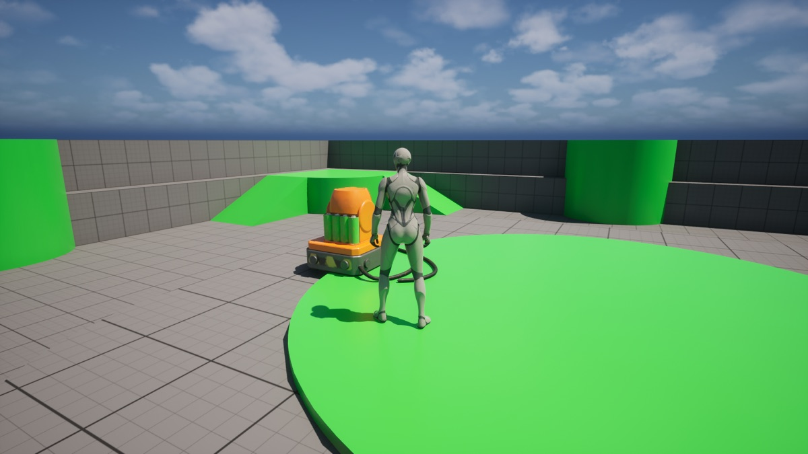

# Make a 3D asset and place it in Unreal with your coding agent

Describe a game asset in one line, and your coding agent makes it with the Meshy CLI and places it in your Unreal Engine level through Unreal MCP. You write no code: you paste prompts, approve the cost, drag one file into the editor, and walk up to the asset in Play In Editor.

**Last tested:** November 8, 2026, with Unreal Engine 5.8.2 on macOS, the Meshy CLI 0.8.3 and Claude Code. Windows hasn't been tested yet.

| The charging dock the Meshy CLI made from a one-line description |
|---|
|  |

[Preview provenance](assets/SOURCES.md).

## What you'll make

The asset is a charging dock for a robot game, the kind of object a level uses as a respawn checkpoint: a steel pad with hazard stripes, an orange tower, a row of green battery cells and two black cables. It comes back as a textured GLB, a file that packages the 3D model and its textures together, and it ends up placed in your level, where your character can walk up to it.

Three tools do the work:

- **Your coding agent**, an AI assistant such as Claude Code, Cursor or Codex that runs commands on your computer. It runs the other two for you and reports back in plain language.
- **The Meshy CLI**, a command-line program that makes 3D models with Meshy. The agent learns how to use it from the meshy-3d-agent skills, a set of instructions you install once.
- **Unreal MCP**, a plugin in Unreal Engine 5.8 that lets an agent work in the open editor. MCP, the Model Context Protocol, is the standard way an agent talks to another program's tools.

The model is made in two Meshy tasks. The first builds the mesh, the shape made of triangles; the second paints it with textures, the images that give the mesh its colors and tell the engine how each part reflects light. Both run on Meshy's servers, and the CLI saves the finished GLB into your Unreal project folder.

To get there, you'll:

1. Install the Meshy CLI and the skills, and sign in with your browser. No credits are spent.
2. Turn on Unreal MCP in the editor and connect your agent to it.
3. See how the asset description is built.
4. Check the cost, approve it, and let the agent make the asset.
5. Wait about two minutes while Meshy builds the mesh and paints it.
6. Bring the file into Unreal and place it in the level.
7. Walk up to it in Play In Editor.

- **Start with:** A one-line description of the asset. The charging dock description in Step 3 is included.
- **Receive:** `charging-dock.glb` in your project's `MeshyAssets` folder, and a static mesh with its material and textures placed in your level.
- **Allow:** about two minutes for generation, plus time for first-time setup.
- **Budget:** about 30 Meshy credits on a Pro plan or above: 20 for the mesh and 10 for the texture.

These are recorded sample costs and timings, not guarantees. Your generated result will vary. [Check current API pricing](https://docs.meshy.ai/en/api/pricing) before you run it.

> **Why the Meshy CLI and not the Meshy MCP server?** Meshy offers both, and they call the same API, so you can make the same assets either way. We use the CLI here for three reasons: you sign in with your browser instead of creating an API key, `--dry-run` shows the credit cost before anything is charged, and `-o` saves the file straight into your Unreal project. It also keeps your agent's setup simple: one MCP server for Unreal, and Meshy as a command the agent runs. The trade-off is that your agent needs terminal access, which Claude Code, Cursor and Codex all have. Already running the Meshy MCP server? See [Already using the Meshy MCP server?](#already-using-the-meshy-mcp-server).

## Before you start

You need four things. None of them involves writing code.

1. **A paid Meshy plan, Pro or above.** A Free account can sign in to the CLI, but Meshy refuses every task it creates with HTTP 402 `plan_upgrade_required`, and the CLI stops with exit code 9. [Check your plan and credit balance](https://www.meshy.ai/settings/subscription). The default run spends about 30 credits.
2. **A coding agent with terminal access**, such as Claude Code, Cursor or Codex.
3. **Node.js 22.12 or newer.** The Meshy CLI runs on it. If `node --version` prints an older version or nothing, install the current LTS release from [nodejs.org](https://nodejs.org) first. The agent installs everything else.
4. **Unreal Engine 5.8 with a project open.** The steps use a new project from the [Third Person template](https://dev.epicgames.com/documentation/en-us/unreal-engine/third-person-template-in-unreal-engine), which ships with the engine. The same steps work in any existing project.

You don't need to download the cookbook. Every command, prompt and client configuration is on this page, and the [agent folder](agent/README.md) holds copies you can save.

Already comfortable on the command line? Jump to [Run it](#run-it) for the commands without an agent.

### Already using the Meshy MCP server?

If your agent already has the [Meshy MCP server](https://www.meshy.ai/mcp), it can make the asset with that instead of the CLI. Both call the same API, so the result and the cost are the same. Ask for the asset in your own words, then continue from [Step 6](#step-6-bring-the-file-into-unreal). Three things differ:

- The MCP server signs in with an API key in `MESHY_API_KEY`, which needs a Pro plan or above. Keep the key in your agent's settings, never in chat.
- It has no dry run. The agent quotes the cost from the server's price list before it creates a task.
- Its downloads go where the agent saves them, often `meshy_output/`. Ask it to save the GLB in your project's `MeshyAssets` folder. Download links expire, so save the file you want to keep.

Your agent then runs two MCP servers, Meshy's and Unreal's. On Claude Code for Windows, add the Meshy server with `claude mcp add-json`.

## Step 1: Install the Meshy CLI and the skills

Open your agent in your Unreal project's folder, the one that holds the `.uproject` file, and paste this prompt. It points the agent at the install guide in the [meshy-3d-agent repository](https://github.com/meshy-dev/meshy-3d-agent), and spends no credits.

```text open-in-agent
Help me install Meshy CLI and the meshy-3d-agent skills: https://raw.githubusercontent.com/meshy-dev/meshy-3d-agent/main/INSTALL.md. Then run meshy balance and tell me my credit balance. Do not generate anything yet.
```

The agent checks Node.js, installs the Meshy CLI 0.8 with npm, installs the `meshy-3d-generation` and `meshy-3d-printing` skills, and starts the sign-in. It shows you a link and a short code: open the link, sign in to your Meshy account, enter the code and approve. You never copy an API key, and nothing secret goes into the chat.

This step is done when the agent reports your credit balance. The agent may ask you to start a new session so it loads the new skills; Step 2 ends with that restart.

## Step 2: Turn on Unreal MCP

Unreal MCP runs inside the editor and listens on your computer only, at `http://127.0.0.1:8000/mcp`. Epic marks it Experimental. Epic also notes that what the plugin sends to your AI provider counts as Licensed Technology under the Unreal Engine EULA, and that you're responsible for making sure the provider doesn't train on it, so check your agent's data settings before you connect it.

1. In the editor, open **Edit > Plugins**, search for **Unreal MCP** and enable it. Search for **All Toolsets** and enable it too. Both turn on **Toolset Registry**, which they need. Restart the editor when it asks.
2. Open **Edit > Editor Preferences > General > Model Context Protocol** and turn on **Auto Start Server**, so the server starts with the editor. To start it once instead, open the console with the `` ` `` key and run `ModelContextProtocol.StartServer`.
3. In the console, write your agent's configuration. For Claude Code:

   ```Unreal
   ModelContextProtocol.GenerateClientConfig ClaudeCode
   ```

   Use `Cursor` or `Codex` in place of `ClaudeCode` for those agents. For Claude Code the editor writes `.mcp.json` into your project folder: that file tells the agent where the server is. If the command is not available, save [the same configuration](agent/README.md) by hand.
4. Restart your agent from the project folder so it reads the new file. Claude Code asks you to approve the project's `unreal-mcp` server; approve it. In Cursor or Codex, open the project folder again; Codex reads `.codex/config.toml` only in a project you've marked as trusted. Our runs used Claude Code.

Then check the connection. This prompt changes nothing:

```text
List the Unreal MCP toolsets you can see. Tell me which tool, if any, can import a GLB file as an asset, and which one can place an actor in the level. Do not change anything in the project.
```

This step is done when the agent lists toolsets such as `SceneTools` and `ActorTools`; ours listed 49. If it finds no Unreal tools, start the server with `ModelContextProtocol.StartServer` in the console, or restart the editor, and ask again. Unreal MCP gives the agent three tools, `list_toolsets`, `describe_toolset` and `call_tool`, and reaches every toolset through them, so a short tool list is normal. The agent finds one import tool, `StaticMeshTools.import_file`. It reads FBX and OBJ files but not GLB, so Step 6 has you drag the file in.

## Step 3: See how the asset description is built

The description is one line that says what the asset is and what it looks like. Meshy reads it to build the mesh and again to paint it. This walkthrough uses this description:

> A chunky robot charging dock that works as the respawn checkpoint in a stylized platformer: a round orange charging pad to stand on, a short rounded orange tower at the back with a battery meter of five thick green bars on its front, a scuffed steel base with four big bolts, two thick black cables looping off the back, and yellow and black hazard stripes around the edge of the pad

It names the object and its job in the game first, then describes its parts, each with a shape and a color. The battery meter is described as bars on purpose. The first version of this description asked for "a large round battery gauge", and Meshy drew a dial with made-up numbers and letters on it:

| First try: "a large round battery gauge" | This description: "a battery meter of five thick green bars" |
|---|---|
|  |  |

Leave these out of a description:

- **Words, numbers, dials and screens.** They come out as garbled writing. Describe shapes and colors instead.
- **Glowing parts.** The texture sets colors and how a surface reflects light; it can't make a lamp glow. Add lights in Unreal afterwards.
- **Thin strands, such as wires or rope.** Make cables thick, or they break into pieces.

For this walkthrough, keep the included description. [Try your own idea](#try-your-own-idea) covers your own asset.

## Step 4: Check the cost and make it

Paste this prompt:

```text
Use the Meshy CLI to make an asset for my Unreal project from this description, word for word: "A chunky robot charging dock that works as the respawn checkpoint in a stylized platformer: a round orange charging pad to stand on, a short rounded orange tower at the back with a battery meter of five thick green bars on its front, a scuffed steel base with four big bolts, two thick black cables looping off the back, and yellow and black hazard stripes around the edge of the pad". Show me the cost from meshy make --dry-run first and wait for my OK. Then submit it with --async and wait on the task until it finishes. If a wait is cut off, wait again on the same task ID and never create the task twice. Save the GLB as MeshyAssets/charging-dock.glb in this project folder. Then import it with Unreal MCP into /Game/Meshy/ChargingDock and place it in the open level about three meters in front of the PlayerStart, standing on the floor. If none of your Unreal MCP tools can import a file, tell me, wait while I drag the GLB into that Content Browser folder, and then place it.
```

The agent first shows the estimate from `meshy make --dry-run`, which sends nothing to Meshy: 30 credits, 20 for the mesh and 10 for the texture. Nothing is charged until you say OK.

The prompt asks for `--async` and `wait` because many agents stop a shell command after a couple of minutes. If a wait is cut off, the task keeps running on Meshy's servers and the agent waits on the same task ID again. Creating the task again would charge for a second one.

## Step 5: Meshy builds the mesh, then paints it

This stage took 93 to 107 seconds in our runs.

- **Build the mesh.** About 30 seconds. Meshy reads the description and builds the mesh, untextured. The CLI calls this the preview task.
- **Paint it.** About a minute. The refine task paints the same mesh: a 4,096 px base color texture for the colors, a 4,096 px normal map for small surface detail, and a 2,048 px map of which parts are metal and how rough each surface is. Unreal's materials read all three.

When the second task finishes, the CLI downloads the GLB to `MeshyAssets/charging-dock.glb`. The agent also downloads Meshy's preview image of the model, looks at it, and tells you where it differs from the description. Next to the GLB, the skills save `charging-dock_meta.json`, which records the task IDs so the agent can make changes to this model later. It also holds download links that work until they expire, so don't share it, and if your project is in Git, add `MeshyAssets/**/*meta.json` to `.gitignore`.

| The finished charging dock, as Meshy rendered it |
|---|
|  |

Check it against the description before you bring it into Unreal. Each run of the same description makes a different model. In the run above the pad came out steel instead of orange, and the battery meter became a row of green battery cells, which still reads as a charging station. If a part you need is missing, ask the agent to make it again, or change the description first; each new run costs the full 30 credits.

## Step 6: Bring the file into Unreal

This is where the file moves from your disk into the editor. Unreal MCP's one import tool, `StaticMeshTools.import_file`, uses Unreal's FBX importer, which reads FBX and OBJ files only. The agent tries it, gets `FbxFactory does not support ".glb" files`, tells you, and waits. Import the file yourself:

1. In the Content Browser, create the folder `Meshy/ChargingDock` and open it.
2. In File Explorer (Finder on a Mac), open your project folder, then `MeshyAssets`.
3. Drag `charging-dock.glb` into the open Content Browser folder. The **Interchange Pipeline Configuration** dialog opens; keep its defaults and click **Import**.
4. Tell the agent the file is imported. It finds the new static mesh and places it in the level with Unreal MCP.

With the default options, the import creates a `charging-dock` folder with the static mesh in `StaticMeshes`, one material in `Materials` and three textures in `Textures`. A static mesh is Unreal's asset for a model that doesn't animate. The import also does three things for you:

- **It converts meters to centimeters.** glTF files are in meters and Unreal works in centimeters, so the dock comes in about 190 cm wide.
- **It turns on Nanite,** Unreal's system for drawing dense meshes quickly. Our runs made models of 436,000 to 646,000 triangles.
- **It adds collision:** one convex shape around the model, so your character bumps into the dock instead of walking through it.

**Why GLB and not FBX?** Meshy can also make an FBX, and Unreal MCP's `import_file` reads it, so the agent could import the model without the drag. In our test that import left Nanite off and built a basic material with the roughness map plugged into Metallic and no metallic map, because FBX has no proper slots for PBR materials. A GLB carries its PBR material, and Unreal's glTF import builds it correctly.

## Step 7: Walk up to it in Play In Editor

The agent places the dock about three meters in front of the PlayerStart, the spot where your character appears. Click **Play** in the toolbar, or press Alt+P, and walk to it with W, A, S and D. Press Esc to stop playing.

| A later run of the same description, in the Third Person level in Play In Editor |
|---|
|  |

Check two things:

- **It stands on the floor.** The GLB's origin, the point the editor moves the model by, is in the middle of the model, and the import keeps it there. Our agent placed the dock with the `snap_to_ground` option of `SceneTools.add_to_scene_from_asset`, which sets its base on the floor. If your dock is half sunk into the floor, ask the agent to lift it until its base touches the floor; that's about 58 cm.
- **It's the right size.** The dock is about 1.9 m wide and 1.15 m tall, next to a character 1.8 m tall. To check, double-click the static mesh: the Static Mesh Editor's viewport shows **Approx Size** in centimeters as width × depth × height, `190x160x115` in our run.

The agent doesn't save the level. When the dock is where you want it, choose **File > Save Current Level**.

## Try your own idea

Write a description that follows [Step 3](#step-3-see-how-the-asset-description-is-built): one object with a job in your game, its parts with shapes and colors, and no writing, glow or thin strands. Then paste this prompt with your description and a short name for the file:

```text
Use the Meshy CLI to make an asset for my Unreal project from this description, word for word: "<your description>". Show me the cost from meshy make --dry-run first and wait for my OK. Then make it the same way as before: submit it with --async, wait on the same task ID until it finishes, and save it as MeshyAssets/<name>.glb. Wait while I drag it into the Content Browser folder /Game/Meshy/<Name>, then place it in the level where I tell you, standing on the floor.
```

Each asset is a new run of about 30 credits. To place several copies of one asset, ask the agent to duplicate the actor in the level; copies cost nothing.

## If something goes wrong

- **Port 8000 is already in use:** another program has the port, and the editor's Output Log shows the error under `LogModelContextProtocol`. Change **Server Port Number** in **Edit > Editor Preferences > General > Model Context Protocol**, or start the server with `ModelContextProtocol.StartServer 8010`. Then run `GenerateClientConfig` again and restart the agent, so it uses the new port.
- **The agent sees no Unreal tools:** restart the editor if you haven't since enabling the plugins, and check that the server is running. Start the agent from the folder where `GenerateClientConfig` wrote its file. In Claude Code, `/mcp` lists its MCP servers and shows which ones failed to connect; `unreal-mcp` shows three tools, and the toolsets sit behind them.
- **Node.js is older than 22.12:** the Meshy CLI won't install or run. Install the current LTS release from [nodejs.org](https://nodejs.org), open a new terminal, and paste the Step 1 prompt again.
- **The CLI isn't signed in:** ask the agent to run `meshy auth status`. To sign in again, ask the agent to sign you in: it runs `meshy auth login --device` and shows you a link and a short code, as in Step 1. Never paste an API key into the chat.
- **Meshy refuses the task with HTTP 402 or exit code 9:** the account is on the Free plan or has run out of credits. Check your plan and balance in your Meshy account. Nothing was charged.
- **The agent's shell timed out during generation:** the task is still running on Meshy's servers. Ask the agent to wait on the same task ID again, and not to create a new one. If it lost the ID, `meshy text-to-3d list` shows your recent tasks. A second create is a second charge.
- **Windows paths:** projects in `Documents\Unreal Projects` have a space in the path, so every path the agent passes has to be in quotes. Paths relative to the project folder, such as `MeshyAssets/charging-dock.glb`, work in PowerShell, Command Prompt and Git Bash alike.
- **The character walks through the dock:** the import options had collision turned off. Open the static mesh, then choose **Collision > Add Box Simplified Collision** in the Static Mesh Editor and save.
- **On a Mac, the editor quits at start with a Metal Toolchain error:** recent Xcode versions download the Metal Toolchain separately. Run `xcodebuild -downloadComponent MetalToolchain` in a terminal, then open the editor again.
- **The import fails or the agent can't find the file:** check that `MeshyAssets/charging-dock.glb` exists in the project folder, then drag it into the Content Browser as [Step 6](#step-6-bring-the-file-into-unreal) describes.

## Technical details

**Meshy CLI commands:** `meshy make --dry-run` (estimate, no requests) → `meshy text-to-3d create --mode preview --async` → `meshy text-to-3d wait` → `meshy text-to-3d create --mode refine --texture-resolution 4k --preview-task-id <id> --async` → `meshy text-to-3d wait -o`. `meshy make` runs the same two tasks in one command.\
**Endpoint:** `POST /openapi/v2/text-to-3d` (preview, then refine) → `GET /openapi/v2/text-to-3d/:id`\
**Unreal side:** Unreal MCP (Experimental) in Unreal Engine 5.8 at `http://127.0.0.1:8000/mcp`, over HTTP. The agent places the asset with `SceneTools.add_to_scene_from_asset`; the GLB is imported by hand with Interchange's default options.\
**Requires:** Node.js 22.12+ · Meshy CLI 0.8.3+ · the meshy-3d-agent skills · a paid Meshy plan · Unreal Engine 5.8 · a coding agent with terminal access\
**Files:** [Prompts](agent/prompts.md) · [Setup commands and MCP client configurations](agent/README.md)\
**Last verified run measurements:** November 8, 2026: Meshy, and Unreal Engine 5.8.2 on macOS · [Sample result](sample-result.json)

The recipe calls Meshy only through the CLI, which signs in with your Meshy account through the browser and keeps the session on your computer. No API key goes into the project. The text-to-3d preview builds the mesh; the refine task textures that mesh and needs the preview's task ID, so the two always run in that order. The CLI's `make` sends the preview with no model named, so it uses the API's current default, and sends the refine with `enable_pbr: true`, `remove_lighting: true` and `texture_resolution: "4k"`. Unreal MCP accepts connections only from your own computer and has no sign-in of its own.

## Run it

Complete [Before you start](#before-you-start). Review the estimated budget above before running.

Install the CLI and sign in once:

    npm install -g meshy-cli@0.8
    meshy auth login
    meshy balance

Then, from your Unreal project folder, check the cost and make the asset:

    meshy make "A chunky robot charging dock that works as the respawn checkpoint in a stylized platformer: a round orange charging pad to stand on, a short rounded orange tower at the back with a battery meter of five thick green bars on its front, a scuffed steel base with four big bolts, two thick black cables looping off the back, and yellow and black hazard stripes around the edge of the pad" --dry-run
    meshy make "A chunky robot charging dock that works as the respawn checkpoint in a stylized platformer: a round orange charging pad to stand on, a short rounded orange tower at the back with a battery meter of five thick green bars on its front, a scuffed steel base with four big bolts, two thick black cables looping off the back, and yellow and black hazard stripes around the edge of the pad" --max-credits 30 -o MeshyAssets/charging-dock.glb

`--max-credits 30` refuses to start if the estimate is higher. A terminal doesn't stop long commands, so plain `meshy make` works here; it waits up to 600 seconds per task and prints the command to resume if a task takes longer. To also get Meshy's preview image, pass a folder instead of a file: `-o MeshyAssets/charging-dock/` saves `model.glb`, `thumbnail.png` and `meta.json`. Like the skills' meta file, `meta.json` holds download links, so keep it out of Git and don't share it.

Then do Step 6 by hand: drag the GLB into the Content Browser, and drag the new static mesh from the Content Browser into the level.

To make the agent setup files yourself instead of with the editor's console command, see the [agent folder](agent/README.md).

## What you get

These are measurements of the sample run pictured at the top of the page.

| File | Contents |
|---|---|
| `charging-dock.glb` | 645,976 triangles, 358,920 vertices, one mesh and one material; three embedded JPEG textures: a 4,096 px base color, a 4,096 px normal map and a 2,048 px metallic-roughness map; 41.5 MB; 1.90 m wide, 1.15 m tall and 1.47 m deep, with the origin at the center of the model |

The mesh task took 29 seconds and the texture task 71 seconds, 107 seconds from the command's start to the file on disk. Three more runs took 93 to 98 seconds: one of the first-try description from Step 3 (522,040 triangles, 35.9 MB), and two of this description through Claude Code with the Step 4 prompt (436,014 triangles, 29.4 MB; and 476,470 triangles, 32.1 MB). The last of those ran against Unreal Engine 5.8.2 on macOS: imported with the default options, its static mesh measured 190 cm wide, 160 cm deep and 115 cm tall, with Nanite on and one convex collision shape, and the agent set it on the floor 3 m in front of the PlayerStart. All four cost 20 credits for the mesh and 10 for the texture, read from each task's `consumed_credits`.

## Parameters worth changing

`meshy make` takes no generation settings. To change any of these, ask the agent for it: the skills pass them to the two `meshy text-to-3d create` commands. `meshy make --dry-run` prices only the default settings, and `create` has no dry run, so when you change a setting, ask the agent to quote the cost from [API pricing](https://docs.meshy.ai/en/api/pricing) before it creates anything. [Text to 3D API reference](https://docs.meshy.ai/en/api/text-to-3d).

| Setting | We use | Why |
|---|---|---|
| The description | The charging dock | Every new description is a new asset at the same cost |
| `--model-type smart-topology` with `--target-polycount` (preview) | Not set: a standard mesh | Clean triangles at a face count you choose, such as 10,000, for assets you place many times. Priced differently: check [API pricing](https://docs.meshy.ai/en/api/pricing) |
| `--texture-resolution` (refine) | `4k`, what `make` sends | `2k` makes a much smaller file; most of the 41.5 MB is texture |
| `--enable-pbr` (refine) | `true` | The normal and metallic-roughness maps Unreal's material reads. `false` keeps only the base color |
| `--target-formats` | `glb` | Unreal imports GLB. Add `fbx` or `usdz` for other tools; extra formats cost nothing |
| `--geometry-resolution` (preview) | `standard` | `2k` or `4k` adds detail to the mesh for extra credits |
