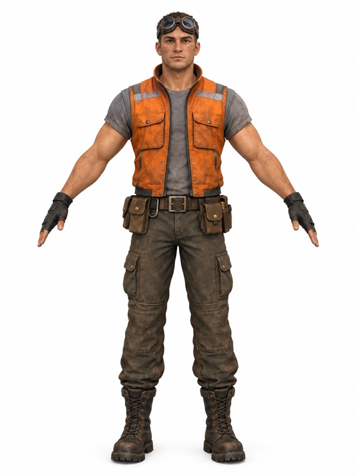
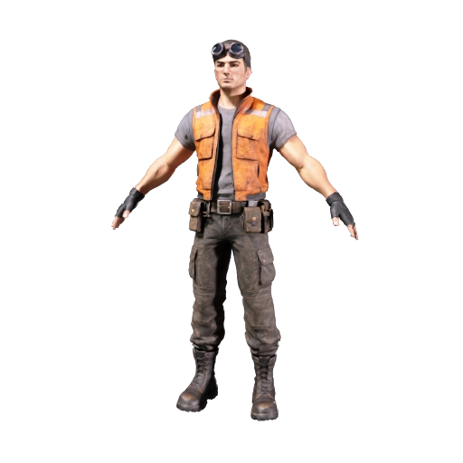
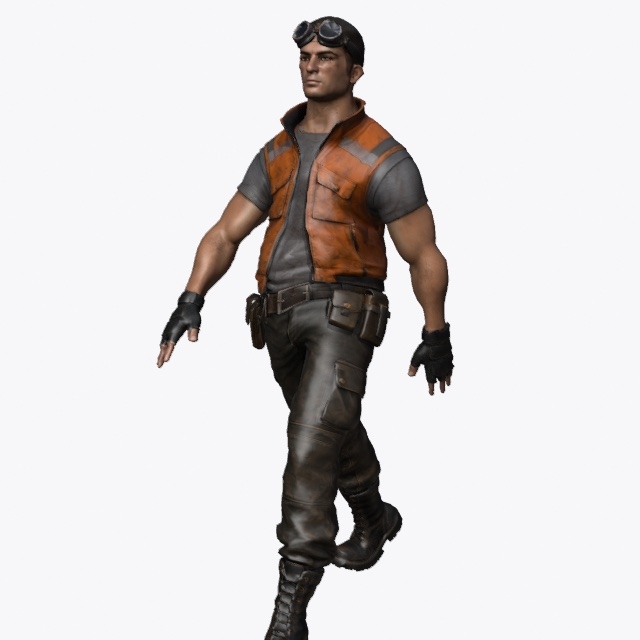
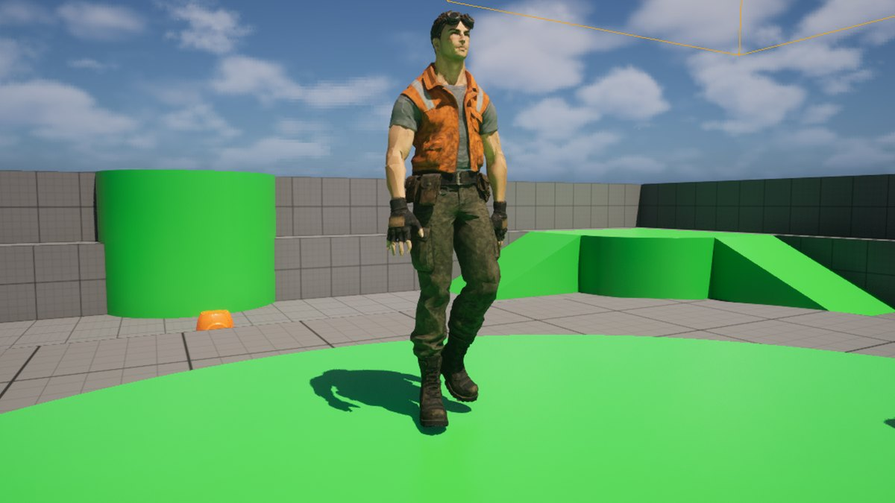

# Make a rigged game character for Unreal with your coding agent

Describe a character, and your coding agent makes it with the Meshy CLI: a concept image in an A-pose, a textured model at a triangle budget you set, and a skeleton with walk and run clips. You bring the FBX files into Unreal Engine 5.8, the agent can place the character walking in your level through Unreal MCP, and you retarget the mannequin's animations onto it. You write no code.

**Last tested:** November 8, 2026, with Claude Code, the Meshy CLI 0.8.3 and Unreal Engine 5.8.2 on macOS. Windows hasn't been tested yet.

| The concept image | The model Meshy built from it | The rigged character walking |
|---|---|---|
|  |  |  |

[Preview provenance](assets/SOURCES.md).

## What you'll make

The character is a scrapyard mechanic for a stylized game: goggles pushed up on his forehead, an orange work vest over a grey shirt, fingerless gloves, a tool belt and heavy boots. He comes back as a rigged FBX, a file that holds the model, its textures and its skeleton, plus two more FBX files with a walk and a run. In Unreal he becomes a skeletal mesh the same height as the mannequin, with his own walk and run, and with the mannequin's animations retargeted onto him.

Meshy makes him in three tasks, one after the other:

1. **A concept image in an A-pose** (Text to Image, 9 credits). Meshy's rigging needs the arms held away from the body, and the pose has to come from the image: the 3D step builds what the picture shows.
2. **A model at your triangle budget** (Image to 3D with Smart Topology, 15 credits). Smart Topology builds the mesh at the number of triangles you ask for, here 30,000, a common budget for a main character. The texture model paints it with 2K PBR maps: a base color, a normal map for small surface detail, and maps of which parts are metal and how rough each surface is.
3. **A skeleton with walk and run clips** (Rigging, 5 credits). Meshy fits a 24-bone humanoid skeleton to the model, scales it to 1.8 m, and includes a walk and a run.

Your coding agent runs the three Meshy commands and reports back in plain language. It learns the Meshy CLI from the meshy-3d-agent skills, a set of instructions you install once. The Unreal steps are a few drags and clicks in the editor.

To get there, you'll:

1. Install the Meshy CLI and the skills, and sign in with your browser. No credits are spent.
2. See how the character description is built.
3. Make the concept image and check it.
4. Make the model and rig it.
5. Bring the character into Unreal.
6. Bring in the walk and run, and place the character in your level.
7. Retarget the mannequin's animations onto your character.

- **Start with:** A description of the character. The mechanic's description in Step 2 is included.
- **Receive:** `rigged_character.fbx`, `walking_fbx.fbx` and `running_fbx.fbx` in your project's `MeshyAssets/mechanic` folder; in Unreal, a skeletal mesh with its skeleton, material and textures, a walk, a run, the character walking in your level, and a retargeted mannequin animation.
- **Allow:** about two and a half minutes of waiting in our agent run, 34 seconds for the image and 108 for the model and rig, plus time to check the image and for first-time setup.
- **Budget:** about 29 Meshy credits on a Pro plan or above: 9 for the image, 15 for the model and 5 for the rig.

These are recorded sample costs and timings, not guarantees. Your generated result will vary. [Check current API pricing](https://docs.meshy.ai/en/api/pricing) before you run it.

## Before you start

You need four things. None of them involves writing code.

1. **A paid Meshy plan, Pro or above.** A Free account can sign in to the CLI, but Meshy refuses every task it creates with HTTP 402 `plan_upgrade_required`, and the CLI stops with exit code 9. [Check your plan and credit balance](https://www.meshy.ai/settings/subscription). The default run spends about 29 credits.
2. **A coding agent with terminal access**, such as Claude Code, Cursor or Codex.
3. **Node.js 22.12 or newer.** The Meshy CLI runs on it. If `node --version` prints an older version or nothing, install the current LTS release from [nodejs.org](https://nodejs.org) first. The agent installs everything else.
4. **Unreal Engine 5.8 with a project open.** The steps use a new project from the [Third Person template](https://dev.epicgames.com/documentation/en-us/unreal-engine/third-person-template-in-unreal-engine), which ships with the engine and includes the mannequin used in Step 7. Any project with the mannequin works the same way.

Unreal MCP, the editor plugin that lets an agent work in the open editor, is optional here. The agent uses it for one thing, placing the character in your level at the end of Step 6; set it up as [cookbook 15's Step 2](../15-text-to-unreal-asset/#step-2-turn-on-unreal-mcp) describes. You import the files yourself either way. You don't need to download the cookbook. Every command and prompt is on this page, and the [agent folder](agent/README.md) holds copies you can save.

Already comfortable on the command line? Jump to [Run it](#run-it) for the commands without an agent.

## Step 1: Install the Meshy CLI and the skills

Already set up for [cookbook 15](../15-text-to-unreal-asset/)? Skip to Step 2.

Open your agent in your Unreal project's folder, the one that holds the `.uproject` file, and paste this prompt. It points the agent at the install guide in the [meshy-3d-agent repository](https://github.com/meshy-dev/meshy-3d-agent), and spends no credits.

```text open-in-agent
Help me install Meshy CLI and the meshy-3d-agent skills: https://raw.githubusercontent.com/meshy-dev/meshy-3d-agent/main/INSTALL.md. Then run meshy balance and tell me my credit balance. Do not generate anything yet.
```

The agent checks Node.js, installs the Meshy CLI 0.8 with npm, installs the `meshy-3d-generation` and `meshy-3d-printing` skills, and starts the sign-in. It shows you a link and a short code: open the link, sign in to your Meshy account, enter the code and approve. You never copy an API key, and nothing secret goes into the chat.

This step is done when the agent reports your credit balance. If the agent asks you to start a new session so it loads the new skills, do that before Step 3.

## Step 2: See how the character description is built

The description becomes the prompt for the concept image, and the image decides what the model looks like. This walkthrough uses this description:

> A sturdy scrapyard mechanic, short cropped hair, welding goggles pushed up on the forehead, sleeveless orange work vest over a grey shirt, fingerless gloves, tool belt with small pouches, cargo trousers tucked into heavy boots, full body, front view, centered with space around it, stylized game-art proportions, soft even studio lighting, plain white background, single character, no props, no text

It starts with who the character is, then lists what they wear, one item at a time, each with a color or material. The rest of the description sets up the picture for the 3D step: the whole body from the front with space around it, even lighting with no hard shadows, a plain background, one character, and nothing in their hands. Meshy builds what the picture shows, so a cropped foot or a shadow painted on the vest ends up in the model.

The description doesn't mention the pose. The image command sets it with `--pose-mode a-pose`, which stands the character with the arms angled down and away from the body. That gap between the arms and the body is what lets the rigging find the arms.

Leave these out of a character description:

- **Long skirts, capes, aprons and long coats.** The skeleton has bones for the body only. Cloth that hangs between or behind the legs stretches when they move.
- **Props in the hands.** A sword or a wrench becomes part of the hand's mesh, and the fingers can't let go of it. Make props as separate models.
- **Words and logos.** They come out as garbled writing.

For this walkthrough, keep the included description. [Try your own idea](#try-your-own-idea) covers your own.

## Step 3: Make the concept image and check it

Paste this prompt:

```text
Use the Meshy CLI to make a character concept image for my Unreal project. Run meshy text-to-image create with --ai-model gpt-image-2-5-flare --pose-mode a-pose --aspect-ratio 3:4 and this prompt, word for word: "A sturdy scrapyard mechanic, short cropped hair, welding goggles pushed up on the forehead, sleeveless orange work vest over a grey shirt, fingerless gloves, tool belt with small pouches, cargo trousers tucked into heavy boots, full body, front view, centered with space around it, stylized game-art proportions, soft even studio lighting, plain white background, single character, no props, no text". It costs 9 credits: tell me that and wait for my OK. Then submit it with --async and wait on the same task ID until it finishes. If a wait is cut off, wait again on the same task ID and never create the task twice. Save the image into MeshyAssets/mechanic/concept/ with -o, show it to me, and tell me its task ID. Do not make the 3D model yet.
```

The CLI has no dry run for a single image, so the agent quotes the price from the prompt and waits for your OK. In our agent run, the image was on disk 34 seconds after the approval; Meshy took 17 seconds of that. The prompt asks for `--async` and `wait` because many agents stop a shell command after a couple of minutes; if a wait is cut off, the task keeps running on Meshy's servers, and creating it again would charge for a second one.

Check the image before you go on. A new image costs 9 credits; a new model costs 15, so this is the cheap place to fix things. The character should:

- show the whole body, head to boots, with space around it;
- hold the arms away from the body, with both hands clear of the hips;
- face the front, on a plain background, with nothing in the hands.

If anything is off, ask the agent to make another image with the same command. Each image is a new task at 9 credits.

## Step 4: Make the model and rig it

Paste this prompt:

```text
Now make the 3D model from that image task and rig it. First run meshy image-to-3d create --input-task-id <the image task ID> --model-type smart-topology --ai-model meshy-t2.5 --target-polycount 30000 --texture-model meshy-7 --enable-pbr true --texture-resolution 2k --pose-mode a-pose. When it finishes, run meshy rigging create --input-task-id <the model task ID> --height-meters 1.8 -o MeshyAssets/mechanic/ --all-assets. Together they cost 20 credits, 15 for the model and 5 for the rig: tell me that and wait for my OK. Submit each one with --async and wait on the same task ID until it finishes. If a wait is cut off, wait again on the same task ID and never create a task twice. Then list the files in MeshyAssets/mechanic/.
```

The agent fills in the two task IDs itself. Here is what each command does:

- **`meshy image-to-3d create`** builds the model from the image, inside Meshy, without downloading the image first. `--model-type smart-topology` with `--ai-model meshy-t2.5` builds the mesh at `--target-polycount 30000` triangles; our two runs came out at 31,472 and 30,315. `--texture-model meshy-7 --enable-pbr true --texture-resolution 2k` paints it with 2K PBR maps. `--pose-mode a-pose` keeps the A-pose from the image. It took 55 and 65 seconds.
- **`meshy rigging create`** fits the skeleton to that model and scales the character to `--height-meters 1.8`. It took 14 and 15 seconds. `-o MeshyAssets/mechanic/ --all-assets` saves every file the rig makes, including the FBX copies Unreal needs. With `--async`, the create returns before the files exist, so the agent puts `-o` and `--all-assets` on the `wait` command instead; ours did that on its own and said so.

In our agent run, the rigged files were on disk 108 seconds after the approval.

When the agent lists the folder, you have:

| File | What it is |
|---|---|
| `rigged_character.fbx` | The character: mesh, textures and skeleton. Step 5 imports it |
| `walking_fbx.fbx`, `running_fbx.fbx` | The character with the walk or the run. Step 6 takes the animation from each |
| `rigged_character.glb`, `walking_glb.glb`, `running_glb.glb` | The same three as GLB files, for tools other than Unreal |
| `walking_armature_glb.glb`, `running_armature_glb.glb` | The walk and the run on the skeleton, with a 288-triangle stand-in body in place of the character's mesh and no textures |
| `meta.json` | The task's details. It holds download links that work until they expire, so don't share it, and if your project is in Git, add `MeshyAssets/**/meta.json` to `.gitignore` |

## Step 5: Bring the character into Unreal

1. In the Content Browser, create the folder `Meshy/Mechanic` and open it.
2. In File Explorer (Finder on a Mac), open your project folder, then `MeshyAssets/mechanic`.
3. Drag `rigged_character.fbx` into the open Content Browser folder. The import options open; keep the defaults and click **Import**.

The import creates the skeletal mesh `rigged_character`, Unreal's asset for a model that animates, plus its skeleton, a physics asset, one material and four textures. It also creates `rigged_character_Anim`, a one-frame animation of the rest pose, which you can delete. Check two things:

- **The height.** Drag the skeletal mesh into the level next to the mannequin. Ours measured 180 cm tall with its feet at the origin; the template's mannequin measures 180.5 cm.
- **The skeleton.** Double-click `rigged_character_Skeleton`. It has 25 bones: Meshy's 24, from `Hips` to the toes, under a root bone named `Armature`. There are no finger bones.

**Why FBX and not GLB?** With Unreal's default glTF import, our `rigged_character.glb` came in as one skeletal mesh with a full PBR material, but 1.8 cm tall: the file keeps the mesh in centimeters under a skeleton scaled to 0.01, and the import applies that scale. The FBX came in at full height with the default options.

The FBX material is built differently from a GLB's. Unreal reads it as an older Phong-style material: the base color and normal textures are connected, the roughness texture goes into its Shininess input, and the metallic texture is imported but not connected.

## Step 6: Bring in the walk and run, and place the character

The walk and run come as two more FBX files, each holding the character again plus one animation. Import only the animations, onto the skeleton you already have:

1. Drag `walking_fbx.fbx` and `running_fbx.fbx` into the same Content Browser folder.
2. In the import options, under **Common Skeletal Meshes and Animations**, turn on **Import Only Animations** and set **Skeleton** to `rigged_character_Skeleton`. Click **Import**.
3. Double-click `walking_fbx` to play it on your character in the Animation Editor.

The import creates two animations on your character's skeleton: `walking_fbx`, 1.03 seconds long, and `running_fbx`, 0.63 seconds. If the import creates a second skeleton or another skeletal mesh instead, delete what it made and import again with both options set.

### Place it in the level

With Unreal MCP running, as [cookbook 15's Step 2](../15-text-to-unreal-asset/#step-2-turn-on-unreal-mcp) sets it up, paste this prompt:

```text
Use Unreal MCP to place my character in the open level. Add /Game/Meshy/Mechanic/rigged_character about two meters in front of the PlayerStart, facing the PlayerStart, with its feet on the floor, and set it to play /Game/Meshy/Mechanic/walking_fbx on a loop. Check where its feet are and which way its face points, and fix the placement if they are off. Do not import, delete or change any assets, do not click any editor buttons, and do not save: I'll save the level myself.
```

The agent adds the character to the level 2 m in front of the PlayerStart, sets it to loop `walking_fbx`, and turns it to face the PlayerStart. The character faces along its own Y axis, so it needs a quarter turn: in both of our runs the agent first stood it side-on, then measured with line traces, saw the mistake and turned it. It also traced the floor under the feet. All that checking took 4 minutes in one run and 17 in the other, because the agent measured with traces instead of looking at the viewport.

The prompt keeps the agent from saving or clicking editor buttons. In a run where we asked it to save, its tools couldn't write the new character into the level, which keeps each actor in a file of its own; it then clicked a save button in the editor, the save dialog opened, and the editor stopped answering the agent until the dialog was closed. When the character stands where you want it, choose **File > Save Current Level** yourself.

| The character placed by the agent in the Third Person level, looping its walk |
|---|
|  |

Without Unreal MCP, drag `rigged_character` from the Content Browser into the level, then in its Details panel set **Animation Mode** to **Use Animation Asset** and **Anim to Play** to `walking_fbx`.

**Why not import with Unreal MCP too?** Its import tool for skeletal meshes uses Unreal's older FBX importer. In our test it put the roughness texture into the material's Metallic input, left the metallic texture out, and brought another copy of the mesh with each clip. Dragging the files in, as Steps 5 and 6 do, avoids all three.

## Step 7: Retarget the mannequin's animations

The Third Person template comes with dozens of mannequin animations: idles, jogs, jumps. Unreal's IK Retargeter copies an animation from one skeleton to another, so your character can use them too.

1. In the Content Browser, open `Characters/Mannequins/Anims/Unarmed/Jog`, right-click `MF_Unarmed_Jog_Fwd` and choose **Retarget Animation Assets**. The Retarget Animations window opens with the mannequin as the source.
2. In its Details panel, set **Target Preview Mesh** to your `rigged_character`. Leave **Auto Generate Retargeter** on, so Unreal makes the IK Rig and IK Retargeter assets for this pair of skeletons.
3. In the Asset Browser panel, select the animations to retarget (Shift-click or Ctrl-click to pick several), then click **Export Animations**, choose a folder such as `Meshy/Mechanic/Retargeted`, and click **Export**.

Epic's [Auto Retargeting documentation](https://dev.epicgames.com/documentation/en-us/unreal-engine/auto-retargeting-in-unreal-engine) describes the window in full. Unreal matches the two skeletons by their parts. On ours it found 11 chains on the Meshy skeleton (the spine, neck, head, both shoulders, arms, legs and feet) and matched each one to the mannequin's. The retargeted jog was a 1.77-second animation on the Meshy skeleton. The Meshy skeleton has no finger bones, so finger motion from the mannequin is dropped, and its spine chain is a single bone, so the upper body bends less than the mannequin's.

To make the character playable, use your retargeted animations in the template's character Blueprint and Animation Blueprint. Epic's [IK Rig retargeting documentation](https://dev.epicgames.com/documentation/en-us/unreal-engine/ik-rig-animation-retargeting-in-unreal-engine) covers that setup.

## Try your own idea

Write a description that follows [Step 2](#step-2-see-how-the-character-description-is-built): who the character is, what they wear with a color or material for each item, and the same closing words for the picture. Paste it into this prompt, with a short name for the folder:

```text
Use the Meshy CLI to make a character concept image for my Unreal project. Run meshy text-to-image create with --ai-model gpt-image-2-5-flare --pose-mode a-pose --aspect-ratio 3:4 and this prompt, word for word: "<your description>, full body, front view, centered with space around it, soft even studio lighting, plain white background, single character, no props, no text". It costs 9 credits: tell me that and wait for my OK. Then make it the same way as before, save it into MeshyAssets/<name>/concept/, show it to me, and tell me its task ID. Do not make the 3D model yet.
```

When the image passes the checks in Step 3, paste the Step 4 prompt with your folder name in place of `mechanic`. Change `--height-meters` to your character's height, and lower `--target-polycount` for characters you place many times: 5,000 to 15,000 triangles is a common range for enemies and NPCs. Each character is a new run of about 29 credits.

Rigging works on humanoid characters: two arms, two legs and a head. Animals, vehicles and creatures can still be made with Steps 3 and 4 (skip the rigging command), and stay static or get animated by hand.

## If something goes wrong

- **Meshy refuses the task with HTTP 402 or exit code 9:** the account is on the Free plan or has run out of credits. Check your plan and balance in your Meshy account. Nothing was charged.
- **The CLI isn't signed in:** ask the agent to run `meshy auth status`. To sign in again, ask the agent to sign you in: it runs `meshy auth login --device` and shows you a link and a short code, as in Step 1. Never paste an API key into the chat.
- **The agent's shell timed out during generation:** the task is still running on Meshy's servers. Ask the agent to wait on the same task ID again, and not to create a new one. If it lost the ID, `meshy image-to-3d list` and `meshy rigging list` show your recent tasks. A second create is a second charge.
- **Meshy refuses the rigging request or the rig is wrong:** rigging needs a clear humanoid in an A-pose; an arm touching the body or a long coat over the legs gets in the way. Make a new image with the arms clear of the body, then a new model. In our tests, a refused request (`422 Pose estimation failed`, on a wolf) cost nothing.
- **The arms or hands are fused to the body in the model:** the image had them too close. Make a new image; check it against Step 3 before making the model.
- **The character is 1.8 cm tall in Unreal:** the GLB was imported. Delete it and import `rigged_character.fbx` instead.
- **The walk import made a new skeleton:** **Import Only Animations** was off, or **Skeleton** was empty. Delete the new assets and import again as Step 6 describes.
- **The placed character faces sideways or away:** ask the agent to turn it a quarter or half turn around its vertical axis until its face points at the PlayerStart.
- **Unreal MCP stops answering the agent:** a dialog is open in the editor, such as a save dialog. Close it in the editor, then ask the agent to carry on.
- **The agent sees no Unreal tools, or port 8000 is in use:** see [If something goes wrong](../15-text-to-unreal-asset/#if-something-goes-wrong) in cookbook 15. Each open editor needs its own port.
- **On a Mac, the editor quits at start with a Metal Toolchain error:** recent Xcode versions download the Metal Toolchain separately. Run `xcodebuild -downloadComponent MetalToolchain` in a terminal, then open the editor again.
- **Windows paths:** projects in `Documents\Unreal Projects` have a space in the path, so every path the agent passes has to be in quotes. Paths relative to the project folder, such as `MeshyAssets/mechanic/`, work in PowerShell, Command Prompt and Git Bash alike.

## Technical details

**Meshy CLI commands:** `meshy text-to-image create --ai-model gpt-image-2-5-flare --pose-mode a-pose --aspect-ratio 3:4 --async` → `meshy text-to-image wait -o` → `meshy image-to-3d create --input-task-id <image task> --model-type smart-topology --ai-model meshy-t2.5 --target-polycount 30000 --texture-model meshy-7 --enable-pbr true --texture-resolution 2k --pose-mode a-pose --async` → `meshy image-to-3d wait` → `meshy rigging create --input-task-id <model task> --height-meters 1.8 --async` → `meshy rigging wait -o --all-assets`\
**Endpoints:** `POST /openapi/v1/text-to-image` → `GET /openapi/v1/text-to-image/:id`, then `POST /openapi/v1/image-to-3d` → `GET /openapi/v1/image-to-3d/:id`, then `POST /openapi/v1/rigging` → `GET /openapi/v1/rigging/:id`\
**Unreal side:** Unreal Engine 5.8's Interchange import with its default options for the character, and **Import Only Animations** with **Skeleton** set for the walk and run; the IK Retargeter with an automatically generated retargeter for the mannequin animations. Optionally, Unreal MCP (Experimental) places the character with its scene and actor tools and checks the placement with line traces.\
**Requires:** Node.js 22.12+ · Meshy CLI 0.8.3+ · the meshy-3d-agent skills · a paid Meshy plan · Unreal Engine 5.8 · a coding agent with terminal access · Unreal MCP for the optional placement\
**Files:** [Prompts](agent/prompts.md) · [Setup commands](agent/README.md)\
**Last verified run measurements:** November 8, 2026: Meshy, and Unreal Engine 5.8.2 on macOS · [Sample result](sample-result.json)

The recipe calls Meshy only through the CLI, which signs in with your Meshy account through the browser and keeps the session on your computer. No API key goes into the project. Each task starts from the one before it through `--input-task-id`, so the image and the model never leave Meshy between steps. The image-to-3d task can't start before the image task has finished, and the rigging task can't start before the model has.

## Run it

Complete [Before you start](#before-you-start). Review the estimated budget above before running.

Install the CLI and sign in once:

    npm install -g meshy-cli@0.8
    meshy auth login
    meshy balance

Then, from your Unreal project folder, make the image (9 credits), the model (15) and the rig (5). Each `create` prints the task ID that the next command takes; `meshy make` has no options for these settings, so the three steps run separately, and none of them has a dry run.

    meshy text-to-image create --ai-model gpt-image-2-5-flare --pose-mode a-pose --aspect-ratio 3:4 --prompt "A sturdy scrapyard mechanic, short cropped hair, welding goggles pushed up on the forehead, sleeveless orange work vest over a grey shirt, fingerless gloves, tool belt with small pouches, cargo trousers tucked into heavy boots, full body, front view, centered with space around it, stylized game-art proportions, soft even studio lighting, plain white background, single character, no props, no text" -o MeshyAssets/mechanic/concept/
    meshy image-to-3d create --input-task-id <image task ID> --model-type smart-topology --ai-model meshy-t2.5 --target-polycount 30000 --texture-model meshy-7 --enable-pbr true --texture-resolution 2k --pose-mode a-pose
    meshy rigging create --input-task-id <model task ID> --height-meters 1.8 -o MeshyAssets/mechanic/ --all-assets

Without `--async`, each command waits for its task and prints the command to resume if the task takes longer than its timeout. Check the image after the first command, before you spend 20 credits on the other two.

Then do Steps 5 to 7 in the editor.

## What you get

These are measurements of the sample run pictured at the top of the page.

| File | Contents |
|---|---|
| `rigged_character.glb` | 31,472 triangles in one mesh, skinned to a 24-joint skeleton under an `Armature` node scaled to 0.01; one material with three embedded textures: base color, metallic-roughness and normal; 9.3 MB |
| `rigged_character.fbx` | The same character as FBX; 10.0 MB |
| `walking_fbx.fbx`, `running_fbx.fbx` | The character with the walk or the run; 10.1 MB and 10.0 MB |
| `walking_glb.glb`, `running_glb.glb` | The same, as GLB; 9.3 MB each |
| `walking_armature_glb.glb`, `running_armature_glb.glb` | The skeleton and its animation on a 288-triangle stand-in body, no textures; 90 KB and 80 KB |

The image task took 20 seconds, the model task 55 seconds and the rigging task 14 seconds, and they cost 9, 15 and 5 credits, read from each task's `consumed_credits`. The unrigged model had 31,472 triangles for the 30,000 target, in 20 separate parts, with no non-manifold edges, and four 2,048 px texture maps: base color, metallic, roughness and normal.

A second run sent the Step 3 and Step 4 prompts, as written here, to Claude Code. The agent quoted 9 and then 20 credits and waited for each approval, created each task once, and was charged 9, 15 and 5 credits. Its image passed the Step 3 checks on the first try. Meshy took 17, 65 and 15 seconds; the image was on disk 34 seconds after the first approval and the rigged files 108 seconds after the second. Its `rigged_character.glb` had 30,315 triangles, the same 24-joint skeleton and the same three textures.

Both runs' FBX files were imported into Unreal Engine 5.8.2 on macOS with the default options. Each `rigged_character.fbx` became one skeletal mesh, 180 cm tall, with a 25-bone skeleton, a physics asset, one material and four textures. The walk and run imported onto its skeleton as animations of 1.03 and 0.63 seconds. An automatically generated IK Retargeter matched 11 chains to the mannequin's and retargeted `MF_Unarmed_Jog_Fwd` as a 1.77-second animation.

The Step 6 placement prompt, sent as written to Claude Code with Unreal MCP in the same project, placed the character at (200, 0, 210) cm, 2 m in front of the PlayerStart with its feet on the floor at 210 cm, turned 90 degrees to face it, and looping `walking_fbx`. It changed no assets and saved nothing.

## Parameters worth changing

To change any of these, ask the agent for it. The CLI has no dry run for these commands, so when you change a setting, ask the agent to quote the cost from [API pricing](https://docs.meshy.ai/en/api/pricing) before it creates anything. API references: [Text to Image](https://docs.meshy.ai/en/api/text-to-image), [Image to 3D](https://docs.meshy.ai/en/api/image-to-3d), [Rigging](https://docs.meshy.ai/en/api/rigging).

| Setting | We use | Why |
|---|---|---|
| The description | The scrapyard mechanic | Every new description is a new character at the same cost |
| `--pose-mode` (image) | `a-pose` | Arms away from the body, for the rig. `t-pose` also works |
| `--aspect-ratio` (image) | `3:4` | A tall frame fits a standing figure with space around it |
| `--target-polycount` | `30000` | The triangle budget. `meshy-t2.5` accepts 100 to 30,000. 5,000 to 15,000 suits enemies and NPCs |
| `--ai-model` (model) | `meshy-t2.5` | `meshy-t2` accepts up to 15,000 triangles |
| `--texture-model` | `meshy-7` | Paints PBR maps. `meshy-n1` paints only a base color, at 2K, and makes smaller files |
| `--texture-resolution` | `2k` | `4k` makes sharper and much larger textures at the same price |
| `--height-meters` (rig) | `1.8` | The character's height in the rigged files |
| `--model-type standard` with remeshing | Not used | The full-detail route from [cookbook 05](../05-image-to-rigged-character/): a sharper texture, at 35 credits for the model and rig |
