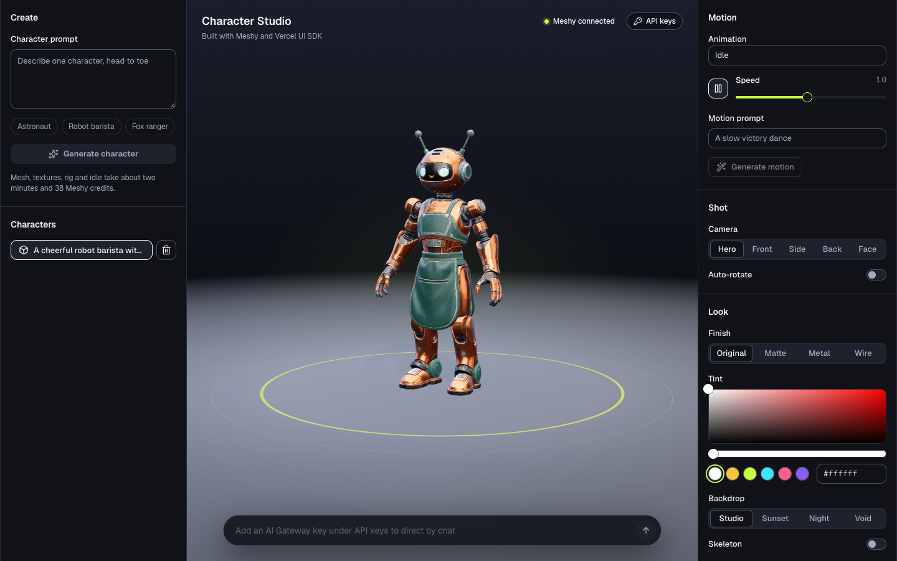
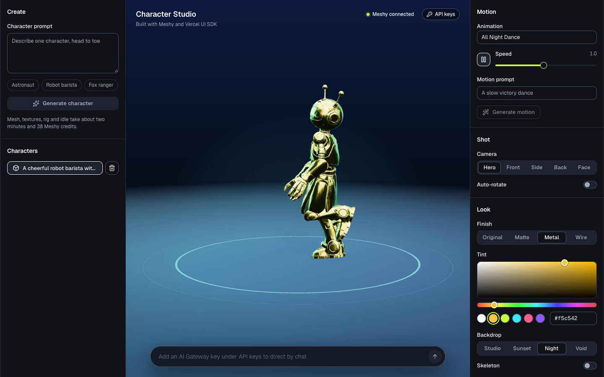
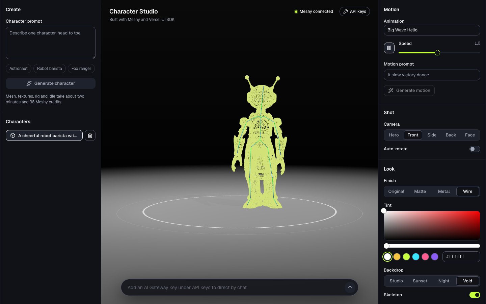

# Character Studio: generate a 3D character and direct it with an AI agent

Character Studio is a web app you run on your own computer. Describe a character in one sentence, and Meshy, an AI service that makes 3D models through its API, builds it, paints it, gives it a skeleton and teaches it to stand idle while you watch. Then you direct it on a 3D stage: pick from 678 animations, describe a move of your own, frame the shot, and change its material and lighting. The app also has a director, an AI model built into the page and separate from the coding agent that installs the app. It works the same controls, so you can type "make it dance under night lights and turn it gold" and watch a pointer change each one.

**Last tested:** November 24, 2026, in Chrome on macOS, with two characters generated in the app.

| On stage, idling | Directed: gold metal, night lights, a dance | The skeleton view |
|---|---|---|
|  |  |  |

The pictures show the robot barista the app generated from its built-in Robot barista prompt, 61,680 triangles with a 24-joint skeleton, for 38 credits, Meshy's unit of payment. [Where these screenshots came from](assets/SOURCES.md).

## What you'll make

You'll run Character Studio, a Next.js app (Next.js is a framework for web apps with their own server code), on your computer. The page has three columns: **Create** on the left, the 3D stage in the middle and **Direct** on the right.

Write one sentence about a character, press **Generate character**, and the app runs four Meshy tasks, one after the other. The stage shows each result as it arrives:

1. **Sculpting mesh** (Text to 3D preview, 20 credits). Meshy builds the character's mesh, its surface made of triangles, with no color yet. It stands in an A-pose, arms angled down and away from the body, so the rigging step can find the shoulders, elbows and hands, and the mesh is remeshed: rebuilt with about 60,000 triangles.
2. **Painting textures** (Text to 3D refine, 10 credits). Meshy paints the mesh with PBR (physically based rendering) textures, the images that tell a 3D viewer how a surface looks under light: a base color, a normal map for small surface detail, and a map of which parts are metal and how rough each part is. The painted model dissolves in over the gray one.
3. **Rigging skeleton** (Rigging, 5 credits). Meshy places a skeleton of 24 joints inside the mesh, works out which part of the mesh each joint moves (the skin weights), scales the character to 1.7 meters, and adds a walk and a run.
4. **Teaching it to idle** (Animation, 3 credits). Meshy fits the Idle motion from its animation library onto the skeleton, which is called retargeting, and the character starts shifting its weight.

That's 38 credits. Our two runs took 2 minutes 21 seconds and 3 minutes 37 seconds. After that, the controls on the right cost nothing, with two exceptions that ask Meshy for a new clip: the first time you play a library animation on a character (3 credits, about 10 seconds), and a move you describe in words (13 credits, about 30 seconds).

The app's own server is the only part that talks to Meshy. Your browser never sees Meshy's download links, because model files pass through the app's server, and with your key in `app/.env`, the app's settings file from Step 1, it never sees the key either. The app saves each character's prompt and Meshy task IDs in your browser, so a reload keeps them, and a reload in the middle of a generation picks up the same Meshy tasks instead of paying for new ones.

To get there, you'll:

1. Give your coding agent the app and store your Meshy API key. No credits are spent.
2. Open the app and check that Meshy is connected.
3. Generate a character, which spends 38 credits when you press Generate.
4. Direct it by hand.
5. Hand the controls to the director. Optional; it needs a key for Vercel AI Gateway, a Vercel service that passes the director's requests to an AI model and bills per token.
6. Put the app online without paying for every visitor. Optional.

- **Start with:** a one-sentence description of one character on two legs. The app suggests three under the **Character prompt** box, Astronaut, Robot barista and Fox ranger, and the pictures show the robot barista.
- **Receive:** a rigged, textured character playing on a 3D stage, with walk, run and idle clips and any animations you add. The app streams the files from Meshy rather than saving them; [What you get](#what-you-get) explains how to keep one.
- **Allow:** two to four minutes per character, plus a few minutes of first-time setup.
- **Budget:** 38 Meshy credits per character, 3 for each library animation the first time you play it on that character, and 13 for each move you describe. The director, if you use it, is billed separately by Vercel AI Gateway, per token.

These are recorded sample costs and timings, not guarantees. Your generated result will vary. [Check current API pricing](https://docs.meshy.ai/en/api/pricing) before you run it.

## Before you start

1. **A Meshy account with API access.** Create an API key in the [Meshy Developer Platform](https://www.meshy.ai/developers/), or sign in with the Meshy CLI instead ([Step 2](#step-2-open-the-app-and-check-that-meshy-is-connected)), and [check your credit balance](https://www.meshy.ai/settings/subscription). One character costs 38 credits.
2. **Node.js 22 or newer and a desktop browser with WebGL.** The app was tested in Chrome. Your agent installs or updates Node.js if needed.
3. **A coding agent.** That is an AI assistant such as Claude Code, Codex or Cursor that can open a folder on your computer and run commands for you. It is optional: [Run it](#run-it) lists the same commands for a terminal.
4. **The example files.** Character Studio is example 17 in the Meshy Cookbook, a public repository of examples for the Meshy API. [Download the cookbook files](https://github.com/meshy-dev/meshy-cookbook/archive/refs/heads/main.zip), unzip them, and open the extracted folder in your agent. Or skip the download and ask your agent to clone the [cookbook repository](https://github.com/meshy-dev/meshy-cookbook) for you. Either way, open the folder containing `AGENTS.md` and `examples`.
5. **Optional: a [Vercel AI Gateway](https://vercel.com/ai-gateway) key** for the director in Step 5. Vercel asks for a credit card on the account before AI Gateway runs models, which also unlocks its free credits. Every control on the page works without it.

Keep your API keys on your computer. Paste them yourself into `app/.env`, the app's local settings file, or into the app's **API keys** dialog, never into chat.

## Step 1: Give your agent the app

With the cookbook folder open in your agent, paste this prompt. It installs the app, helps you store your key, and starts the app without spending any credits.

```text
If the Meshy cookbook folder is not already open, clone https://github.com/meshy-dev/meshy-cookbook and work inside it. Read AGENTS.md, examples/17-character-studio/README.md and examples/17-character-studio/app/AGENTS.md. Check that Node.js 22 or newer is installed, and install or update it if needed. Install the app's dependencies, copy app/.env.example to app/.env, and help me put my MESHY_API_KEY in it without asking me to paste the key into chat. Set ALLOW_SERVER_MESHY=true in that file, because the app will only run on my computer. Then start the app with npm run dev and give me the local address. Do not press anything in the app: it spends credits only when I press its Generate buttons.
```

Follow the agent's instructions and paste your key into `examples/17-character-studio/app/.env` yourself. The first install takes a minute or two. This step is done when the agent gives you an address such as `http://127.0.0.1:3000`. The app listens only on this computer, so nobody else on your network can open it or spend your credits through it.

`ALLOW_SERVER_MESHY` is a safety switch for putting the app online. Without it, the app's server never spends the key in `.env`, and each visitor has to bring their own. [Step 6](#step-6-put-the-app-online-without-paying-for-every-visitor) explains why.

## Step 2: Open the app and check that Meshy is connected

Open the address in your browser. The status above the stage reads **Meshy connected** when the app has a key it may use; hover it to see which key. If it reads **No Meshy key**, ask your agent to check that `app/.env` has both `MESHY_API_KEY` and `ALLOW_SERVER_MESHY=true`, then restart the app: Next.js reads `.env` only when it starts.

You can also skip `.env`. Click **API keys** above the stage, paste your Meshy key, and press **Check and save**. The app asks Meshy whether the key works and shows your credit balance before saving it. A key saved this way stays in this browser's local storage and goes to the app's server with each request, which uses it for that request and never stores it. That is also how you use someone else's copy of the app with your own account.

Or use the Meshy CLI, Meshy's command-line tool, which keeps a browser sign-in on your computer. Under `npm run dev`, with no key in the dialog or in `app/.env`, the app uses that sign-in, so if the CLI is already signed in, the status reads **Meshy connected** straight away. Otherwise open **API keys** and press **Sign in with Meshy** in the Meshy CLI section. Open the sign-in page, check that it shows the same code as the dialog, and approve; the dialog then shows the account and its balance. The app never sees the CLI's token: for each Meshy request its server runs the CLI's `meshy api` command, and the CLI signs the request. If the dialog says the CLI isn't installed, install it with `npm install -g meshy-cli` and reopen the dialog.

When there's more than one, a key in the dialog comes first, then `MESHY_API_KEY` with `ALLOW_SERVER_MESHY=true`, then the CLI's sign-in.

## Step 3: Generate a character

Click **Robot barista** under the **Character prompt** box to fill in the sample, or write your own: one character, on two legs, whole body in view. Press **Generate character**. The hint under the button repeats the price, 38 credits, and Meshy charges each task when it starts.

The left column lists the four steps with a progress bar for the one running, and the stage builds the character in front of you: a gray mesh first, then the painted model dissolving in, then the skeleton, then the idle. In the robot barista run the steps took about 60, 42, 30 and 9 seconds, 141 seconds in all. A second character, from the prompt "A funky Viking", took 217 seconds.

When the character appears under **Characters** and starts to idle, check three things:

- **The proportions match your description.** Meshy invents what a sentence leaves out, so a vague prompt gets a generic body.
- **The arms are clear of the body.** In the A-pose they angle down and out. Arms fused to the sides rig badly.
- **The idle plays without tearing.** If a sleeve or a cloak stretches strangely as the character breathes, the skin weights for that part are off; a tighter outfit in the prompt usually fixes it.

Each new character joins the **Characters** list, and clicking one puts it back on stage. The trash button next to a character deletes it from this list only; its tasks stay in your Meshy account.

## Step 4: Direct it by hand

Every control in the **Direct** column changes the character on the stage:

| Control | What it does | Cost |
|---|---|---|
| **Animation** | Search Meshy's library of 678 animations for two-legged characters by name. Walk, Run and Idle came with the character | 3 credits and about 10 seconds the first time you play one on this character, while the hint reads "Retargeting onto your character…". Free after that |
| **Play** and **Speed** | Pause the clip, or play it from 0.1 to 2 times normal speed | Free |
| **Motion prompt** and **Generate motion** | Describe a move the library doesn't have. Meshy's Text to Motion makes a 6-second clip, then fits it onto your character's skeleton. The clip joins the Animation list | 13 credits (10 for the motion, 3 to fit it), about 30 seconds |
| **Camera** and **Auto-rotate** | Frame the shot: Hero, Front, Side, Back or Face, with an optional slow orbit | Free |
| **Finish** | Original keeps Meshy's textures. Matte and Metal swap them for one plain material, and Wire shows the triangles | Free |
| **Tint** | Color the finish: any color, or one of six presets | Free |
| **Backdrop** | Studio, Sunset, Night or Void lighting | Free |
| **Skeleton** | Draw the 24 joints inside the body | Free |

To make the middle picture at the top of this page, set **Finish** to Metal, pick the gold **Tint** swatch, set **Backdrop** to Night, and search **Animation** for "dance". The All Night Dance costs 3 credits the first time.

Meshy returns each animation as a full copy of the character, about 13 MB, so the stage keeps the model it already loaded and takes only the motion from each new file. Switching between clips you have played before is instant.

## Step 5: Hand the controls to the director

The bar under the stage is the director, an AI model that works the same controls you just used. It needs a Vercel AI Gateway key. Add `AI_GATEWAY_API_KEY` and `ALLOW_SERVER_CHAT=true`, the director's version of `ALLOW_SERVER_MESHY`, to `app/.env` and restart the app, or paste the key under **API keys**. Three suggested instructions then appear as buttons above the bar.

Type an instruction such as "Make it dance under night lights, turn it gold, and spin the camera". The model reads a list of every control on the page with its current state, then sends actions such as Backdrop to Night, Finish to Metal, Tint to gold, Animation to a dance, and Auto-rotate on. The browser runs them one at a time while a pointer moves to each control, and the actions appear under the model's reply.

The controls are built with Vercel's [UI SDK](https://github.com/vercel-labs/ui), a component library whose controls an AI model can read and operate by name.

- **The director can't see or open API keys.**
- **The director can't press Generate character or Generate motion.** They spend credits, so the director stops and asks you to press them. If you ask it for a new character, it writes the prompt into the box and waits for you.
- **The director can't delete a character.**

It can pick library animations, though, and each one costs 3 credits the first time, just as when you pick it. Each request gets up to 8 rounds; a round is one reply from the model that reads the page or changes it, and one round can carry several actions.

The director uses `anthropic/claude-sonnet-5.5` through AI Gateway unless you set `AGENT_MODEL` in `app/.env` to another AI Gateway model id. AI Gateway bills you per token.

## Step 6: Put the app online without paying for every visitor

The app runs on any host that runs Next.js, such as Vercel. Build it with `npm run build` and start it with `npm start`, or point your host at the `examples/17-character-studio/app` folder.

`MESHY_API_KEY` and `AI_GATEWAY_API_KEY` on the server do nothing by themselves. On Vercel, the app could also reach AI Gateway with `VERCEL_OIDC_TOKEN`, a token Vercel can give a deployment, and without `ALLOW_SERVER_CHAT=true` it doesn't use that either. Until you set `ALLOW_SERVER_MESHY=true` or `ALLOW_SERVER_CHAT=true`, the server spends none of your credits, and each visitor adds their own keys under **API keys**. That is the right setting for a public link.

If you do switch them on, the app limits each visitor's network address to 12 Meshy tasks an hour (a character is 4) and 10 director requests every 10 minutes, and the director still can't press the Generate buttons. The counts are kept in the server's memory, so they start over when the server restarts, and if your host runs several copies of the server at once, as serverless hosts such as Vercel can, each copy counts on its own. Don't set the `ALLOW_SERVER_*` switches on a public link unless you mean to pay for everyone who opens it.

The Meshy CLI's sign-in belongs to whoever runs the server. The app uses it under `npm run dev`, which listens only on your computer, and on a production server only with `ALLOW_SERVER_MESHY=true` and no `MESHY_API_KEY`. Most hosts don't have the CLI installed anyway.

## Try your own idea

Write your own character, or start from one of these. Paste one into **Character prompt** and press **Generate character**; each costs 38 credits.

- "A weathered astronaut in a patched orange suit, helmet under one arm, stylized, full body"
- "A fox ranger in a green hooded cloak and leather boots, storybook style, standing"
- "A knight in rounded toy-like armor, chunky proportions, low-poly, full body"
- "A deep-sea diver in a brass helmet and patched canvas suit, weathered, full body"

Rigging works best on one character, on two legs, with the whole body in view and the arms clear of the torso. It tends to fail on animals on four legs, several characters at once, floor-length cloaks or gowns, and anything without clear arms and legs.

With an AI Gateway key, try these in the director's bar:

- "Close-up on the face, give a big wave, then pull back to the hero shot at sunset"
- "Show me the skeleton in wireframe from the side at half speed"
- "Moody shot: void backdrop, matte finish, violet tint, seen from behind"
- "Put everything back the way it started"
- "Make a new character: a pirate chef with a wooden spoon for a leg" (it writes the prompt, and you press Generate)

For a move the library doesn't have, write it in **Motion prompt**, for example "A deep theatrical bow, then a flourish with one arm" or "Shadow boxing: three quick jabs, then a duck", and press **Generate motion** for 13 credits.

To change the app itself, ask your agent. This prompt halves the character's triangle count, which loads faster on a phone:

```text
In examples/17-character-studio/app, change the triangle target the app asks Meshy for when it generates a character from 60,000 to 30,000, and update the Parameters worth changing table in examples/17-character-studio/README.md to match. Run npm run check and npm run build, and tell me the results. Do not generate a character.
```

## If something goes wrong

- **The status reads No Meshy key:** the app has no key it may use. Ask your agent to check `MESHY_API_KEY` and `ALLOW_SERVER_MESHY=true` in `app/.env` and restart the app, add your key under **API keys**, or sign in with the Meshy CLI there. Never paste the key into chat.
- **There's no Meshy CLI section under API keys:** the app offers it only under `npm run dev`, or on a production server with `ALLOW_SERVER_MESHY=true`.
- **The CLI sign-in failed, expired or was denied:** press **Sign in with Meshy** again for a new code. If a character was made with a different account's key, the CLI's account can't open its tasks, and the stage shows an error.
- **"Meshy rejected the API key":** the key is wrong or revoked. Create a new one in the Meshy Developer Platform.
- **"Meshy needs more credits or a paid plan for this":** check your balance and plan, then press Generate again.
- **Rigging fails:** the stage keeps showing the last model that finished, usually the painted one, and names the error. Rewrite the prompt with one standing character whose arms and legs are clear of the body, and generate again. A new generation pays for all four tasks again.
- **"This character's files expired":** Meshy deletes generated files after three days outside Enterprise plans. The stage shows two buttons: **Regenerate** makes it again from the same prompt for 38 credits, and **Remove from library** takes it off the Characters list.
- **You closed or reloaded the tab mid-generation:** open the app in the same browser. It picks up the same Meshy tasks instead of starting paid new ones. Characters live in that browser only, so another browser starts empty.
- **"The director is unavailable":** add an AI Gateway key under **API keys**, or `AI_GATEWAY_API_KEY` with `ALLOW_SERVER_CHAT=true` in `app/.env`. "AI Gateway needs a credit card" means the Vercel account behind the key has none on file yet; add one in Vercel's AI Gateway settings. "The director hit its step limit" is the app's message when one request used all 8 rounds; send a shorter instruction.
- **The stage stays empty after the app opens:** the browser needs WebGL. Open the browser's developer console and paste the error to your agent.

## Technical details

**Endpoints:** `POST /openapi/v2/text-to-3d` (preview, then refine) → `GET /openapi/v2/text-to-3d/:id`, then `POST /openapi/v1/rigging` → `GET /openapi/v1/rigging/:id`, then `POST /openapi/v1/animations` → `GET /openapi/v1/animations/:id`; for a described move, `POST /openapi/v1/text-to-motion` → `GET /openapi/v1/text-to-motion/:id` first. `GET /openapi/v1/animations/library` and `GET /openapi/v1/balance` are free\
**Stack:** Next.js 16.4 on Node.js 22+, React 19.3, three.js 0.186 with react-three-fiber 9.8 and drei 10.7, UI SDK 0.1.0-beta.16, AI SDK 7 with Vercel AI Gateway; optionally the Meshy CLI 0.8.6 or newer\
**Source:** [Meshy client](app/src/lib/meshy.ts) · [Pipeline](app/src/lib/pipeline.ts) · [Stage](app/src/components/stage.tsx) · [Director bridge](app/src/lib/agent.ts) · [Director route](app/src/app/api/chat/route.ts)\
**Last verified run measurements:** November 24, 2026 · [Sample result](sample-result.json)

The browser runs the pipeline: it asks the app's server to create each task, polls it, and saves each task ID as it gets it, which is how a reload resumes. The server holds the key, adds it to each Meshy request, and proxies model files, so the signed download links Meshy returns never reach the browser. The director's three tools, `snapshot`, `query` and `act`, have no code on the server: each call goes back to the browser, runs on the page's controls, and returns the result to the model.

## Run it

Complete [Before you start](#before-you-start) and review the budget above before generating. From a terminal:

    git clone https://github.com/meshy-dev/meshy-cookbook.git
    cd meshy-cookbook/examples/17-character-studio/app
    npm install
    cp .env.example .env      # add MESHY_API_KEY and set ALLOW_SERVER_MESHY=true
    npm run dev               # open the address it prints: http://127.0.0.1:3000

Nothing is generated until you press a Generate button in the page. `npm run dev` listens only on this computer. To open the app from another device, run `npx next dev --hostname 0.0.0.0` instead, and know that anyone on your network can then spend the key or CLI sign-in it uses. To check and build the app:

    npm run check             # Next.js type generation, TypeScript and the tests; no Meshy calls
    npm run build             # production build
    npm start                 # serve the production build

`app/.env.example` lists every setting: `MESHY_API_KEY`, `ALLOW_SERVER_MESHY`, `AI_GATEWAY_API_KEY`, `ALLOW_SERVER_CHAT` and `AGENT_MODEL`.

## How it works

The excerpts below are from the app. [src/lib/meshy.ts](app/src/lib/meshy.ts) holds every Meshy request; [src/lib/pipeline.ts](app/src/lib/pipeline.ts) chains them in the browser.

1. **Build the mesh.** The first task asks Text to 3D for an A-pose preview, remeshed to about 60,000 triangles. `ai_model: "latest"` follows Meshy's current model.

```ts
case "preview":
  return {
    mode: "preview",
    prompt: input.prompt,
    ai_model: "latest",
    pose_mode: "a-pose",
    should_remesh: true,
    target_polycount: 60000,
  }
```

2. **Paint it.** The refine task textures that preview, with PBR maps.

```ts
case "refine":
  return {
    mode: "refine",
    preview_task_id: input.previewTaskId,
    enable_pbr: true,
  }
```

3. **Rig it, then animate it.** Rigging takes the refine task as its input. Every animation, the idle included, is a request with the rig task and either a library action id (the number of an animation in Meshy's library; Idle is 0) or a Text to Motion task. Text to Motion has two modes; the app uses prime, which costs 10 credits, and swift costs 3.

```ts
case "rig":
  return { input_task_id: input.inputTaskId, height_meters: 1.7 }
case "animate":
  return "motionTaskId" in input
    ? { rig_task_id: input.rigTaskId, motion_task_id: input.motionTaskId }
    : { rig_task_id: input.rigTaskId, action_id: Number(input.actionId) }
case "motion":
  return { prompt: input.prompt, mode: "prime", duration: input.duration }
```

4. **Keep the key on the server.** `resolveMeshyAuth` in [src/lib/paid.ts](app/src/lib/paid.ts) picks how each request reaches Meshy: the visitor's own key if they sent one, the server's key only when `ALLOW_SERVER_MESHY` is on, and otherwise the Meshy CLI's sign-in, under `next dev` or with that same switch. With none, `requireAuth` in `src/lib/meshy.ts` stops the request before it reaches Meshy, and the page asks for a key.

```ts
const key = resolveMeshyKey(own, env)
if (key) return { kind: "key", key }
if (cliAllowed(env)) return { kind: "cli" }
return undefined
```

   A CLI request runs `meshy api` from [src/lib/meshy-cli.ts](app/src/lib/meshy-cli.ts), with `MESHY_API_KEY` removed from its environment so the CLI signs it with its stored sign-in. The app never reads the CLI's credential files.

5. **Proxy the files.** The page loads models from `/api/meshy/asset/<kind>/<id>`, where `<kind>` is the task type (`preview`, `refine`, `rig` or `animate`) and `<id>` its task ID. For each request the server reads the task again with the key, takes a new signed download URL, because Meshy's expire, checks that it points at Meshy's file host, `assets.meshy.ai`, so the proxy never fetches anything else, and streams the file.

6. **Play only the motion.** Each animation file holds the whole character again. [src/components/character-model.tsx](app/src/components/character-model.tsx) takes the file's first animation clip and plays it on the model already on stage, which is why switching clips doesn't reload the character.

7. **Let the director work the page.** [src/app/api/chat/route.ts](app/src/app/api/chat/route.ts) gives the model UI SDK's three agent tools, `snapshot`, `query` and `act`, without server code; in the code and in UI SDK, "agent" means the director. The browser runs each call on the page's controls, one step at a time, with the pointer from [src/lib/agent.ts](app/src/lib/agent.ts). Controls marked `data-agent-confirm`, the two Generate buttons and the trash button, refuse a press from the director, and `data-agent-hidden` hides the keys dialog from it.

## What you get

Meshy returns each result as a GLB, a single file that holds the mesh, its textures and, once rigged, the skeleton and its clips. The app shows these files but doesn't save them, and Meshy deletes them after three days outside Enterprise plans. To keep a character, download its rigging task's files: the rigged character as GLB and as FBX, a format most 3D tools and game engines import, plus its walk and run. The page doesn't show task IDs, but the newest rigging task in your account is usually the character you generated last. Paste this prompt:

```text
Without spending any credits, list my five newest Meshy rigging tasks: call GET https://api.meshy.ai/openapi/v1/rigging?sort_by=-created_at&page_size=5 with the MESHY_API_KEY in examples/17-character-studio/app/.env, or with meshy api if I'm signed in to the Meshy CLI instead, and show each task's ID and creation time. When I pick one, download its rigged character GLB and FBX and its walking and running GLB files into a folder I name, and tell me the file names and sizes.
```

Each animation you played is a separate animation task with its own file. Every generation made with your key is also listed in your Meshy account's [API console logs](https://www.meshy.ai/api-console/logs). The robot barista run's files measured:

| File | Task | Contents |
|---|---|---|
| `model.glb` | Text to 3D preview | 61,680 triangles, no materials, 2.4 MB |
| `model.glb` | Text to 3D refine | The same mesh with three 2,048 px JPEG textures: base color, metallic-roughness and normal; 11.3 MB |
| `Character_output.glb` | Rigging | The textured mesh with one 24-joint skin, 1.70 m tall, 13.3 MB; the rigging task also returns walk (1.07 s) and run (0.67 s) files |
| `Animation_Idle_withSkin.glb` | Animation, action 0 | The whole rigged character again, with a 4.03-second Idle clip, 13.4 MB |

Library clips from the same run were 5.37 seconds (Big Wave Hello), 8.20 (All Night Dance) and 9.37 (Victory Cheer), and a move described in words was 5.97 seconds of the 6 asked for. Each animation file was 13.4 to 13.5 MB. The Viking from the second run was 20.4 MB rigged.

These are measurements of two runs, not guarantees: the triangle count lands near the 60,000 target, but file sizes and clip lengths change with the character and the animation.

## Parameters worth changing

| Parameter | We use | Why |
|---|---|---|
| [`target_polycount`](https://docs.meshy.ai/en/api/text-to-3d#create-a-text-to-3d-preview-task) (text-to-3d preview, `src/lib/meshy.ts`) | `60000` | Triangles in the character. Lower loads and draws faster, on phones especially |
| [`ai_model`](https://docs.meshy.ai/en/api/text-to-3d#create-a-text-to-3d-preview-task) (text-to-3d preview) | `"latest"` | Follows Meshy's current model. Pin a model id to keep results steady |
| [`enable_pbr`](https://docs.meshy.ai/en/api/text-to-3d#create-a-text-to-3d-refine-task) (text-to-3d refine) | `true` | Adds the metallic-roughness and normal maps, which the Original finish shows; Matte and Metal replace all the textures |
| [`height_meters`](https://docs.meshy.ai/en/api/rigging#create-a-rigging-task) (rigging) | `1.7` | Character height in meters, which is also the API default |
| [`duration`](https://docs.meshy.ai/en/api/text-to-motion) and `mode` (text-to-motion, `src/lib/pipeline.ts` and `src/lib/meshy.ts`) | `6` seconds, `"prime"` | Length and quality of a described move. Prime costs 10 credits; swift costs 3 |
| `AGENT_MODEL` (`app/.env`) | `anthropic/claude-sonnet-5.5` | Any AI Gateway model id for the director |
| `MAX_CHAT_TOOL_ROUNDS`, `MESHY_SERVER_RATE`, `CHAT_SERVER_RATE` (`src/lib/limits.ts`) | 8 rounds; 12 tasks an hour; 10 requests per 10 minutes | Limits for a server that pays for its visitors |

Unlike Text to 3D, the rigging and animation endpoints have no model to choose.
